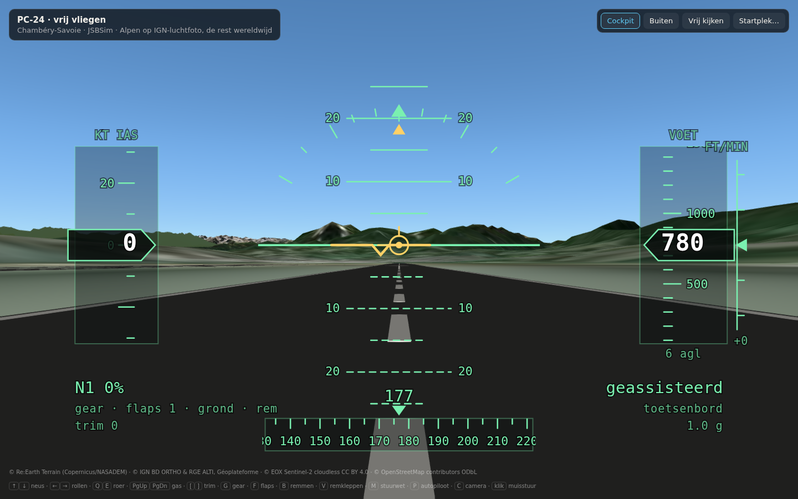
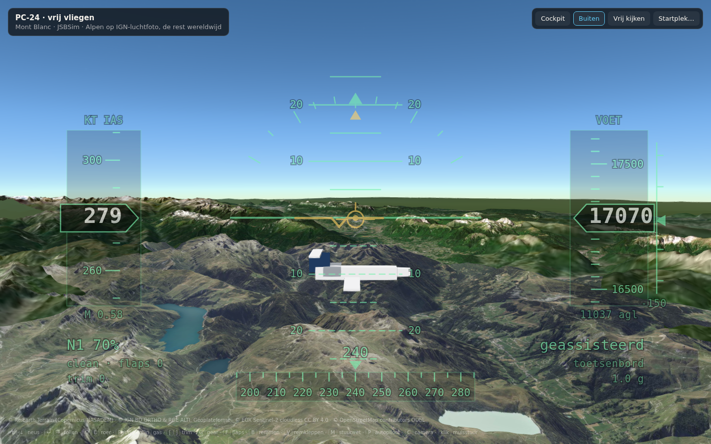
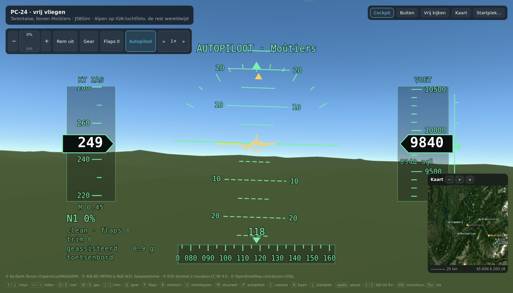
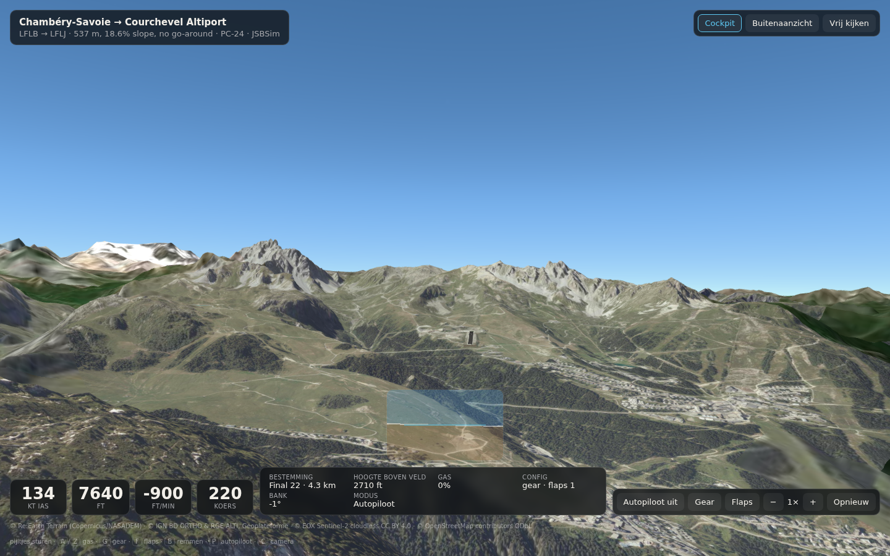

# Flight view (Chambéry → Courchevel)

A light jet **you fly yourself**, over real terrain streamed from open data.
Same stack as the ride view — CesiumJS, open geodata, a builder that prepares
the geometry — but the vehicle flies and nobody else is holding the controls.

It asks where to begin before it puts you anywhere: a region, one of 28,000
airfields by name or code, or a field at random. The runway at Chambéry-Savoie,
the 18.6% slope at Courchevel Altiport, short final into it, or anywhere on
earth — the terrain and the satellite imagery are global, and the menu takes
coordinates too. The autopilot is a button, not the default.

Entry point: `fly.html` → `src/fly/main.js`.

## Run it

```bash
npm run build:airport -- --airport lflb
npm run build:airport -- --airport lflj
npm run dev   # then open /fly.html
```

| Parameter | Meaning |
| --- | --- |
| `start` | a place from `src/fly/places.js` — the six airfields `lflb` `lflj` `lsgg` `lfli` `lflp` `lfhm`, or `final`, `tarentaise`, `montblanc`, `matterhorn`, `amsterdam`, `grandcanyon`, `fuji` — **or any ICAO code in the world index**, such as `eham` or `lszs`. Giving it at all skips the start menu, which is what makes a shared link land where it says |
| `lat`, `lon`, `alt`, `hdg`, `speed` | start anywhere instead; `alt` is metres above sea level |
| `view` | `cockpit`, `chase` or `free` |
| `fdm` | `jsbsim` (the default) or `simple` for the point-mass model, which has no atmosphere and so reports true airspeed as indicated |

```
/fly.html?start=lflj                     on the slope at Courchevel
/fly.html?lat=46.02&lon=7.75&alt=4200    somewhere above the Valais
```

### Controls

| | |
| --- | --- |
| Arrows | nose and roll — down is nose up, as on a stick |
| `W` / `S` | throttle (also `PgUp`/`PgDn`, `=`/`-`) |
| `A` / `D` | roll, for flying one-handed on the left of the keyboard |
| `Q` / `E` | rudder, and nosewheel steering on the ground — also the `◀ ROER ▶` buttons, held down |
| `[` / `]` | trim |
| `G` `F` `B` `V` | gear, flaps, brakes, speedbrake |
| `M` | control law: assisted or direct |
| `P` | autopilot: off → heading and height → the valley route → off |
| `J` | engine and airflow sound |
| `N` | the moving map |
| `C` `L` `space` `1` `2` | camera, start picker, pause, time rate |
| click | the mouse becomes a yoke, `Esc` lets go |

There is also a **strip of buttons** in the corner — throttle lever, brakes,
gear, flaps, autopilot — so the aeroplane can be flown with a trackpad and
nothing else. That is not a convenience: the throttle was on `PgUp`/`PgDn`
alone to begin with, which on a MacBook keyboard is `Fn`+arrow, and a throttle
nobody can find is an aeroplane that does not move.

A **gamepad** is picked up as soon as it is moved: sticks for roll, pitch and
rudder, triggers or the right stick for the throttle, face buttons for brakes,
gear, flaps and camera. Nothing to configure.

Input runs on real elapsed time while the simulation step is clamped, so the
throttle lever takes the same two seconds to travel whether the machine is
managing sixty frames a second or six.

Touching the controls disengages the autopilot, the way it would in the
aeroplane.









## What stands on the ground

Eleven boxes of scenery, one around each place the aeroplane gets close to the
ground, built by `scripts/build-scenery.mjs` and loaded only when you fly
within sixteen kilometres of them:

```bash
npm run build:scenery -- --area courchevel
```

**Buildings** are OpenStreetMap footprints, each with a real height where OSM
knows one — a `height` tag, else storeys times three, else a guess from what
kind of building it is, which is still better than making every house the same
box. Each one is placed on the ground elevation measured at its own centroid,
so a village on a slope steps down the hillside instead of floating on a plane.
An area is one batched Cesium primitive: six thousand separate ones would be
six thousand draw calls.

| area | buildings | woods |
| --- | --- | --- |
| Courchevel | 2059 | 224 |
| Méribel | 1768 | 108 |
| Megève | 4512 | 154 |
| Moûtiers en Bozel | 4454 | 28 |
| Alpe d'Huez | 818 | 26 |
| Chambéry, Aix, Albertville, Annecy, Annemasse, Genève | 6000 each (capped) | 115–470 |

**The Netherlands is different, and better.** PDOK streams the whole country
as LoD 2.2 3D Tiles — real roof shapes from BAG footprints and AHN heights,
with 8 cm aerial photography under them — so there is nothing to build and
nothing to store. The tileset switches on when the aeroplane is over the
country and off again when it leaves. It is what the Alps would need a week of
work to match, and it is the argument for national open data in one tileset.

Flanders has an equivalent, 3D GRB at LoD 1 under a free licence, but it is a
download behind an account rather than a streaming service, so the Flemish
boxes — Hasselt-Kiewit, Genk, Lommel — go through the OSM builder like the
Alps.

A note on that builder: IGN's elevation service is *not* worldwide despite its
`wld` resource name. Over Belgium and the Netherlands it answers −99999. So
anything it will not answer for now falls back to the Terrarium tiles, which do
cover the globe and which the rail builder already used.

**Trees** are scattered through the OSM woods and clamped to the terrain, so
none of them needs a height: the GPU puts them on whatever the ground turns out
to be. The sprite is *drawn* in `src/fly/trees.js` rather than downloaded — a
spruce is a triangle and a trunk, the Alps are full of them, and drawing it
means there is no asset to ship and no licence to honour. They fade in around
two kilometres and are gone by five, and a phone plants a sixth as many as a
desktop because it has a fraction of the fill rate.

## Asking where to begin

Opening `fly.html` used to put you on runway 36 at Chambéry whether that was
where you wanted to be or not. The picker that could take you somewhere else
existed only once you were already flying — the wrong way round, because
choosing where to go is the first thing you want to do and was the last thing
offered.

`src/fly/start.js` now asks first, and it asks over the load rather than before
it. The menu goes up immediately; the airfield JSON, the terrain, the imagery
and JSBSim carry on behind it, with the loading line reporting at the foot of
the sheet; the answer is awaited only at the moment the aeroplane has to be put
somewhere. Choosing therefore costs nothing — by the time most people have read
the regions the model is ready. A menu over a frozen screen looks like a menu
over a broken simulator, which is why the status line is there at all.

Three ways to answer, which is the shape of the question:

- **A region** — the groups in `places.js` as tabs, opening a list of
  hand-picked fields with a sentence each. Closed to begin with: opened, a
  region's thirteen fields push the other two ways off the bottom of the sheet,
  so the menu would offer three and show one.

  One of them, **Altiports**, is a group a place can belong to *as well as* its
  own region, which is why `places.js` grew an `also` field and a `groupsOf`
  helper. Courchevel belongs in Savoie and among the altiports both, and asking
  people to guess which of the two lists it was filed under is asking them to
  guess. Eight fields: the four built Savoie altiports, plus La Motte-Chalancon
  in the Drôme, Peyresourde-Balestas at 1,584 m in the Pyrenees, Lukla, and Ua
  Pou in the Marquesas. The last four come out of the index, so they have the
  right strip on the right heading and **no surveyed slope** — Lukla's 11.7% is
  not there. That is the one thing an altiport is about, so they are a place to
  fly from, not the real approach.
- **Any airfield on earth** — the same search as in flight, over the 28,000
  field index, with runway length and surface on each hit.
- **A field at random**, on two dice. One draws from the whole world; the other
  only from inside the aerial photography — France, Switzerland, South Tyrol,
  Austria, the Netherlands and Flanders — because a random field in the middle
  of Kazakhstan is a grey Sentinel-2 smear with a runway drawn on it. Both ask
  for a paved runway of at least a thousand metres and for a field the
  simulator can actually line up on, so the dice cannot hand you somewhere it
  will then fail to place you.

The answer is written into the URL with `history.replaceState`, so a reload
lands where you chose instead of back at the menu, and the link is shareable.
A URL that already names `start`, or `lat`/`lon`, skips the menu entirely —
every link that worked before still works and lands where it says. `start` now
also takes any ICAO code in the index, not only the curated ids, which is what
the search box and the dice hand back.

## Any airfield in the world

`npm run build:airports` turns **OurAirports** into a 3.9 MB index — 1.3 MB
over the wire. 28,375 fields with at least one runway, 33,406 runways, from
86,000 entries. Open the start picker, type an ICAO or a name, and you are
lined up on the longest runway.

The index is fetched in the background as soon as the aeroplane is flying,
not only when somebody searches. That was a real bug rather than a nicety:
the fetch used to be triggered by the search box or by a start place that
names an ICAO code, and the built fields — Chambéry, Courchevel, Geneva —
name none. Take off from one of those and the index never loaded, so the
moving map drew no airfields at all, anywhere.

Its elevation comes from the terrain rather than from the data. OurAirports
gives a height above sea level, this viewer works above the ellipsoid, and the
difference between the two is a different number in every part of the world —
so the ground is sampled where the aeroplane is about to stand. Checked against
Samedan, the highest airfield in Europe: placed at 1712 m against a charted
1707 m, lined up on runway 03.

What you do not get outside the built fields is pavement: no asphalt, no
markings, no surveyed slope. You are standing on the terrain mesh at the right
place and heading. The nine built airfields below are the ones with real
geometry.

**Standing in the grass beside the runway.** `?start=LFMA` put the aeroplane
down at Aix-les-Milles on the grass, east of the pavement and short of it.
Measured against the IGN orthophoto by sampling the brightness across the
strip at nineteen stations along it, OurAirports' line for LFMA runs **57 m
east of the real centreline and 97 m too long**. The airport record's own
position sits 60 m west of that line — which is to say on the centreline,
within the accuracy of the measurement. Two independent errors do not agree
like that, so it is the runway ends that are wrong and not the airport point.

The index is crowd-sourced and the two end coordinates are the weakest thing
in it. `runwayLine` in `src/fly/airports.js` now corrects them, in order of
how sure the correction is:

| | |
| --- | --- |
| **The length is the declared one** | `length_ft` is published; the distance between the end coordinates is whatever the person who plotted them managed. They disagree by more than 40 m on one surveyed single-runway field in six. The line is trimmed to the declared length about its own middle. |
| **A line that cannot measure itself cannot place itself** | When those two lengths disagree by more than 40 m the ends are demonstrably wrong, and the only other evidence is the airport position. If that is 10–150 m to one side, the line slides sideways onto it. Outside that band, nothing: under 10 m there is nothing to win, over 150 m the airport point is the terminal building. It fires on 2.3% of fields. |
| **Ends that are not ends** | 158 rows have the same point twice, or two points 8,000 km apart. Those are laid out around the airport position on the heading in the runway number, the way the build step already handles the fields whose ends were never surveyed. `?start=` on one of those used to teleport you a continent away. |
| **The displaced threshold** | 3,746 runways have one and we were throwing it away. At LFMA it is 50 m, at Schiphol 18R 270 m, at Chambéry 18 230 m. |

The start point is then measured **back from the middle of the strip**, not
forward from an end coordinate: the middle is the part of the line worth
trusting, because an error at either end moves it by half as much and two
equal errors move it not at all. Back by half the declared length, forward
again past the displaced threshold and 5% of the length (30–90 m), so you are
past the piano keys with the whole runway in front of you.

For the ordinary field none of this moves anything much: the median start
shifts 18 m, the ninetieth percentile 54 m, and for every field whose line was
left alone the start is still exactly on it. At LFMA it is the difference
between the grass and the centreline.

This is also why it is OurAirports and not X-Plane's `apt.dat`: `apt.dat` is
GPL and shipping it would pull the GPL over everything here, while OurAirports
is public domain under the Unlicense — nothing to carry at all.

## The built airfields

Nine, all built by `scripts/build-airport.mjs` from OSM outlines plus sampled
elevations, and all within forty minutes of each other:

| | | |
| --- | --- | --- |
| **LFLJ** Courchevel | 501 m, 12.7% mean and 19.6% at its steepest | no go-around |
| **LFHU** Alpe d'Huez | 445 m, 10.3%, at 1814 m | above the hairpins |
| **LFHM** Megève | 543 m, 7.5%, at 1432 m | |
| **LFKX** Méribel | 407 m, 6.6%, at 1691 m | the next valley from Courchevel, and shorter |
| **LFLB** Chambéry-Savoie | 1651 m, 0.2% | beside the Lac du Bourget |
| **LFLE** Chambéry-Challes | 987 m, 0.5% | flat, and a relief after the altiports |
| **LSGG** Genève | 3582 m | the big one in the valley |
| **LFLP** Annecy-Meythet | 1133 m | mountains on three sides |
| **LFLI** Annemasse | 900 m | under the Geneva approach |

Four of the nine are mountain altiports, which between them cover 6.6% to
19.6% of slope — a useful spread, because that is exactly the axis along which
the ground model misbehaves (see below).

Heights outside France come from the same IGN endpoint: its `wld` resource is
a worldwide blend rather than RGE ALTI's one metre, so Geneva is built at DEM
accuracy. That is the right trade for a flat valley field and would not be for
another Courchevel.

Two things the builder learned here. It used to pick the runway by how many
points OSM happened to draw it with, which gave Megève a 109 m "runway" from a
fragment and would have missed its real one entirely, since that is drawn with
exactly two points; it now measures length on the ground. And the IGN elevation
service rate-limits, so building four airports in a row trips a 429 — it now
backs off and retries rather than giving up.

## Data

| Layer | Source | Licence |
| --- | --- | --- |
| Terrain | Re:Earth Terrain — global quantized mesh from Copernicus/NASADEM, blended with the EGM2008 geoid | open, keyless |
| Base imagery | EOX Sentinel-2 cloudless, 10 m | CC BY 4.0 |
| France imagery | IGN BD ORTHO, 20 cm, via the Géoplateforme WMTS | open licence |
| Switzerland imagery | swisstopo SWISSIMAGE, 10 cm | open, keyless |
| South Tyrol imagery | Orthofoto Südtirol 2023, 20 cm | CC BY 4.0 |
| Austria imagery | basemap.at Orthofoto, 30 cm | CC BY 4.0 |
| Netherlands imagery | PDOK luchtfoto, 8 cm | CC BY 4.0 |
| Netherlands buildings | PDOK 3D Basisvoorziening, LoD 2.2 as 3D Tiles | CC BY 4.0 |
| Runway heights | IGN RGE ALTI (1 m) via the Géoplateforme elevation API | open licence |
| Airport geometry | OpenStreetMap `aeroway=*` | ODbL |

No keys and no accounts: the browser streams all of it directly. Almost every
service answers with `Access-Control-Allow-Origin: *`; South Tyrol's echoes
the requesting origin instead, which works the same way from a browser.

## Why the airports are built rather than streamed

The global terrain is a 30 m DEM. Over a mountain range from a cockpit that is
plenty; for a runway it is useless, and Courchevel is the extreme case — a
500 m strip carved into a shoulder at 2000 m, climbing at 12.6% on average and
19.6% at its steepest. A 30 m DEM renders that as a vague bump.

So `scripts/build-airport.mjs` takes the runway and apron outlines from OSM,
samples IGN RGE ALTI along them — three lanes across the pavement, median of
the three, because a metre of drift sideways on an 18% slope is worth several
metres of height — smooths the result and forces it monotone, and writes the
geometry out. The viewer lays that on a platform, cuts the coarse DEM out from
underneath with a clipping polygon, and paints centreline, edges and threshold
bars on top.

Measured against the published figures: Chambéry comes out at 774 ft against a
published 779, and Courchevel's steepest section at 19.6% against a published
18.6% maximum.

**The pavement has to be the colour of pavement.** The slab replaces the
photograph rather than sitting on it, because the globe is cut away
underneath; so a colour that is not the real one reads as a hole in the world,
and `#3d3c3a` read as a black one. Over Brittany, where nothing is built,
there is only the photograph and the contrast is obvious. The colours are now
sampled from the IGN orthophoto over all nine built runways — median of each
strip with the markings filtered out — and the median of those nine is what
one colour for nine fields can honestly be:

| | Measured | Was | Is |
| --- | --- | --- | --- |
| Runway | (178,179,176) median of nine; Chambéry is light concrete at (208,206,194), Megève dark at (124,127,136) | #3d3c3a | #b2b3b0 |
| Taxiways and aprons | (158,158,157), median of eighteen of them at seven fields — nine tenths of the runway, not three quarters | #4a4846 | #9e9e9d |
| Skirt | the grass beside the strip, (148,139,122) | #6b6355 | #948b7a |
| Markings | unchanged — 1.3× the runway now, where they were 3.8× | #e8e6df | #e8e6df |

The lighting was checked rather than assumed: the slab photographs at
luminance 60 for a colour of 61, so `flat: false` costs nothing on a
horizontal surface at this sun angle and what is written is what appears. It
is kept on because it is what makes Courchevel's slope read as a slope — and
because it is doing visible work elsewhere, the skirt's vertical kerb coming
out at 109 for a colour of 136, which is the four-fifths a lambert term gives
a vertical face.

Photographed from 700 m straight down over Chambéry, before and after: the
runway slab went from luminance 60 to 178 against a photograph reading 143 to
212 beside it, and the aprons from 72 to 158 against 179 to 212. A quarter of
their surroundings, to four fifths of them.

The real answer is not a colour at all — it is to texture the slab with the
orthophoto, which is 20 cm a pixel and already contains the markings. The
builder samples IGN heights along the same polygons, so it could cut the
imagery with them and write a PNG beside the geometry. Not done.

## Heights, again

The same datum problem as the ride view, one step worse. IGN heights are above
sea level; the terrain renders above the ellipsoid; in the Alps the geoid sits
about 50 m below. The viewer measures the difference itself rather than
assuming it — the median gap between the streamed terrain and the IGN heights
along the runway at Chambéry, which is flat enough that a 30 m DEM is accurate
there — and shifts every airport and every route altitude by it. It comes out
at 49.5 m, which is the EGM2008 undulation for Savoie.

## The flying

`src/fly/jsbsim.js` runs **JSBSim** — the flight dynamics library inside
FlightGear, used by NASA as a benchmark — compiled to WebAssembly and stepped
at 120 Hz from the browser. It is not an approximation of an aeroplane: it
integrates six-degree-of-freedom equations over a real aircraft definition, so
thrust lapses with altitude, a climb bleeds speed, the wing stalls because it
runs out of lift, and the gear and brakes bring the aeroplane to a stop by
themselves.

The point-mass model is still there behind `?fdm=simple`. It needs no
WebAssembly and runs on anything, which is worth keeping.

### The aeroplane

`public/fdm/aircraft/pc24/pc24.xml` and `public/fdm/engine/fj44.xml` are this
project's own work, written against published PC-24 figures rather than copied
from FlightGear's aircraft library — which matters for the licence, see
`docs/licensing.md`. Geometry, mass, gear, flight controls, a lift curve, a drag
polar with a compressibility rise, and a turbine with an altitude lapse table.

`npm run test:fdm` flies it headless in Node and prints what it does, which is
how the numbers below were tuned. Against Pilatus' figures:

| | Book | Model |
| --- | --- | --- |
| Rotate | ~95 KIAS | 95 KIAS after 13.5 s |
| Initial climb | ~4000 fpm | 3887 fpm |
| To FL410 | ~30 min to FL450 at MTOW | 17.5 min at 15,500 lb |
| Cruise | 425–440 KTAS | 428 KTAS / M0.746 at FL405 |
| Mmo | M0.74 | drag rise holds it at M0.75 |
| Stall, clean | ~95 KIAS | 98 KIAS |
| Stall, landing | ~85 KIAS | still flying at 80 KIAS |
| Landing roll | ~600 m light, dry | 384 m from 102 KIAS, flat |

The landing roll is on the short side of the book figure, which quotes a
distance from fifty feet with a delay before the brakes come on. The model
measures a pure ground roll with everything applied at once.

**The speedbrake was turning the wing off.** Its lift dump was written as
ΔCL −0.35 against a wing that makes about CL 0.29 in the cruise, so pulling
it removed more lift than the aeroplane had. Measured hands off and level at
3,000 m and 260 KIAS: an instant bunt to 3,100 fpm down, settling at 2,300,
with alpha driven from 0.5° to 4.7° — the aeroplane falling out from under
you rather than slowing down. At −0.06, about a fifth of cruise lift, it
behaves like a speedbrake: 800 fpm down and 32 knots off in twenty seconds at
part power, and a steady 450 fpm at 284 knots with the levers at the stop.
The drag term was already right at ΔCD +0.030, which is more than the whole
clean airframe's 0.023. The cost is thirty-two metres of landing roll, since
the same term is what pins the aeroplane down after touchdown.

**Power first, then attitude.** The high-speed protection used to do one
thing — bring the nose up — and at full thrust that is a losing fight:
measured, it settled into a 4000 fpm climb at 294 knots, over the red line,
with the stick fully forward and nothing on the glass saying why. There are
now two limits doing two jobs. At VMO and MMO the protection takes the
*throttle* off, closing a loop rather than guessing a gain, which is visible
on the gauge in a way a pitch protection quietly fighting your hand is not.
Only six knots further on does it touch the stick. The glass says which
protection has the stick, because a limit you cannot see is indistinguishable
from an aeroplane that has stopped answering. `M` for direct law still turns
all of it off.

**Where the limit sits, and how it moves.** Both of the above were wrong
twice over in the first version, and only flying it showed how. The limits
were set eight knots under the airframe's, at 282 KIAS and M0.72, on the
theory that a margin is free. It is not: MMO is M0.74 and this aeroplane
cruises between M0.72 and M0.74, so the limit lay inside the cruise. And the
thrust cap was a switch — full travel off while over, full travel on while
under — which on a loop this slow does not regulate at all. Measured at
FL350 with the throttle against the stop: the aeroplane reached M0.728, the
cap slammed to its 15% floor, and it sat there for over a minute while the
speed bled off, with the autopilot off and nothing saying why. From the
cockpit that is a throttle that keeps pulling itself back.

The limits are now the aeroplane's own, VMO 290 and MMO M0.74 for the
throttle, 296 and M0.755 for the stick. And the cap moves at a rate set by
how far over the limit the speed is *going to be* — the exceedance plus three
seconds of its own trend — so it comes off quickly when far over, barely
moves near the limit, and creeps back on at a quarter of the speed it came
off. Measured again:

| Test | Before | After |
| --- | --- | --- |
| FL350, throttle at the stop | M0.728, thrust pinned at the 15% floor | settles at M0.740 with the thrust at 84–88%, steady |
| 7000 m, 13° dive at full power | — | thrust eased 95→62% through VMO, floor at 291 kt, pitch guard takes the stick at 296 and the speed comes back |

The dive is the ordering working: power first, all of it, and only when idle
thrust in a thirteen-degree dive still is not enough does the stick move.

**The lever is not the thrust.** The fix above was right and still looked
wrong, because the glass drew the throttle lever from the delivered thrust.
Hold the lever at the stop at three thousand feet and the limit holds 290
knots on 58% — so the lever slid down to 58% under your hand, which from the
cockpit is indistinguishable from an aeroplane taking the throttle off you.
The lever now shows where your hand left it, the N1 figure shows what the
engines are getting, and the limit is drawn as a line across the lever with
`N1 58% · VMO LIMIT` beside it in amber. Same two numbers, in the two places
they belong.

That also took the limit out of the warning line. `VMO · THRUST HELD BACK`
was lit for as long as you left the lever at the stop in the cruise, which is
indefinitely — a warning that never goes out is a warning you learn to read
past. The stick guard, `VMO · NOSE HELD UP`, stays there, because that one is
the aeroplane overriding you rather than declining to go faster.

**It was regulating against its own arithmetic.** Three seconds of trend is
the lead that keeps the cap from chasing the speed, but the trend was a
frame-to-frame difference divided by a sixtieth of a second: a tenth of a knot
of numerical noise reads as six knots a second, and three times that is the
whole error term. The speed was held perfectly — dead on 290 — while the
thrust swung between 48% and 79% doing it. Averaging the trend over about a
second keeps the lead and loses the noise: same 290 knots, thrust steady
between 58% and 63%.

| Level flight, lever at the stop | Speed held | Thrust |
| --- | --- | --- |
| 3,000 ft | 290 KIAS, the limit | 58%, steady within five points |
| FL250 | 290 KIAS, the limit | 71%, wandering up to 100% |
| FL350 | M0.739, the limit | 86%, wandering up to 100% |

Which answers the question the fix raised: holding thrust back is not a fault
down low, it is the only way to stay under VMO with the lever at the stop. Up
high there is less to hold back and, as the table says, the cap still wanders
while it holds — the speed is right, the thrust figure under it is restless.
The loop is an integrator with three seconds of lead against a plant whose
time constant at FL350 is nearer a minute, which is not enough phase margin;
down low, where the aeroplane answers the throttle in seconds, it is. The
honest fix is proportional feedback on the exceedance on top of the
integrator, so the cap answers at once and the integrator only finds where it
has to rest. Not yet done.

**A parked aeroplane is not stalling.** Angle of attack is worked out from
the velocity vector, so an aeroplane standing still with the brakes on — doing
a millimetre a second of settling onto its gear, and nothing forward — is
flying straight down at 127 degrees alpha. That lit STALL on the glass on the
runway and, worse, handed the stick to the alpha protection before the
take-off roll had begun. Alpha is now only believed above 40 KIAS, which is
well under any stall this wing has (98 clean, 80 with gear and flap), so
nothing real is lost.

**It stands on its own undercarriage.** A ground start puts the centre of
gravity at a height written into `reset`, and that height was a guess: 1.6 m,
where the aeroplane actually rests at 1.90. The wheels therefore began a third
of a metre underground, the springs answered in the first second of flight, and
what you saw on arriving anywhere was the aeroplane coming up to 2.07 m and
sinking back — a small drop, exactly where a parked aeroplane should be doing
nothing at all. `Fdm.settle` now spends that second before the loading screen
comes down, with the brakes on and the stick still, running until the vertical
speed has been under six millimetres a second for half a second. Measured at
the first frame, against the 1.90 m it settles to: Brussels 2.07 → 1.89,
Eindhoven 2.08 → 1.92, Kiewit 2.12 → 1.90 and dead still, Chambéry 1.90 and
dead still. Zwartberg is the one that still moves, 2.08 → 2.02 with a tenth of
a metre of ringing afterwards; the aeroplane there appears not to come to rest
at all, which is a slope and a locked wheel and not this.

### Two control laws

A real flight model is not keyboard-flyable with raw surface commands, so there
are two laws and `M` switches between them.

**Assisted**, the default, is an attitude-command system like a modern
fly-by-wire: the axes move a *commanded* pitch and bank, and an inner loop works
out the elevator and aileron. Ask for ten degrees of pitch and the aeroplane
finds the deflection; let go and it stays there. Four arrow keys are enough.

**Direct** puts the axes on the control surfaces, with the trim doing what trim
does. It is what a stick or a gamepad deserves and what the aeroplane actually
has; it is also much harder on a keyboard, which is why it is not the default.

That inner loop needs an integrator, not just a proportional term, and this is
the one lesson worth writing down. Holding an attitude takes a standing
deflection that changes with speed, flap setting and centre of gravity, and a
proportional loop can only produce a standing deflection by sitting on a
standing error. On the approach that error was eight degrees: commanded twelve,
flying three, which is the difference between landing and flying into a
mountain. The integrator is the trim wheel, and it does the same job here as it
does in the cockpit.

### The autopilot, when you want it

`P` cycles through three states. **Heading and height hold** freezes what the
aeroplane is doing now, which is the useful one in free flight. **Route** flies
the Chambéry–Courchevel valley and lands. Then off again.

The route autopilot is three cascaded loops — route to heading, heading to
bank, altitude to vertical speed to pitch attitude — plus two things a real one
has and a naive one does not:

- **The throttle is flown on energy, not speed.** An aeroplane below its
  profile is *fast for the leg*, so a speed-only autothrottle pulls the thrust
  back while the nose is up to climb. That is exactly how a real aeroplane ends
  up mushing downhill at high alpha with the engines at idle, and it is what
  this one did until the vertical speed error was added to the throttle law.
- **Speed protection.** The flight model will stall if asked to, so the
  autopilot has to not ask: below the configuration's minimum speed the nose
  comes down and the climb waits.

The last leg is an approach rather than a waypoint. Flying to a point will not
land an aeroplane, it will circle one; so the final leg tracks the runway axis,
holds about six degrees down to the threshold — twice an airliner's approach,
which is what Courchevel is — flares below 9 m, and brakes.

`npm run test:fdm` checks the model in Node; `scripts/fly-check.mjs` flies the
actual browser build headless, either on the autopilot or on the stick:

```
$ node scripts/fly-check.mjs lflb 22
los op 123 KIAS na 22 s
 11 min: 166 KIAS, 8980 ft, 5621 agl, naar Bozel
 13 min: 125 KIAS, 7488 ft, 2799 agl, naar Final 22
neer op 103 KIAS, -437 fpm, na 14.2 min
stil na 9 s uitrollen

$ node scripts/fly-check.mjs lflb 9 manual
rotatie op 95 KIAS na 17 s
los na 22 s, 120 KIAS
genivelleerd op 8188 ft na 2.1 min, 249 KIAS
bocht van 90° klaar na 2.1 min, bank tot 66°, 249 KIAS
```

The manual run drives the same axes the keyboard and the gamepad feed, so the
path a person actually uses is the path that is tested.

### The Courchevel trench

The worst of the lot, and the cause was a shortcut taken much earlier. The
surveyed heights are above sea level and the terrain renders above the
ellipsoid, so a geoid offset is needed — and it was measured once, at
Chambéry, and applied everywhere.

At Courchevel that put the runway **seventeen metres below the streamed
terrain around it**. Cutting the globe away over a thirty-metre strip then
left the aeroplane at the bottom of a seventeen-metre trench: black sky,
because the sky was behind the walls, and a departure that bounced off them.

Seventeen metres is not a geoid error. It is a 30 m DEM smoothing away a shelf
cut into a mountain. So the offset is now measured **per airfield**, along its
own runway, and absorbs both the geoid and the DEM's own opinion of the ground
there. Courchevel's drawn terrain and its runway now agree to within 0.2 m
along the whole centreline.

The trade is that the absolute altitude at Courchevel is a few metres off its
charted elevation, while the *slope* — the only reason that airfield is
interesting — is exactly as surveyed. That is the right way round.

### What else broke at Courchevel

Three faults found there in one sitting, all of them invisible at Chambéry:

**The landscape disappeared.** Cesium builds one signed distance field for an
entire `ClippingPolygonCollection`, sized to the union of its polygons. Two
airports sixty kilometres apart therefore stretched that field across sixty
kilometres, and a strip of asphalt thirty metres wide fell far below one texel
of it. The result was not a missing runway but a missing *mountain range*: at
Courchevel every hillside vanished and the aeroplane sat in a void with the
sky showing through the ground. With a single polygon loaded it is correct, so
the hole now follows the aeroplane — whichever airport it is near, or none.

**The departure end was the wrong one.** The start placed the aeroplane at
`centre[2]` on the stored runway heading, which at Courchevel is the low end
pointing uphill: the landing direction. You take off downhill there, on 04 from
the top. A place can now name the end it wants.

**Nothing steered on the ground.** JSBSim drives the nosewheel from
`fcs/steer-cmd-norm`, which was never set, so taxiing had only the rudder's
aerodynamic yaw — nearly nothing at fifteen knots. And the sign was inverted:
with this aeroplane's `CnDr`, a positive rudder command yaws the nose *left*,
so full right pedal used to turn it twenty degrees to the left. Both fixed and
measured: right pedal now gives about ten degrees a second at taxi speed, and
the nosewheel's authority tapers off with speed so a bootful of pedal during
the take-off roll does not put the aeroplane in the grass.

### The grey slab at the border

Both national imagery services are published as rectangles in this viewer, and
neither country is a rectangle. Outside its own coverage, **IGN does not answer
with nothing — it answers with a flat grey tile**, and so does swisstopo. An
opaque grey slab over the neighbour is what makes a frontier show up as a seam
in the landscape, which is exactly what it looked like flying from Annemasse
towards Geneva.

Asking IGN for PNG instead, in the hope of transparency, returns HTTP 400: that
layer is JPEG only. So the fix is to key the colour out. Both no-data shades
were *measured* rather than guessed — a tile from outside the coverage was
fetched, decoded and its average colour read: IGN's is `rgb(215,216,214)` and
swisstopo's `rgb(160,161,162)` — and Cesium's `colorToAlpha` removes exactly
those, with a tight threshold so real concrete and snow survive.

Switzerland then gets SWISSIMAGE on top at 10 cm, which is both better than the
fallback and the reason the Geneva basin now reads properly.

### The same trick, twice more, for the eastern Alps

Geneva is not where the Alps stop, and east of it the ground used to be
Sentinel-2 at 10 m — fine from six kilometres up, mush on short final. Two
more services fix that, and both were checked the same way before being
trusted:

- **South Tyrol** publishes its own 20 cm orthomosaic through MapProxy
  (`geoservices.buergernetz.bz.it`). It is the best-behaved service in the
  stack: beyond the province it answers with a 334-byte fully transparent PNG,
  so nothing has to be keyed out at all. Inside, a tile comes back as JPEG —
  the URL says `.png`, the content type says otherwise, and Cesium goes by the
  content type. That is Bolzano, the Dolomites and the Vinschgau.
- **basemap.at** covers Austria at 30 cm, so Innsbruck sits in its valley
  rather than on a smear. It behaves like PDOK: beyond its coverage it answers
  with a blank sheet, in this case `rgb(253,253,253)` flecked with pure white.

That white sheet is why the first Bolzano screenshot had a white slab lying
across the Adige valley behind the mountains: basemap.at's rectangle reaches
deep into Italy, and at the coarse zoom levels you see from altitude it
answers there rather than 404s. Keying white out is riskier than keying grey,
because the Alps are full of real snow — so this was measured rather than
assumed. Over the Pasterze, the Hintertux, the Dachstein and the Ötztal at
30 cm, at most **0.02%** of pixels come within ±6 of the no-data colour, and
three of the four never exceed 254 in any channel. The threshold is ±3, which
removes the sheet and leaves the glaciers.

One more thing that cost a round of head-scratching: **basemap.at numbers its
tiles row before column**. The URL is `{z}/{y}/{x}`, not the `{z}/{x}/{y}`
every other service here uses, and asking the usual way answers 404 on every
single tile — which looks exactly like a country with no coverage.

### Feeding it the ground, anywhere

JSBSim needs a terrain height under the aircraft every frame, synchronously,
and getting it wrong is how an aeroplane ends up inside a mountain. Cesium
offers nothing that does this well: `Globe.getHeight` only knows tiles the
camera has already drawn — so it is empty ahead of you and wrong behind you —
and `sampleTerrainMostDetailed` is a network call.

`src/fly/terrain.js` therefore keeps a **grid of sampled heights that follows
the aircraft**: 33 × 33 points, resampled asynchronously as it moves and
centred slightly ahead of it, read synchronously with bilinear interpolation.
This is what makes free flight possible; the earlier version sampled one fixed
profile along the Courchevel route and could not leave it.

How big the patch is matters more than it looks. Height sets the resolution
worth having — a hundred metres matters on short final and not at all in the
cruise — but **speed sets how much ground is needed**, because a patch has to
outlast the time it takes to sample the next one. The first version sized it
on height alone and led the aircraft by fifteen seconds, which at approach
speed put the aeroplane on the very edge of its own terrain. It then flew off
it, `heightAt` returned nothing, the ground fell back to the last height it had
— and the aeroplane made a perfectly smooth landing on a flat invisible surface
1.8 km short of the runway. A stale number is worse than a coarse one, so the
last resort is now the globe, with a sanity check, and not the last answer.

Seven more things had to be right:

1. **The property is `position/terrain-elevation-asl-ft`.** Writing
   `position/terrain-elevation-ft` at runtime reads back fine and changes
   nothing — the aeroplane keeps touching down on the height it was initialised
   with, which on a mountain approach means landing several hundred metres
   below the runway.
2. **The globe is asked last, not first.** It answered one approach with a
   2600 m peak half a valley away. The order is airport survey, then the
   sampled patch, then the globe with a sanity check.
3. **The ground must not teleport.** A height that jumps a few hundred metres
   in one frame puts the gear that far inside the hillside, and a 9000 lb/ft
   spring answers with a few million pounds. Under the aircraft the ground can
   only change as fast as it is being flown over, so that is the rate limit.
4. **The survey only speaks for as far as the platform is drawn.** Its full
   radius is now derived from the same constant as the rendered skirt, so the
   flight model can never claim runway height where there is no runway to
   stand on.
5. **The runway survey has a skirt.** It used to stop dead at 60 m from the
   centreline, which at Courchevel — a shelf cut into a mountain — is a step of
   a hundred metres. It now fades into the terrain between 45 m and 160 m, so
   running off the edge is a slope rather than a cliff.
6. **A standing start is placed by the feed, not beside it.** Starting at a
   streamed airfield measured the ground twice. The place was resolved against
   the terrain at its exact spot, and the flight model was then fed from the
   patch, which samples every fifty metres and takes the highest of the four
   corners around the aeroplane whenever the ground is close. Measured over
   ten Flemish fields the two disagree by 0 to 0.27 m — small, but it is the
   model's own floor moving under a parked aeroplane, and it also depended on
   whether the patch had arrived yet. `terrainService.prime` now fills the
   patch before the model is built, at half the usual span so the samples are
   25 m apart, and reads the start height out of it the way the first frame
   will. The two cannot disagree any more, because they are one measurement.
7. **Every field gets a flat runway.** The six built airports have a surveyed
   platform; everywhere else the wheels are on the global terrain model, and
   along a runway that model has waviness in it — flat ground sampled from
   space and interpolated. Measured down Deurne's runway: 30 cm of it over
   380 m, in steps of up to 15 cm between samples 20 m apart, which at
   touchdown speed is 15 cm in a third of a second, over and over. You cannot
   see it and you can certainly feel it. `src/fly/strip.js` now lays a paper
   runway at whichever indexed field the aeroplane is near and low: the
   terrain is sampled along each centreline, a straight line is fitted through
   those heights, and that line is the ground inside the strip, handing back
   to the terrain within sixty metres of it. Same probe as the built airports,
   same skirt; the only difference is that the centreline's heights are a fit
   to the terrain rather than a survey, so it meets the ground at the ends and
   introduces no step. Down the same runway afterwards: 0 cm of waviness, 8 mm
   of worst step. It costs one terrain sample per field.

Checked away from the Alps by flying two minutes at each of several places and
watching the ground: Mont Blanc 2209 m, the Matterhorn 3453 m, the Grand Canyon
1577 m with 276 ft of clearance over the rim, Fuji 1262 m. Real heights
everywhere, which is the whole claim.

### Time acceleration

`1` and `2`, or the `«  »` control in the strip, step through 0.25× to **8×**.
Cruise is the dull part of any flight and this is the fix for it.

Eight is the ceiling because that is where the simulation stops holding
together, and finding out why was the useful part. Three things break under
time acceleration, and all three are the same mistake in different places —
code that runs *once a frame* behaving as though a frame were a fixed amount
of flight:

- **The stick.** The commanded attitude was integrated on the simulated step,
  so at eight times speed a tap on the arrow key was worth eight times the
  pitch. It now integrates on the pilot's clock, which is the real one.
- **The autopilot.** Its throttle law is incremental and ran once a frame, so
  its gain per *simulated* second silently fell with the rate: at sixteen
  times it lost a hundred knots before catching the speed. It is now scaled by
  the step, clamped so one coarse pass cannot swing the levers end to end.
- **The terrain.** At eight times speed the ground goes by eight times as
  fast, so the patch has to reach eight times as far ahead. Feeding it the raw
  airspeed left the aeroplane outside its own terrain in 49 of 60 samples; with
  the rate folded in and the span cap raised to 120 km, 4 of 60.

Below 300 m above the ground the rate is held to 4× whatever you ask for, and
the glass shows the rate in force rather than the one requested. Contact
forces want small steps, and a crash at eight times speed is not a landing.

### The moving map

`N`, or the Kaart button. North up — a map that rotates with the aeroplane
tells you where you are pointing, and the question a map answers is where you
*are*. It is drawn on a canvas from the same Sentinel-2 cloudless tiles the
scene already uses, so there is no second source and no second licence, and
the mosaic reads at every zoom from the continents down to one valley.

On it: the aeroplane and its heading, a breadcrumb trail of the last five
minutes, the places from `places.js` as landmarks, the route with its waypoint
names when the route autopilot is flying, and **every airfield under the map**
— drawn as the runway itself, a dark casing and a bright core with a tick at
each threshold, so it reads as somewhere to land and not as a scratch on the
photograph. The fields come from the same index the start menu searches, so
the map has them anywhere in the world; which ones are drawn follows the zoom
(a runway shorter than six pixels at that scale is left out, or the Low
Countries are a wall of labels), except the nearest field, which is always
worth a line. The index is 28,000 entries, so the list is asked for again only
when the map has moved a fifth of its width or been zoomed.

**One flick of a trackpad is one zoom step.** It used to be one step per
wheel event, and a Mac trackpad sends a hundred of them with inertia behind
them — so the map went from the valley to the continent before the fingers had
left the glass, and then sat there, apparently zooming itself out for no
reason. A gesture now counts once, however long it coasts: a quarter of a
second of quiet ends it, and scrolling again gives another step. There are
eleven zoom levels in the whole map.

**Drag it to look around**, and ⌖ or a double-click brings it back to the
aeroplane. Pan and it stays where you put it, while the simulator runs or
while it is paused. Changing the start point clears the trail and recentres
it: a teleport is not a leg, and the breadcrumbs used to join Chambéry to a
field in Limburg with a straight line across France that looked exactly like a
route.

It redraws ten times a second rather than every frame, because it is not
flight data and the scene needs the budget more.

### Other people's aeroplanes

`T`, or the Traffic button. Real airlines on real city pairs, flown by nobody.

`scripts/build-routes.mjs` joins **OpenFlights**' route and airline databases
to OurAirports' positions and writes 48,753 routes, 445 airlines and 2,804
airports into `public/airports/routes.json` — a megabyte, fetched the first
time traffic is switched on. The data is ODbL and says so; it is also not
current, having been curated around 2014, so Germanwings and Jet Airways still
fly out of Brussels. For something you see from three miles away that is the
right trade, and `docs/licensing.md` says it plainly rather than implying the
network is live.

**Nothing is exchanged and nothing is fetched.** A flight's existence, its
departure time and its flight number all come out of a hash of the route, so
two people flying the same minute over the same country see the same traffic
with no server between them — which is also why this is the right thing to
build before multiplayer rather than after it: other players are more of this.

How often a pair is flown scales with how far it is: short-haul several times
a day, long-haul once or twice. That is both how airlines work and what keeps
the sky honest. Every route flying every hour or two put 358 aeroplanes inside
130 km of Brussels, about three times the real thing on a busy afternoon; it
is now 124 there, 64 over Chambéry, 33 over New York and 1 over the Sahara.

The flying is a point walked along a great circle with a climb, a cruise at a
level chosen by distance, and a descent — not a flight model, and it does not
pretend to be one. A flight is only drawn between the first and last fiftieth
of its route, because the ground track is walked at a steady rate and an
aeroplane at progress zero would be sitting on its departure airport doing 460
knots across the grass.

Three cadences keep it free:

- Which of the 48,753 routes could come near you: every 20 seconds or 15 km.
  A latitude test throws most of the world out before any trigonometry.
- **When** each surviving route is in range, as a window on its own progress,
  computed once in the same pass. This is what makes the rest cheap: a route
  is a fixed line and you are a fixed point, so the stretch that comes within
  range is one arc and can be found once instead of per flight per frame.
  Half the routes that pass the first test never actually come near, and they
  are dropped here.
- Who is airborne inside that window: twice a second, arithmetic only. Where
  the forty being drawn have got to: every frame, and forty is nothing.

They are drawn as `public/fly/airliner.glb` — 144 triangles of this project's
own, written by `scripts/build-traffic-model.mjs`, because every aircraft model
worth downloading carries a licence of its own. There is one airframe and it is
a narrowbody, so the IATA type code picks a scale: a Dash 8 is two thirds of it
and a 747 half again, which is all the resolution three miles of air gives you.
The entity's colour is tinted per airline from a hash, which is a livery after
a fashion and honest about being one.

Two things cost an afternoon between writing that model and seeing it. A glTF
chunk is padded to four bytes, and the specification says the JSON chunk is
padded with **spaces** — padding it with zero bytes writes a file of the right
length that parses nowhere, and Cesium's answer to that is to draw nothing and
say nothing. And the model has to face the way Cesium thinks forward is: nose
along -Z in the glTF, which lands on +Y of the heading/pitch/roll frame, whose
axes are x right, y forward, z up. `aircraft.js` has a comment about learning
that the hard way. So does this now. On the moving map they are collision-warning diamonds with their
height relative to yours in hundreds of feet, filled when they are within a
thousand feet of your level.

### The glass

`src/fly/panel.js` is one SVG head-up display: speed on the left, altitude and
vertical speed on the right, heading along the bottom, and a horizon with a
pitch ladder in the middle — plus a **flight path marker**, the symbol that
says where the aeroplane is going rather than where its nose is pointing, which
is the one thing you cannot judge from the window on an approach into a valley.

Each tape is a fixed ladder of marks that slides by the remainder and relabels
itself, so forty thousand feet needs no more geometry than four hundred knots.
Warnings come up for the stall, Vmo, Mmo, a high sink rate low down, a missing
gear — and for the parking brake, because standing on the runway at full
thrust going nowhere is confusing for exactly as long as nobody tells you. The
throttle lever carries the one reading the warning line is the wrong place for:
your hand's position as the fill, the overspeed limit as a line across it, and
the delivered N1 beside it — see *The lever is not the thrust* above.

**The credits and the keys fold away.** They used to be two lines of 45% white
laid straight on the scene. Over a forest that reads; over a snowfield, a
cloud deck or the white edge of an imagery coverage it is invisible, and the
credit line wrapped underneath the moving map so that it appeared to run
twice. They are one panel now, behind a button at the foot of the screen that
carries its own background and so reads over anything. The button keeps a
short credit on it — *© IGN, swisstopo, PDOK, basemap.at and others* — because
attribution is a licence condition for most of this imagery and not a detail;
the full list is one click under it, which is what every map on the web does.

## Known limitations

- **Two runways in the whole world.** Chambéry and Courchevel are built from
  survey data; everywhere else you start in the air and there is nothing to
  land on but terrain. The fix is **OurAirports**, not `apt.dat` — see below.
- **No weather, traffic or systems.** No wind, no clouds beyond what the
  imagery shows, no failures, no pressurisation. JSBSim supports the systems
  side; none of it is configured.
- **The cockpit view does not look around.** The mouse is the yoke; there is no
  head movement, so checking the turn means using the outside view.
- **Steep altiports are bumpy.** The cause is understood and quantified: JSBSim's
  default ground model treats the terrain as locally horizontal, so the
  vertical speed of an aeroplane rolling *along* a steep slope is counted in
  full as strut closure the moment a wheel touches. At Courchevel's 19.8% that
  produced 112,000 lb and 8 g; softening the gear damping brought it to
  42,000 lb and 3 g at a cost of three metres of landing roll on the flat, but
  it cannot be removed without a ground callback that knows the surface
  normal, which this WebAssembly build does not expose. Méribel at 6.6% and
  Megève at 7.5% are noticeably gentler; the valley fields are unaffected.
- **A downhill departure from Courchevel skims.** From about forty knots the
  gear unloads completely and the aeroplane follows the falling slope a metre
  or two above it rather than rolling on it, with the wheels flickering in and
  out of contact until it flies properly at around 108 KIAS. The trench is
  gone, the profile is smoothed, the height is interpolated along the
  centreline and the attitude loop is inhibited on the wheels — none of those
  were it. The recorded descent rate during the roll is about six hundred feet
  a minute steeper than the slope alone accounts for, and that discrepancy is
  not yet explained.
- **It lands long.** Touchdown is at Vref on a 500 m runway, and the rollout
  runs past the end onto the terrain above it. A real PC-24 at Courchevel is
  put down on the first metres of pavement; this autopilot aims at the
  threshold and arrives a little fast.
- **No cockpit.** The cockpit view is the pilot's eye position with an attitude
  indicator, not a modelled flight deck.
- **The aeroplane is boxes.** Recognisably a T-tailed light jet from outside,
  no more.
- **One aeroplane.** A second would be the test of whether the plumbing is
  general or quietly PC-24-shaped.
- **Courchevel is 500 m here, not 537.** That is what OSM maps as pavement; the
  published length includes ground the way does not cover.
- **Terrain resolution.** 30 m globally. The Alps read well at altitude and get
  soft close to the ground away from the airports, where the runway geometry
  takes over. Swiss or French national LiDAR terrain would fix that, at the cost
  of a per-country adapter.

## Why JSBSim and not FlightGear

Worth recording, since this was the question that led here.

**FlightGear** (GPL, going since 1997) is the real open-source flight
simulator: worldwide scenery, several flight dynamics engines, multiplayer, a
large aircraft library. It reads airports in `apt.dat`, the format X-Plane uses,
so a Courchevel built in WorldEditor would work in both. What it does not have
is this project's terrain pipeline — its scenery is pre-generated and shipped,
not streamed from national open data, so the Alps look like 2010 rather than
like IGN.

**JSBSim** (LGPL 2.1) is the piece worth taking on its own: it *is* FlightGear's
flight dynamics engine, and it is packaged as WebAssembly in
`@0x62/jsbsim-wasm` (MIT wrapper around the LGPL library).

So the path taken was to keep the scene — streamed open geodata, surveyed
runways — and replace the point-mass model with JSBSim plus an aircraft
configuration of our own. The open data stays, the arcade model becomes a
fallback, and the aeroplane now has a weight and a wing rather than a thrust
number.

## Where the rest of the world comes from

An earlier version of this file said the way to get airports outside Savoie was
an `apt.dat` reader. That was wrong, and the licence is why: **X-Plane's
`apt.dat` is published under the GPL**, so shipping it would pull the GPL over
this whole distribution — the same trap as FlightGear's aircraft library, which
is precisely the trap this project already decided to avoid.

The right source is **[OurAirports](https://ourairports.com/data/)**: 86,000
airports, heliports and airfields with runway endpoints, surfaces, lengths and
elevations, as daily CSV, released into the **public domain** under the
Unlicense. No attribution required, no share-alike, nothing to carry. It gives
the catalogue and the runway geometry; OSM keeps giving the pavement outlines
the builder already uses, and the elevation service keeps giving the heights.

Other sources worth knowing, with the licence that decides whether they can be
used here at all:

| Want | Source | Licence | Usable |
| --- | --- | --- | --- |
| Airport catalogue, runways | OurAirports | Unlicense (public domain) | yes |
| Airport layouts | X-Plane `apt.dat` | **GPL** | no |
| Airport layouts | OSM `aeroway=*` | ODbL | yes, in use |
| Buildings, France | IGN BD TOPO (footprint + height) | Licence Ouverte 2.0 | yes |
| Buildings, Switzerland | swisstopo swissBUILDINGS3D | open | yes |
| Buildings, Netherlands | PDOK 3D Basisvoorziening, 3D BAG | CC BY 4.0 | yes, in use |
| Buildings, global | OSM `building` + `height` | ODbL | yes |
| Buildings, global | Cesium OSM Buildings | needs an ion key | no, breaks the keyless rule |
| Trees | OSM `natural=wood`, `landuse=forest`, `natural=tree` | ODbL | yes |
| Tree and prop models | Quaternius, Poly Haven, Kenney | CC0 | yes |
| Aircraft models | NASA 3D Resources | public domain | yes |
| Aircraft models | FlightGear / X-Plane | GPL / proprietary | no |

## Next

Airports from OurAirports, so there is somewhere to land outside Savoie; a head
that looks around the cockpit; a second aeroplane; wind; and the Swiss data
adapter — swisstopo publishes terrain at zoom 18 and 10 cm imagery, which would
make a Valais flight look considerably better than this.
