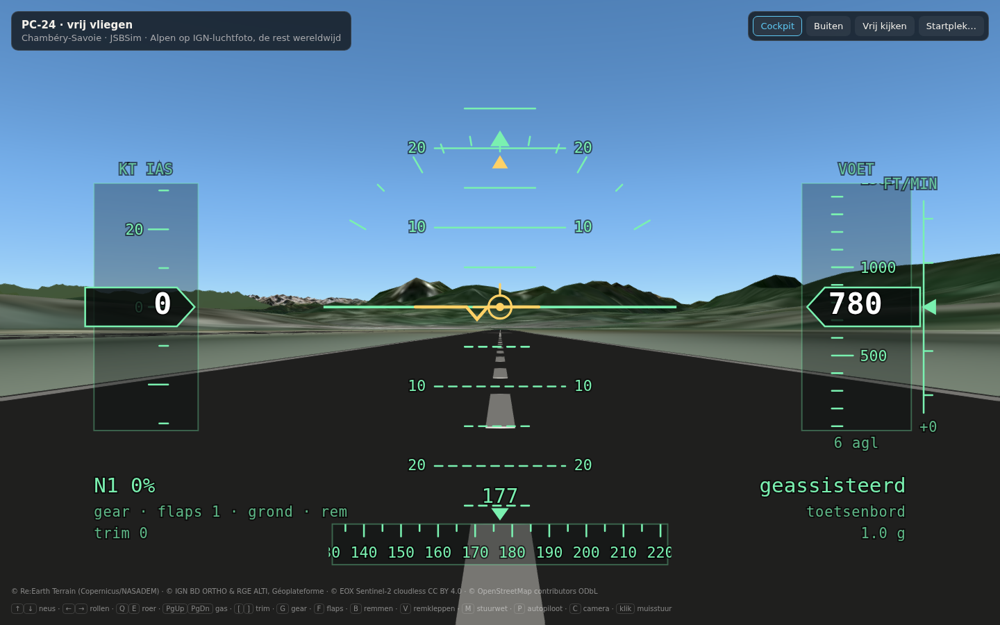
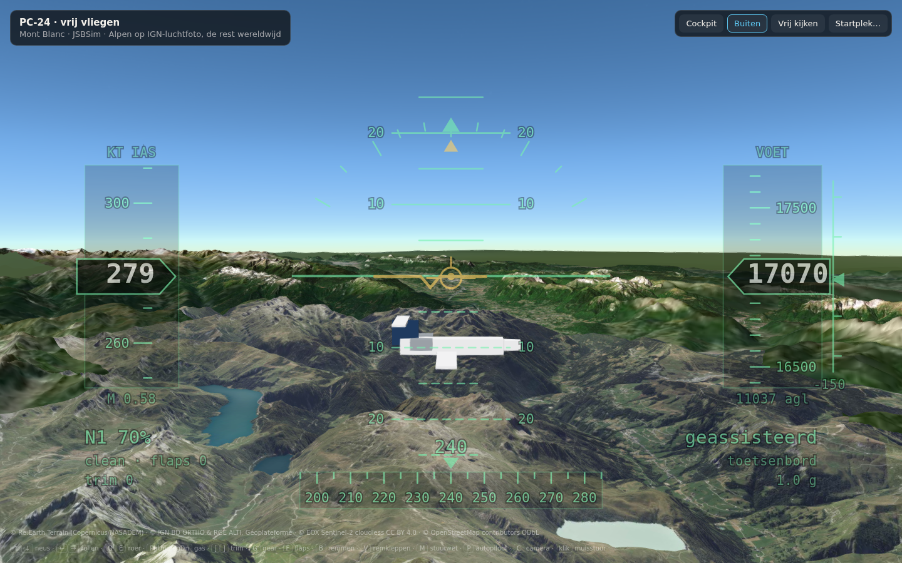
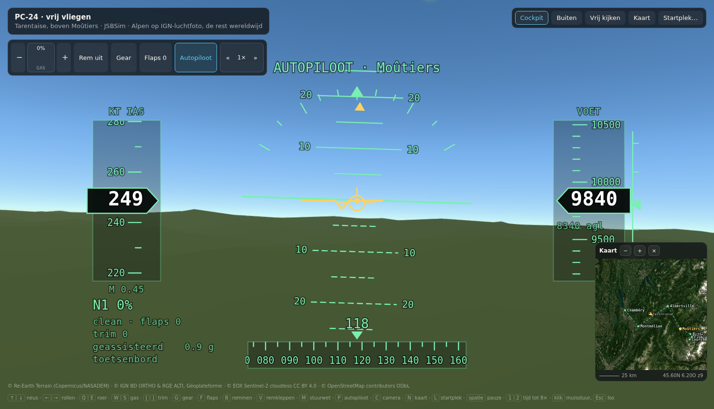
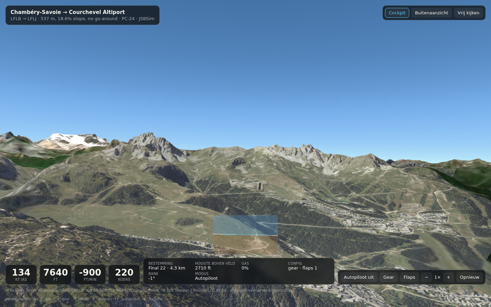

# Flight view (Chambéry → Courchevel)

A light jet **you fly yourself**, over real terrain streamed from open data.
Same stack as the ride view — CesiumJS, open geodata, a builder that prepares
the geometry — but the vehicle flies and nobody else is holding the controls.

Start on the runway at Chambéry-Savoie, on the 18.6% slope at Courchevel
Altiport, on short final into it, or anywhere on earth: the terrain and the
satellite imagery are global, and the picker takes coordinates. The autopilot
is a button, not the default.

Entry point: `fly.html` → `src/fly/main.js`.

## Run it

```bash
npm run build:airport -- --airport lflb
npm run build:airport -- --airport lflj
npm run dev   # then open /fly.html
```

| Parameter | Meaning |
| --- | --- |
| `start` | a place from `src/fly/places.js` — the six airfields `lflb` `lflj` `lsgg` `lfli` `lflp` `lfhm`, or `final`, `tarentaise`, `montblanc`, `matterhorn`, `amsterdam`, `grandcanyon`, `fuji` |
| `lat`, `lon`, `alt`, `hdg`, `speed` | start anywhere instead; `alt` is metres above sea level |
| `view` | `cockpit`, `chase` or `free` |
| `fdm` | `jsbsim` (the default) or `simple` for the point-mass model, which has no atmosphere and so reports true airspeed as indicated |

```
/fly.html?start=lflj                     on the slope at Courchevel
/fly.html?lat=46.02&lon=7.75&alt=4200    somewhere above the Valais
```

### Controls

| | |
| --- | --- |
| Arrows | nose and roll — down is nose up, as on a stick |
| `W` / `S` | throttle (also `PgUp`/`PgDn`, `=`/`-`) |
| `A` / `D` | roll, for flying one-handed on the left of the keyboard |
| `Q` / `E` | rudder, and nosewheel steering on the ground — also the `◀ ROER ▶` buttons, held down |
| `[` / `]` | trim |
| `G` `F` `B` `V` | gear, flaps, brakes, speedbrake |
| `M` | control law: assisted or direct |
| `P` | autopilot: off → heading and height → the valley route → off |
| `J` | engine and airflow sound |
| `N` | the moving map |
| `C` `L` `space` `1` `2` | camera, start picker, pause, time rate |
| click | the mouse becomes a yoke, `Esc` lets go |

There is also a **strip of buttons** in the corner — throttle lever, brakes,
gear, flaps, autopilot — so the aeroplane can be flown with a trackpad and
nothing else. That is not a convenience: the throttle was on `PgUp`/`PgDn`
alone to begin with, which on a MacBook keyboard is `Fn`+arrow, and a throttle
nobody can find is an aeroplane that does not move.

A **gamepad** is picked up as soon as it is moved: sticks for roll, pitch and
rudder, triggers or the right stick for the throttle, face buttons for brakes,
gear, flaps and camera. Nothing to configure.

Input runs on real elapsed time while the simulation step is clamped, so the
throttle lever takes the same two seconds to travel whether the machine is
managing sixty frames a second or six.

Touching the controls disengages the autopilot, the way it would in the
aeroplane.









## What stands on the ground

Eleven boxes of scenery, one around each place the aeroplane gets close to the
ground, built by `scripts/build-scenery.mjs` and loaded only when you fly
within sixteen kilometres of them:

```bash
npm run build:scenery -- --area courchevel
```

**Buildings** are OpenStreetMap footprints, each with a real height where OSM
knows one — a `height` tag, else storeys times three, else a guess from what
kind of building it is, which is still better than making every house the same
box. Each one is placed on the ground elevation measured at its own centroid,
so a village on a slope steps down the hillside instead of floating on a plane.
An area is one batched Cesium primitive: six thousand separate ones would be
six thousand draw calls.

| area | buildings | woods |
| --- | --- | --- |
| Courchevel | 2059 | 224 |
| Méribel | 1768 | 108 |
| Megève | 4512 | 154 |
| Moûtiers en Bozel | 4454 | 28 |
| Alpe d'Huez | 818 | 26 |
| Chambéry, Aix, Albertville, Annecy, Annemasse, Genève | 6000 each (capped) | 115–470 |

**The Netherlands is different, and better.** PDOK streams the whole country
as LoD 2.2 3D Tiles — real roof shapes from BAG footprints and AHN heights,
with 8 cm aerial photography under them — so there is nothing to build and
nothing to store. The tileset switches on when the aeroplane is over the
country and off again when it leaves. It is what the Alps would need a week of
work to match, and it is the argument for national open data in one tileset.

Flanders has an equivalent, 3D GRB at LoD 1 under a free licence, but it is a
download behind an account rather than a streaming service, so the Flemish
boxes — Hasselt-Kiewit, Genk, Lommel — go through the OSM builder like the
Alps.

A note on that builder: IGN's elevation service is *not* worldwide despite its
`wld` resource name. Over Belgium and the Netherlands it answers −99999. So
anything it will not answer for now falls back to the Terrarium tiles, which do
cover the globe and which the rail builder already used.

**Trees** are scattered through the OSM woods and clamped to the terrain, so
none of them needs a height: the GPU puts them on whatever the ground turns out
to be. The sprite is *drawn* in `src/fly/trees.js` rather than downloaded — a
spruce is a triangle and a trunk, the Alps are full of them, and drawing it
means there is no asset to ship and no licence to honour. They fade in around
two kilometres and are gone by five, and a phone plants a sixth as many as a
desktop because it has a fraction of the fill rate.

## Any airfield in the world

`npm run build:airports` turns **OurAirports** into a 1.5 MB index — 547 kB
over the wire, and only fetched when somebody types in the search box. 10,903
fields that have at least one runway with both ends known, from 86,000 entries.
Open the start picker, type an ICAO or a name, and you are lined up on the
longest runway.

Its elevation comes from the terrain rather than from the data. OurAirports
gives a height above sea level, this viewer works above the ellipsoid, and the
difference between the two is a different number in every part of the world —
so the ground is sampled where the aeroplane is about to stand. Checked against
Samedan, the highest airfield in Europe: placed at 1712 m against a charted
1707 m, lined up on runway 03.

What you do not get outside the built fields is pavement: no asphalt, no
markings, no surveyed slope. You are standing on the terrain mesh at the right
place and heading. The nine built airfields below are the ones with real
geometry.

This is also why it is OurAirports and not X-Plane's `apt.dat`: `apt.dat` is
GPL and shipping it would pull the GPL over everything here, while OurAirports
is public domain under the Unlicense — nothing to carry at all.

## The built airfields

Nine, all built by `scripts/build-airport.mjs` from OSM outlines plus sampled
elevations, and all within forty minutes of each other:

| | | |
| --- | --- | --- |
| **LFLJ** Courchevel | 501 m, 12.7% mean and 19.6% at its steepest | no go-around |
| **LFHU** Alpe d'Huez | 445 m, 10.3%, at 1814 m | above the hairpins |
| **LFHM** Megève | 543 m, 7.5%, at 1432 m | |
| **LFKX** Méribel | 407 m, 6.6%, at 1691 m | the next valley from Courchevel, and shorter |
| **LFLB** Chambéry-Savoie | 1651 m, 0.2% | beside the Lac du Bourget |
| **LFLE** Chambéry-Challes | 987 m, 0.5% | flat, and a relief after the altiports |
| **LSGG** Genève | 3582 m | the big one in the valley |
| **LFLP** Annecy-Meythet | 1133 m | mountains on three sides |
| **LFLI** Annemasse | 900 m | under the Geneva approach |

Four of the nine are mountain altiports, which between them cover 6.6% to
19.6% of slope — a useful spread, because that is exactly the axis along which
the ground model misbehaves (see below).

Heights outside France come from the same IGN endpoint: its `wld` resource is
a worldwide blend rather than RGE ALTI's one metre, so Geneva is built at DEM
accuracy. That is the right trade for a flat valley field and would not be for
another Courchevel.

Two things the builder learned here. It used to pick the runway by how many
points OSM happened to draw it with, which gave Megève a 109 m "runway" from a
fragment and would have missed its real one entirely, since that is drawn with
exactly two points; it now measures length on the ground. And the IGN elevation
service rate-limits, so building four airports in a row trips a 429 — it now
backs off and retries rather than giving up.

## Data

| Layer | Source | Licence |
| --- | --- | --- |
| Terrain | Re:Earth Terrain — global quantized mesh from Copernicus/NASADEM, blended with the EGM2008 geoid | open, keyless |
| Base imagery | EOX Sentinel-2 cloudless, 10 m | CC BY 4.0 |
| France imagery | IGN BD ORTHO, 20 cm, via the Géoplateforme WMTS | open licence |
| Switzerland imagery | swisstopo SWISSIMAGE, 10 cm | open, keyless |
| Netherlands imagery | PDOK luchtfoto, 8 cm | CC BY 4.0 |
| Netherlands buildings | PDOK 3D Basisvoorziening, LoD 2.2 as 3D Tiles | CC BY 4.0 |
| Runway heights | IGN RGE ALTI (1 m) via the Géoplateforme elevation API | open licence |
| Airport geometry | OpenStreetMap `aeroway=*` | ODbL |

No keys and no accounts: every service answers with
`Access-Control-Allow-Origin: *`, so the browser streams all of it directly.

## Why the airports are built rather than streamed

The global terrain is a 30 m DEM. Over a mountain range from a cockpit that is
plenty; for a runway it is useless, and Courchevel is the extreme case — a
500 m strip carved into a shoulder at 2000 m, climbing at 12.6% on average and
19.6% at its steepest. A 30 m DEM renders that as a vague bump.

So `scripts/build-airport.mjs` takes the runway and apron outlines from OSM,
samples IGN RGE ALTI along them — three lanes across the pavement, median of
the three, because a metre of drift sideways on an 18% slope is worth several
metres of height — smooths the result and forces it monotone, and writes the
geometry out. The viewer lays that on a platform, cuts the coarse DEM out from
underneath with a clipping polygon, and paints centreline, edges and threshold
bars on top.

Measured against the published figures: Chambéry comes out at 774 ft against a
published 779, and Courchevel's steepest section at 19.6% against a published
18.6% maximum.

## Heights, again

The same datum problem as the ride view, one step worse. IGN heights are above
sea level; the terrain renders above the ellipsoid; in the Alps the geoid sits
about 50 m below. The viewer measures the difference itself rather than
assuming it — the median gap between the streamed terrain and the IGN heights
along the runway at Chambéry, which is flat enough that a 30 m DEM is accurate
there — and shifts every airport and every route altitude by it. It comes out
at 49.5 m, which is the EGM2008 undulation for Savoie.

## The flying

`src/fly/jsbsim.js` runs **JSBSim** — the flight dynamics library inside
FlightGear, used by NASA as a benchmark — compiled to WebAssembly and stepped
at 120 Hz from the browser. It is not an approximation of an aeroplane: it
integrates six-degree-of-freedom equations over a real aircraft definition, so
thrust lapses with altitude, a climb bleeds speed, the wing stalls because it
runs out of lift, and the gear and brakes bring the aeroplane to a stop by
themselves.

The point-mass model is still there behind `?fdm=simple`. It needs no
WebAssembly and runs on anything, which is worth keeping.

### The aeroplane

`public/fdm/aircraft/pc24/pc24.xml` and `public/fdm/engine/fj44.xml` are this
project's own work, written against published PC-24 figures rather than copied
from FlightGear's aircraft library — which matters for the licence, see
`docs/licensing.md`. Geometry, mass, gear, flight controls, a lift curve, a drag
polar with a compressibility rise, and a turbine with an altitude lapse table.

`npm run test:fdm` flies it headless in Node and prints what it does, which is
how the numbers below were tuned. Against Pilatus' figures:

| | Book | Model |
| --- | --- | --- |
| Rotate | ~95 KIAS | 95 KIAS after 13.5 s |
| Initial climb | ~4000 fpm | 3887 fpm |
| To FL410 | ~30 min to FL450 at MTOW | 17.5 min at 15,500 lb |
| Cruise | 425–440 KTAS | 428 KTAS / M0.746 at FL405 |
| Mmo | M0.74 | drag rise holds it at M0.75 |
| Stall, clean | ~95 KIAS | 98 KIAS |
| Stall, landing | ~85 KIAS | still flying at 80 KIAS |
| Landing roll | ~600 m light, dry | 352 m from 102 KIAS, flat |

The landing roll is on the short side of the book figure, which quotes a
distance from fifty feet with a delay before the brakes come on. The model
measures a pure ground roll with everything applied at once.

**Power first, then attitude.** The high-speed protection used to do one
thing — bring the nose up — and it did it from the operating limit, 282 KIAS.
At full thrust that is a losing fight: measured, it settled into a 4000 fpm
climb at 294 knots, over the red line, with the stick fully forward and
nothing on the glass saying why. There are now two limits doing two jobs. From
282 the protection takes the *throttle* off, closing a loop rather than
guessing a gain, which is visible on the gauge in a way a pitch protection
quietly fighting your hand is not. Only past the red line at 290 does it touch
the stick. Measured again on the same test — full thrust, stick held fully
forward from 9900 ft — the aeroplane descends at 3000 to 7500 fpm with the
speed parked between 286 and 292 instead of climbing away, and the attitude
protection stays out of it. The glass now says which protection has the stick,
because a limit you cannot see is indistinguishable from an aeroplane that has
stopped answering. `M` for direct law still turns all of it off.

**It stands on its own undercarriage.** A ground start puts the centre of
gravity at a height written into `reset`, and that height was a guess: 1.6 m,
where the aeroplane actually rests at 1.90. The wheels therefore began a third
of a metre underground, the springs answered in the first second of flight, and
what you saw on arriving anywhere was the aeroplane coming up to 2.07 m and
sinking back — a small drop, exactly where a parked aeroplane should be doing
nothing at all. `Fdm.settle` now spends that second before the loading screen
comes down, with the brakes on and the stick still, running until the vertical
speed has been under six millimetres a second for half a second. Measured at
the first frame, against the 1.90 m it settles to: Brussels 2.07 → 1.89,
Eindhoven 2.08 → 1.92, Kiewit 2.12 → 1.90 and dead still, Chambéry 1.90 and
dead still. Zwartberg is the one that still moves, 2.08 → 2.02 with a tenth of
a metre of ringing afterwards; the aeroplane there appears not to come to rest
at all, which is a slope and a locked wheel and not this.

### Two control laws

A real flight model is not keyboard-flyable with raw surface commands, so there
are two laws and `M` switches between them.

**Assisted**, the default, is an attitude-command system like a modern
fly-by-wire: the axes move a *commanded* pitch and bank, and an inner loop works
out the elevator and aileron. Ask for ten degrees of pitch and the aeroplane
finds the deflection; let go and it stays there. Four arrow keys are enough.

**Direct** puts the axes on the control surfaces, with the trim doing what trim
does. It is what a stick or a gamepad deserves and what the aeroplane actually
has; it is also much harder on a keyboard, which is why it is not the default.

That inner loop needs an integrator, not just a proportional term, and this is
the one lesson worth writing down. Holding an attitude takes a standing
deflection that changes with speed, flap setting and centre of gravity, and a
proportional loop can only produce a standing deflection by sitting on a
standing error. On the approach that error was eight degrees: commanded twelve,
flying three, which is the difference between landing and flying into a
mountain. The integrator is the trim wheel, and it does the same job here as it
does in the cockpit.

### The autopilot, when you want it

`P` cycles through three states. **Heading and height hold** freezes what the
aeroplane is doing now, which is the useful one in free flight. **Route** flies
the Chambéry–Courchevel valley and lands. Then off again.

The route autopilot is three cascaded loops — route to heading, heading to
bank, altitude to vertical speed to pitch attitude — plus two things a real one
has and a naive one does not:

- **The throttle is flown on energy, not speed.** An aeroplane below its
  profile is *fast for the leg*, so a speed-only autothrottle pulls the thrust
  back while the nose is up to climb. That is exactly how a real aeroplane ends
  up mushing downhill at high alpha with the engines at idle, and it is what
  this one did until the vertical speed error was added to the throttle law.
- **Speed protection.** The flight model will stall if asked to, so the
  autopilot has to not ask: below the configuration's minimum speed the nose
  comes down and the climb waits.

The last leg is an approach rather than a waypoint. Flying to a point will not
land an aeroplane, it will circle one; so the final leg tracks the runway axis,
holds about six degrees down to the threshold — twice an airliner's approach,
which is what Courchevel is — flares below 9 m, and brakes.

`npm run test:fdm` checks the model in Node; `scripts/fly-check.mjs` flies the
actual browser build headless, either on the autopilot or on the stick:

```
$ node scripts/fly-check.mjs lflb 22
los op 123 KIAS na 22 s
 11 min: 166 KIAS, 8980 ft, 5621 agl, naar Bozel
 13 min: 125 KIAS, 7488 ft, 2799 agl, naar Final 22
neer op 103 KIAS, -437 fpm, na 14.2 min
stil na 9 s uitrollen

$ node scripts/fly-check.mjs lflb 9 manual
rotatie op 95 KIAS na 17 s
los na 22 s, 120 KIAS
genivelleerd op 8188 ft na 2.1 min, 249 KIAS
bocht van 90° klaar na 2.1 min, bank tot 66°, 249 KIAS
```

The manual run drives the same axes the keyboard and the gamepad feed, so the
path a person actually uses is the path that is tested.

### The Courchevel trench

The worst of the lot, and the cause was a shortcut taken much earlier. The
surveyed heights are above sea level and the terrain renders above the
ellipsoid, so a geoid offset is needed — and it was measured once, at
Chambéry, and applied everywhere.

At Courchevel that put the runway **seventeen metres below the streamed
terrain around it**. Cutting the globe away over a thirty-metre strip then
left the aeroplane at the bottom of a seventeen-metre trench: black sky,
because the sky was behind the walls, and a departure that bounced off them.

Seventeen metres is not a geoid error. It is a 30 m DEM smoothing away a shelf
cut into a mountain. So the offset is now measured **per airfield**, along its
own runway, and absorbs both the geoid and the DEM's own opinion of the ground
there. Courchevel's drawn terrain and its runway now agree to within 0.2 m
along the whole centreline.

The trade is that the absolute altitude at Courchevel is a few metres off its
charted elevation, while the *slope* — the only reason that airfield is
interesting — is exactly as surveyed. That is the right way round.

### What else broke at Courchevel

Three faults found there in one sitting, all of them invisible at Chambéry:

**The landscape disappeared.** Cesium builds one signed distance field for an
entire `ClippingPolygonCollection`, sized to the union of its polygons. Two
airports sixty kilometres apart therefore stretched that field across sixty
kilometres, and a strip of asphalt thirty metres wide fell far below one texel
of it. The result was not a missing runway but a missing *mountain range*: at
Courchevel every hillside vanished and the aeroplane sat in a void with the
sky showing through the ground. With a single polygon loaded it is correct, so
the hole now follows the aeroplane — whichever airport it is near, or none.

**The departure end was the wrong one.** The start placed the aeroplane at
`centre[2]` on the stored runway heading, which at Courchevel is the low end
pointing uphill: the landing direction. You take off downhill there, on 04 from
the top. A place can now name the end it wants.

**Nothing steered on the ground.** JSBSim drives the nosewheel from
`fcs/steer-cmd-norm`, which was never set, so taxiing had only the rudder's
aerodynamic yaw — nearly nothing at fifteen knots. And the sign was inverted:
with this aeroplane's `CnDr`, a positive rudder command yaws the nose *left*,
so full right pedal used to turn it twenty degrees to the left. Both fixed and
measured: right pedal now gives about ten degrees a second at taxi speed, and
the nosewheel's authority tapers off with speed so a bootful of pedal during
the take-off roll does not put the aeroplane in the grass.

### The grey slab at the border

Both national imagery services are published as rectangles in this viewer, and
neither country is a rectangle. Outside its own coverage, **IGN does not answer
with nothing — it answers with a flat grey tile**, and so does swisstopo. An
opaque grey slab over the neighbour is what makes a frontier show up as a seam
in the landscape, which is exactly what it looked like flying from Annemasse
towards Geneva.

Asking IGN for PNG instead, in the hope of transparency, returns HTTP 400: that
layer is JPEG only. So the fix is to key the colour out. Both no-data shades
were *measured* rather than guessed — a tile from outside the coverage was
fetched, decoded and its average colour read: IGN's is `rgb(215,216,214)` and
swisstopo's `rgb(160,161,162)` — and Cesium's `colorToAlpha` removes exactly
those, with a tight threshold so real concrete and snow survive.

Switzerland then gets SWISSIMAGE on top at 10 cm, which is both better than the
fallback and the reason the Geneva basin now reads properly.

### Feeding it the ground, anywhere

JSBSim needs a terrain height under the aircraft every frame, synchronously,
and getting it wrong is how an aeroplane ends up inside a mountain. Cesium
offers nothing that does this well: `Globe.getHeight` only knows tiles the
camera has already drawn — so it is empty ahead of you and wrong behind you —
and `sampleTerrainMostDetailed` is a network call.

`src/fly/terrain.js` therefore keeps a **grid of sampled heights that follows
the aircraft**: 33 × 33 points, resampled asynchronously as it moves and
centred slightly ahead of it, read synchronously with bilinear interpolation.
This is what makes free flight possible; the earlier version sampled one fixed
profile along the Courchevel route and could not leave it.

How big the patch is matters more than it looks. Height sets the resolution
worth having — a hundred metres matters on short final and not at all in the
cruise — but **speed sets how much ground is needed**, because a patch has to
outlast the time it takes to sample the next one. The first version sized it
on height alone and led the aircraft by fifteen seconds, which at approach
speed put the aeroplane on the very edge of its own terrain. It then flew off
it, `heightAt` returned nothing, the ground fell back to the last height it had
— and the aeroplane made a perfectly smooth landing on a flat invisible surface
1.8 km short of the runway. A stale number is worse than a coarse one, so the
last resort is now the globe, with a sanity check, and not the last answer.

Seven more things had to be right:

1. **The property is `position/terrain-elevation-asl-ft`.** Writing
   `position/terrain-elevation-ft` at runtime reads back fine and changes
   nothing — the aeroplane keeps touching down on the height it was initialised
   with, which on a mountain approach means landing several hundred metres
   below the runway.
2. **The globe is asked last, not first.** It answered one approach with a
   2600 m peak half a valley away. The order is airport survey, then the
   sampled patch, then the globe with a sanity check.
3. **The ground must not teleport.** A height that jumps a few hundred metres
   in one frame puts the gear that far inside the hillside, and a 9000 lb/ft
   spring answers with a few million pounds. Under the aircraft the ground can
   only change as fast as it is being flown over, so that is the rate limit.
4. **The survey only speaks for as far as the platform is drawn.** Its full
   radius is now derived from the same constant as the rendered skirt, so the
   flight model can never claim runway height where there is no runway to
   stand on.
5. **The runway survey has a skirt.** It used to stop dead at 60 m from the
   centreline, which at Courchevel — a shelf cut into a mountain — is a step of
   a hundred metres. It now fades into the terrain between 45 m and 160 m, so
   running off the edge is a slope rather than a cliff.
6. **A standing start is placed by the feed, not beside it.** Starting at a
   streamed airfield measured the ground twice. The place was resolved against
   the terrain at its exact spot, and the flight model was then fed from the
   patch, which samples every fifty metres and takes the highest of the four
   corners around the aeroplane whenever the ground is close. Measured over
   ten Flemish fields the two disagree by 0 to 0.27 m — small, but it is the
   model's own floor moving under a parked aeroplane, and it also depended on
   whether the patch had arrived yet. `terrainService.prime` now fills the
   patch before the model is built, at half the usual span so the samples are
   25 m apart, and reads the start height out of it the way the first frame
   will. The two cannot disagree any more, because they are one measurement.
7. **Every field gets a flat runway.** The six built airports have a surveyed
   platform; everywhere else the wheels are on the global terrain model, and
   along a runway that model has waviness in it — flat ground sampled from
   space and interpolated. Measured down Deurne's runway: 30 cm of it over
   380 m, in steps of up to 15 cm between samples 20 m apart, which at
   touchdown speed is 15 cm in a third of a second, over and over. You cannot
   see it and you can certainly feel it. `src/fly/strip.js` now lays a paper
   runway at whichever indexed field the aeroplane is near and low: the
   terrain is sampled along each centreline, a straight line is fitted through
   those heights, and that line is the ground inside the strip, handing back
   to the terrain within sixty metres of it. Same probe as the built airports,
   same skirt; the only difference is that the centreline's heights are a fit
   to the terrain rather than a survey, so it meets the ground at the ends and
   introduces no step. Down the same runway afterwards: 0 cm of waviness, 8 mm
   of worst step. It costs one terrain sample per field.

Checked away from the Alps by flying two minutes at each of several places and
watching the ground: Mont Blanc 2209 m, the Matterhorn 3453 m, the Grand Canyon
1577 m with 276 ft of clearance over the rim, Fuji 1262 m. Real heights
everywhere, which is the whole claim.

### Time acceleration

`1` and `2`, or the `«  »` control in the strip, step through 0.25× to **8×**.
Cruise is the dull part of any flight and this is the fix for it.

Eight is the ceiling because that is where the simulation stops holding
together, and finding out why was the useful part. Three things break under
time acceleration, and all three are the same mistake in different places —
code that runs *once a frame* behaving as though a frame were a fixed amount
of flight:

- **The stick.** The commanded attitude was integrated on the simulated step,
  so at eight times speed a tap on the arrow key was worth eight times the
  pitch. It now integrates on the pilot's clock, which is the real one.
- **The autopilot.** Its throttle law is incremental and ran once a frame, so
  its gain per *simulated* second silently fell with the rate: at sixteen
  times it lost a hundred knots before catching the speed. It is now scaled by
  the step, clamped so one coarse pass cannot swing the levers end to end.
- **The terrain.** At eight times speed the ground goes by eight times as
  fast, so the patch has to reach eight times as far ahead. Feeding it the raw
  airspeed left the aeroplane outside its own terrain in 49 of 60 samples; with
  the rate folded in and the span cap raised to 120 km, 4 of 60.

Below 300 m above the ground the rate is held to 4× whatever you ask for, and
the glass shows the rate in force rather than the one requested. Contact
forces want small steps, and a crash at eight times speed is not a landing.

### The moving map

`N`, or the Kaart button. North up — a map that rotates with the aeroplane
tells you where you are pointing, and the question a map answers is where you
*are*. It is drawn on a canvas from the same Sentinel-2 cloudless tiles the
scene already uses, so there is no second source and no second licence, and
the mosaic reads at every zoom from the continents down to one valley.

On it: the aeroplane and its heading, a breadcrumb trail of the last five
minutes, the places from `places.js` as landmarks, the route with its waypoint
names when the route autopilot is flying, and **every airfield under the map**
— drawn as the runway itself, a dark casing and a bright core with a tick at
each threshold, so it reads as somewhere to land and not as a scratch on the
photograph. The fields come from the same index the start menu searches, so
the map has them anywhere in the world; which ones are drawn follows the zoom
(a runway shorter than six pixels at that scale is left out, or the Low
Countries are a wall of labels), except the nearest field, which is always
worth a line. The index is 28,000 entries, so the list is asked for again only
when the map has moved a fifth of its width or been zoomed.

**Drag it to look around**, and ⌖ or a double-click brings it back to the
aeroplane. Pan and it stays where you put it, while the simulator runs or
while it is paused. Changing the start point clears the trail and recentres
it: a teleport is not a leg, and the breadcrumbs used to join Chambéry to a
field in Limburg with a straight line across France that looked exactly like a
route.

It redraws ten times a second rather than every frame, because it is not
flight data and the scene needs the budget more.

### The glass

`src/fly/panel.js` is one SVG head-up display: speed on the left, altitude and
vertical speed on the right, heading along the bottom, and a horizon with a
pitch ladder in the middle — plus a **flight path marker**, the symbol that
says where the aeroplane is going rather than where its nose is pointing, which
is the one thing you cannot judge from the window on an approach into a valley.

Each tape is a fixed ladder of marks that slides by the remainder and relabels
itself, so forty thousand feet needs no more geometry than four hundred knots.
Warnings come up for the stall, Vmo, Mmo, a high sink rate low down, a missing
gear — and for the parking brake, because standing on the runway at full
thrust going nowhere is confusing for exactly as long as nobody tells you.

## Known limitations

- **Two runways in the whole world.** Chambéry and Courchevel are built from
  survey data; everywhere else you start in the air and there is nothing to
  land on but terrain. The fix is **OurAirports**, not `apt.dat` — see below.
- **No weather, traffic or systems.** No wind, no clouds beyond what the
  imagery shows, no failures, no pressurisation. JSBSim supports the systems
  side; none of it is configured.
- **The cockpit view does not look around.** The mouse is the yoke; there is no
  head movement, so checking the turn means using the outside view.
- **Steep altiports are bumpy.** The cause is understood and quantified: JSBSim's
  default ground model treats the terrain as locally horizontal, so the
  vertical speed of an aeroplane rolling *along* a steep slope is counted in
  full as strut closure the moment a wheel touches. At Courchevel's 19.8% that
  produced 112,000 lb and 8 g; softening the gear damping brought it to
  42,000 lb and 3 g at a cost of three metres of landing roll on the flat, but
  it cannot be removed without a ground callback that knows the surface
  normal, which this WebAssembly build does not expose. Méribel at 6.6% and
  Megève at 7.5% are noticeably gentler; the valley fields are unaffected.
- **A downhill departure from Courchevel skims.** From about forty knots the
  gear unloads completely and the aeroplane follows the falling slope a metre
  or two above it rather than rolling on it, with the wheels flickering in and
  out of contact until it flies properly at around 108 KIAS. The trench is
  gone, the profile is smoothed, the height is interpolated along the
  centreline and the attitude loop is inhibited on the wheels — none of those
  were it. The recorded descent rate during the roll is about six hundred feet
  a minute steeper than the slope alone accounts for, and that discrepancy is
  not yet explained.
- **It lands long.** Touchdown is at Vref on a 500 m runway, and the rollout
  runs past the end onto the terrain above it. A real PC-24 at Courchevel is
  put down on the first metres of pavement; this autopilot aims at the
  threshold and arrives a little fast.
- **No cockpit.** The cockpit view is the pilot's eye position with an attitude
  indicator, not a modelled flight deck.
- **The aeroplane is boxes.** Recognisably a T-tailed light jet from outside,
  no more.
- **One aeroplane.** A second would be the test of whether the plumbing is
  general or quietly PC-24-shaped.
- **Courchevel is 500 m here, not 537.** That is what OSM maps as pavement; the
  published length includes ground the way does not cover.
- **Terrain resolution.** 30 m globally. The Alps read well at altitude and get
  soft close to the ground away from the airports, where the runway geometry
  takes over. Swiss or French national LiDAR terrain would fix that, at the cost
  of a per-country adapter.

## Why JSBSim and not FlightGear

Worth recording, since this was the question that led here.

**FlightGear** (GPL, going since 1997) is the real open-source flight
simulator: worldwide scenery, several flight dynamics engines, multiplayer, a
large aircraft library. It reads airports in `apt.dat`, the format X-Plane uses,
so a Courchevel built in WorldEditor would work in both. What it does not have
is this project's terrain pipeline — its scenery is pre-generated and shipped,
not streamed from national open data, so the Alps look like 2010 rather than
like IGN.

**JSBSim** (LGPL 2.1) is the piece worth taking on its own: it *is* FlightGear's
flight dynamics engine, and it is packaged as WebAssembly in
`@0x62/jsbsim-wasm` (MIT wrapper around the LGPL library).

So the path taken was to keep the scene — streamed open geodata, surveyed
runways — and replace the point-mass model with JSBSim plus an aircraft
configuration of our own. The open data stays, the arcade model becomes a
fallback, and the aeroplane now has a weight and a wing rather than a thrust
number.

## Where the rest of the world comes from

An earlier version of this file said the way to get airports outside Savoie was
an `apt.dat` reader. That was wrong, and the licence is why: **X-Plane's
`apt.dat` is published under the GPL**, so shipping it would pull the GPL over
this whole distribution — the same trap as FlightGear's aircraft library, which
is precisely the trap this project already decided to avoid.

The right source is **[OurAirports](https://ourairports.com/data/)**: 86,000
airports, heliports and airfields with runway endpoints, surfaces, lengths and
elevations, as daily CSV, released into the **public domain** under the
Unlicense. No attribution required, no share-alike, nothing to carry. It gives
the catalogue and the runway geometry; OSM keeps giving the pavement outlines
the builder already uses, and the elevation service keeps giving the heights.

Other sources worth knowing, with the licence that decides whether they can be
used here at all:

| Want | Source | Licence | Usable |
| --- | --- | --- | --- |
| Airport catalogue, runways | OurAirports | Unlicense (public domain) | yes |
| Airport layouts | X-Plane `apt.dat` | **GPL** | no |
| Airport layouts | OSM `aeroway=*` | ODbL | yes, in use |
| Buildings, France | IGN BD TOPO (footprint + height) | Licence Ouverte 2.0 | yes |
| Buildings, Switzerland | swisstopo swissBUILDINGS3D | open | yes |
| Buildings, Netherlands | PDOK 3D Basisvoorziening, 3D BAG | CC BY 4.0 | yes, in use |
| Buildings, global | OSM `building` + `height` | ODbL | yes |
| Buildings, global | Cesium OSM Buildings | needs an ion key | no, breaks the keyless rule |
| Trees | OSM `natural=wood`, `landuse=forest`, `natural=tree` | ODbL | yes |
| Tree and prop models | Quaternius, Poly Haven, Kenney | CC0 | yes |
| Aircraft models | NASA 3D Resources | public domain | yes |
| Aircraft models | FlightGear / X-Plane | GPL / proprietary | no |

## Next

Airports from OurAirports, so there is somewhere to land outside Savoie; a head
that looks around the cockpit; a second aeroplane; wind; and the Swiss data
adapter — swisstopo publishes terrain at zoom 18 and 10 cm imagery, which would
make a Valais flight look considerably better than this.
