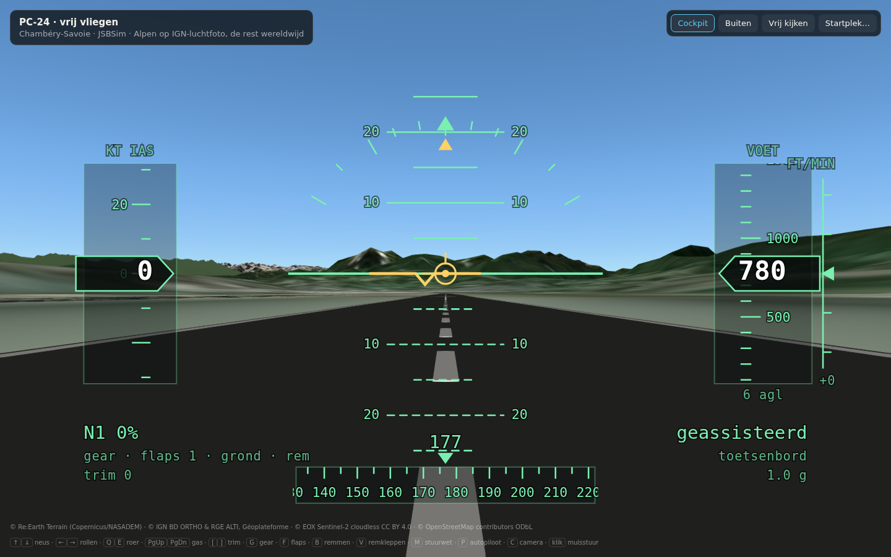
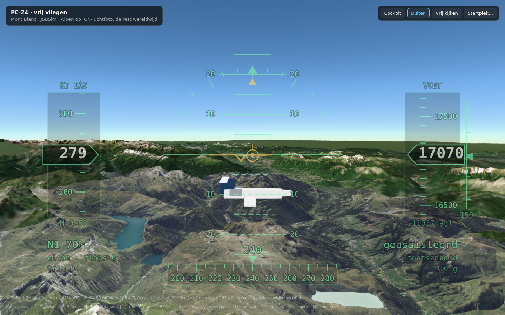
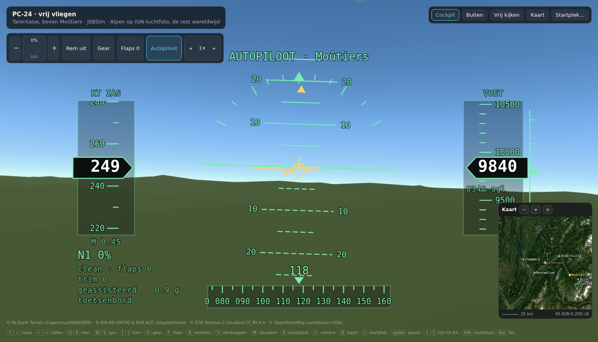
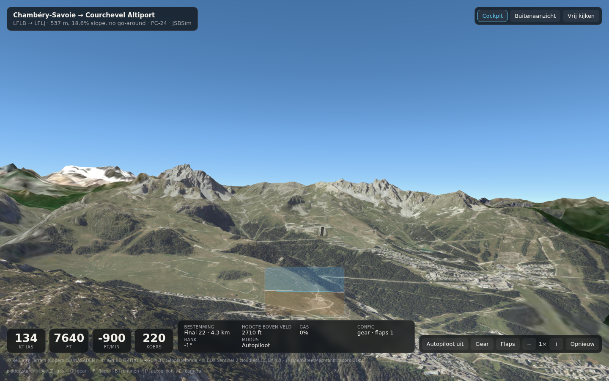

# Flight view (Chambéry → Courchevel)

A light jet **you fly yourself**, over real terrain streamed from open data.
Same stack as the ride view — CesiumJS, open geodata, a builder that prepares
the geometry — but the vehicle flies and nobody else is holding the controls.

It asks where to begin before it puts you anywhere: a region, one of 28,000
airfields by name or code, or a field at random. The runway at Chambéry-Savoie,
the 18.6% slope at Courchevel Altiport, short final into it, or anywhere on
earth — the terrain and the satellite imagery are global, and the menu takes
coordinates too. The autopilot is a button, not the default.

Entry point: `fly.html` → `src/fly/main.js`.

## Run it

```bash
npm run build:airport -- --airport lflb
npm run build:airport -- --airport lflj
npm run dev   # then open /fly.html
```

| Parameter | Meaning |
| --- | --- |
| `aircraft` | `pc24` (the default) or `a380`. The start menu asks as well |
| `traffic` | `1` puts other people's aeroplanes in the sky from the start; otherwise they are off and `T` switches them on |
| `start` | a place from `src/fly/places.js` — the six airfields `lflb` `lflj` `lsgg` `lfli` `lflp` `lfhm`, or `final`, `tarentaise`, `montblanc`, `matterhorn`, `amsterdam`, `grandcanyon`, `fuji` — **or any ICAO code in the world index**, such as `eham` or `lszs`. Giving it at all skips the start menu, which is what makes a shared link land where it says |
| `lat`, `lon`, `alt`, `hdg`, `speed` | start anywhere instead; `alt` is metres above sea level |
| `view` | `cockpit`, `chase` or `free` |
| `res` | how many pixels the world is drawn with per CSS pixel. The default is the screen's own, capped at 2 (phones excepted); `res=1` is Cesium's own default and what this used to do |
| `sharpen` | a contrast-limited sharpening pass over the scene, off by default. `sharpen=0.6` is a good place to start |
| `fdm` | `jsbsim` (the default) or `simple` for the point-mass model, which has no atmosphere and so reports true airspeed as indicated |

```
/fly.html?start=lflj                     on the slope at Courchevel
/fly.html?start=lfpg&aircraft=a380       an A380 on 26R at Charles de Gaulle
/fly.html?lat=46.02&lon=7.75&alt=4200    somewhere above the Valais
```

### Controls

| | |
| --- | --- |
| Arrows | nose and roll — down is nose up, as on a stick |
| `W` / `S` | throttle (also `PgUp`/`PgDn`, `=`/`-`) |
| `A` / `D` | roll, for flying one-handed on the left of the keyboard |
| `Q` / `E` | rudder, and nosewheel steering on the ground — also the `◀ ROER ▶` buttons, held down |
| `[` / `]` | trim |
| `G` `F` `B` `V` | gear, flaps, brakes, speedbrake |
| `M` | control law: assisted or direct |
| `P` | autopilot: off → heading and height → your own plan → the valley route → off |
| `J` | engine and airflow sound |
| `N` | the moving map |
| `R` | the flight plan, and where you are going |
| `C` `L` `space` `1` `2` | camera, start picker, pause, time rate |
| click | the mouse becomes a yoke, `Esc` lets go |

There is also a **strip of buttons** in the corner — throttle lever, brakes,
gear, flaps, autopilot — so the aeroplane can be flown with a trackpad and
nothing else. That is not a convenience: the throttle was on `PgUp`/`PgDn`
alone to begin with, which on a MacBook keyboard is `Fn`+arrow, and a throttle
nobody can find is an aeroplane that does not move.

A **gamepad** is picked up as soon as it is moved: sticks for roll, pitch and
rudder, triggers or the right stick for the throttle, face buttons for brakes,
gear, flaps and camera. Nothing to configure.

Input runs on real elapsed time while the simulation step is clamped, so the
throttle lever takes the same two seconds to travel whether the machine is
managing sixty frames a second or six.

Touching the controls disengages the autopilot, the way it would in the
aeroplane.

**A focused text field owns the keyboard.** Every control here is a letter,
and the axis keys have to swallow their own keypresses — a `W` that scrolls
the page is not a throttle — so the window-level listener that reads them was
also reading what people typed into the search fields. Typing a destination
dropped the `E` and the `D` into the rudder and the roll and handed the `L` to
the start menu; in the coordinate fields, where `-` and `.` are trim and
rudder, `-5.3` arrived as `53` and a negative longitude could not be entered
at all. An input, textarea, select or contenteditable now takes the lot while
it has the focus, and a focused button keeps its own space and return, so
clicking `Gear` and then pressing space works the button instead of pausing
the simulation.









## What stands on the ground

Eleven boxes of scenery, one around each place the aeroplane gets close to the
ground, built by `scripts/build-scenery.mjs` and loaded only when you fly
within sixteen kilometres of them:

```bash
npm run build:scenery -- --area courchevel
```

**Buildings** are OpenStreetMap footprints, each with a real height where OSM
knows one — a `height` tag, else storeys times three, else a guess from what
kind of building it is, which is still better than making every house the same
box. Each one is placed on the ground elevation measured at its own centroid,
so a village on a slope steps down the hillside instead of floating on a plane.
An area is one batched Cesium primitive: six thousand separate ones would be
six thousand draw calls.

| area | buildings | woods |
| --- | --- | --- |
| Courchevel | 2059 | 224 |
| Méribel | 1768 | 108 |
| Megève | 4512 | 154 |
| Moûtiers en Bozel | 4454 | 28 |
| Alpe d'Huez | 818 | 26 |
| Chambéry, Aix, Albertville, Annecy, Annemasse, Genève | 6000 each (capped) | 115–470 |

**The Netherlands is different, and better.** PDOK streams the whole country
as LoD 2.2 3D Tiles — real roof shapes from BAG footprints and AHN heights,
with 8 cm aerial photography under them — so there is nothing to build and
nothing to store. The tileset switches on when the aeroplane is over the
country and off again when it leaves. It is what the Alps would need a week of
work to match, and it is the argument for national open data in one tileset.

Flanders has an equivalent, 3D GRB at LoD 1 under a free licence, but it is a
download behind an account rather than a streaming service, so the Flemish
boxes — Hasselt-Kiewit, Genk, Lommel — go through the OSM builder like the
Alps.

A note on that builder: IGN's elevation service is *not* worldwide despite its
`wld` resource name. Over Belgium and the Netherlands it answers −99999. So
anything it will not answer for now falls back to the Terrarium tiles, which do
cover the globe and which the rail builder already used.

**Trees** are scattered through the OSM woods and clamped to the terrain, so
none of them needs a height: the GPU puts them on whatever the ground turns out
to be. The sprite is *drawn* in `src/fly/trees.js` rather than downloaded — a
spruce is a triangle and a trunk, the Alps are full of them, and drawing it
means there is no asset to ship and no licence to honour. They fade in around
two kilometres and are gone by five, and a phone plants a sixth as many as a
desktop because it has a fraction of the fill rate.

## Asking where to begin

Opening `fly.html` used to put you on runway 36 at Chambéry whether that was
where you wanted to be or not. The picker that could take you somewhere else
existed only once you were already flying — the wrong way round, because
choosing where to go is the first thing you want to do and was the last thing
offered.

`src/fly/start.js` now asks first, and it asks over the load rather than before
it. The menu goes up immediately; the airfield JSON, the terrain, the imagery
and JSBSim carry on behind it, with the loading line reporting at the foot of
the sheet; the answer is awaited only at the moment the aeroplane has to be put
somewhere. Choosing therefore costs nothing — by the time most people have read
the regions the model is ready. A menu over a frozen screen looks like a menu
over a broken simulator, which is why the status line is there at all.

Three ways to answer, which is the shape of the question:

- **A region** — the groups in `places.js` as tabs, opening a list of
  hand-picked fields with a sentence each. Closed to begin with: opened, a
  region's thirteen fields push the other two ways off the bottom of the sheet,
  so the menu would offer three and show one.

  One of them, **Altiports**, is a group a place can belong to *as well as* its
  own region, which is why `places.js` grew an `also` field and a `groupsOf`
  helper. Courchevel belongs in Savoie and among the altiports both, and asking
  people to guess which of the two lists it was filed under is asking them to
  guess. Eight fields: the four built Savoie altiports, plus La Motte-Chalancon
  in the Drôme, Peyresourde-Balestas at 1,584 m in the Pyrenees, Lukla, and Ua
  Pou in the Marquesas. The last four come out of the index, so they have the
  right strip on the right heading and **no surveyed slope** — Lukla's 11.7% is
  not there. That is the one thing an altiport is about, so they are a place to
  fly from, not the real approach.
- **Any airfield on earth** — the same search as in flight, over the 28,000
  field index, with runway length and surface on each hit.
- **A field at random**, on two dice. One draws from the whole world; the other
  only from inside the aerial photography — France, Switzerland, South Tyrol,
  Austria, the Netherlands and Flanders — because a random field in the middle
  of Kazakhstan is a grey Sentinel-2 smear with a runway drawn on it. Both ask
  for a paved runway of at least a thousand metres and for a field the
  simulator can actually line up on, so the dice cannot hand you somewhere it
  will then fail to place you.

The answer is written into the URL with `history.replaceState`, so a reload
lands where you chose instead of back at the menu, and the link is shareable.
A URL that already names `start`, or `lat`/`lon`, skips the menu entirely —
every link that worked before still works and lands where it says. `start` now
also takes any ICAO code in the index, not only the curated ids, which is what
the search box and the dice hand back.

## Any airfield in the world

`npm run build:airports` turns **OurAirports** into a 3.9 MB index — 1.3 MB
over the wire. 28,375 fields with at least one runway, 33,406 runways, from
86,000 entries. Open the start picker, type an ICAO or a name, and you are
lined up on the longest runway.

The index is fetched in the background as soon as the aeroplane is flying,
not only when somebody searches. That was a real bug rather than a nicety:
the fetch used to be triggered by the search box or by a start place that
names an ICAO code, and the built fields — Chambéry, Courchevel, Geneva —
name none. Take off from one of those and the index never loaded, so the
moving map drew no airfields at all, anywhere.

Its elevation comes from the terrain rather than from the data. OurAirports
gives a height above sea level, this viewer works above the ellipsoid, and the
difference between the two is a different number in every part of the world —
so the ground is sampled where the aeroplane is about to stand. Checked against
Samedan, the highest airfield in Europe: placed at 1712 m against a charted
1707 m, lined up on runway 03.

What you do not get outside the built fields is pavement: no asphalt, no
markings, no surveyed slope. You are standing on the terrain mesh at the right
place and heading. The nine built airfields below are the ones with real
geometry.

**Standing in the grass beside the runway.** `?start=LFMA` put the aeroplane
down at Aix-les-Milles on the grass, east of the pavement and short of it.
Measured against the IGN orthophoto by sampling the brightness across the
strip at nineteen stations along it, OurAirports' line for LFMA runs **57 m
east of the real centreline and 97 m too long**. The airport record's own
position sits 60 m west of that line — which is to say on the centreline,
within the accuracy of the measurement. Two independent errors do not agree
like that, so it is the runway ends that are wrong and not the airport point.

The index is crowd-sourced and the two end coordinates are the weakest thing
in it. `runwayLine` in `src/fly/airports.js` now corrects them, in order of
how sure the correction is:

| | |
| --- | --- |
| **The length is the declared one** | `length_ft` is published; the distance between the end coordinates is whatever the person who plotted them managed. They disagree by more than 40 m on one surveyed single-runway field in six. The line is trimmed to the declared length about its own middle. |
| **A line that cannot measure itself cannot place itself** | When those two lengths disagree by more than 40 m the ends are demonstrably wrong, and the only other evidence is the airport position. If that is 10–150 m to one side, the line slides sideways onto it. Outside that band, nothing: under 10 m there is nothing to win, over 150 m the airport point is the terminal building. It fires on 2.3% of fields. |
| **Ends that are not ends** | 158 rows have the same point twice, or two points 8,000 km apart. Those are laid out around the airport position on the heading in the runway number, the way the build step already handles the fields whose ends were never surveyed. `?start=` on one of those used to teleport you a continent away. |
| **The displaced threshold** | 3,746 runways have one and we were throwing it away. At LFMA it is 50 m, at Schiphol 18R 270 m, at Chambéry 18 230 m. |

The start point is then measured **back from the middle of the strip**, not
forward from an end coordinate: the middle is the part of the line worth
trusting, because an error at either end moves it by half as much and two
equal errors move it not at all. Back by half the declared length, forward
again past the displaced threshold and 5% of the length (30–90 m), so you are
past the piano keys with the whole runway in front of you.

For the ordinary field none of this moves anything much: the median start
shifts 18 m, the ninetieth percentile 54 m, and for every field whose line was
left alone the start is still exactly on it. At LFMA it is the difference
between the grass and the centreline.

**Rozas, where the record is consistent and wrong.** `?start=LERO` put the
aeroplane in a field 550 m west-north-west of the runway at Rozas, by Lugo.
None of the four corrections fires there, and none of them should: the two
ends measure 1193 m against a declared 1200 and bear 36 for a runway called
04. The line is internally perfect, and translated as a unit.

The airport position is 501 m to one side of it, which looks like the
signature of exactly that — until you look at Burgos. Single runway, 2100 m,
airport position 444 m to one side, the same numbers to within a tenth, and
there the line is on the asphalt and the airport position is the apron. 327
single-runway fields sit in that band with their length agreeing, and nothing
in the record separates the two cases.

Nor does the terrain. A runway is flat, so a line across a slope is not on
one; sampled at twenty-five stations on the Terrarium DEM, Rozas' wrong line
spreads 11.9 m, its real line 9.7 m, and Burgos' correct line 12.2 m. Galician
heath at 30 m postings is as flat as a runway. The test is not useless — El
Castaño's line spreads 73.9 m against its real 16 m — but it cannot see this.

What settles it is the photograph, now that Spain has one at 25 cm. The
centreline was fitted by principal axis to the pavement pixels in a corridor
around the strip and the thresholds read off the coverage profile along it:
**1202 m of pavement against a declared 1200, 45–48 m wide against a declared
45, bearing 35.1**. Its midpoint falls 2 m from the published airport
position, which is the second measurement agreeing with the first. Those two
ends are a `MEASURED` table in `src/fly/airports.js`, applied as the index is
read so that the map and the start cannot disagree, and the take-off roll is
now on asphalt at every station from the piano keys to the far threshold.

**Then all of Spain.** Rozas is unlikely to be alone, so all 137 Spanish
fields in the index went through the same mill: score the line the record
gives, search the neighbourhood for the best runway-shaped line, draw both on
the photograph, and look.

Runway-shaped is defined without colour — a band of one material flanked on
both sides by another — because Spanish asphalt runs from Rozas' pale grey
through El Castaño's blue to Beas de Segura's warm sand. Two further tests
were tried and thrown away. Measuring the band's width should tell a 23 m
taxiway from a 45 m runway; it wanders onto the shoulders and reported 193 m
for Ciudad Real's runway. Looking for the painted centreline should be
decisive, since a runway is marked and a taxiway is not; at 1.75 m to the
pixel the markings are under the resolution, and the test fired on a bright
apron instead.

So the search cannot be trusted to decide. Worse, it is biased the wrong way:
**a taxiway is more uniform than a runway**, having no markings, no rubber and
no patched thresholds, so it scores higher. At Ciudad Real, Bilbao, Albacete
and Alicante that is exactly what it picked — the parallel taxiway, 200 to 330
m from a perfectly good runway. The search only draws; the eye decides, on
twenty-three contact sheets.

Twelve fields were wrong, and every one of them is small. All the large
airports are right — Madrid, Barcelona, Palma, Seville, Bilbao, Málaga,
Santiago, the Canaries — which is what you would expect of fields a thousand
people have looked at. That includes Getafe and Zaragoza, where PNOA blurs the
photograph for being military and the line still lands on the strip under the
blur.

| | shift | what the record had you on |
| --- | --- | --- |
| LECT El Castaño | 1301 m, 106° | the same threshold, then off into the hills |
| LEBE Beas de Segura | 516 m | the olive terraces north of the field |
| LEMR La Morgal | 344 m | the grass south of the runway |
| LECD La Cerdanya | 307 m | the grass beside the strip |
| LETI El Tietar | 215 m | the scrub east of it |
| ES-0219 Camarenilla | 202 m | the dirt short of the threshold |
| ES-0069 Air Marugán | 176 m, 58° | across the runway, not along it |
| LEGY Garray | 135 m | the apron, among the parked aeroplanes |
| LEOC Ocaña | 116 m, 10° | on at the west end, in the fields by the east |
| LECF Calaf-Sallavinera | 92 m, 8° | crossing the strip diagonally |
| ES-0088 Benagéber | 57 m, 19° | crossing the cleared strip |
| LERE Requena | 33 m, 10° | crossing the strip near its middle |

Each line was read off the orthophoto at zoom 18, about 1.3 m to the pixel,
threshold to threshold, and checked by drawing it back over the photograph
with the start point marked. Ten of the twelve come out within 4% of the
declared length. Headings mostly agree with the runway number; where they do
not — Beas de Segura measures 101 for a runway called 09, Benagéber 102 for
one called 12 — the photograph wins, because a painted number is rounded to
ten degrees and sometimes to the magnetic north of decades ago.

One thing had to change in the code beyond the table. A measured line must not
be corrected towards anything: rule 2 slides a suspect line onto the airport
position, and at Garray and Air Marugán the airport position *is* the apron,
so it dragged the aeroplane straight back off the runway it had just been put
on. Runways from the table are now marked, and the four corrections leave them
alone.

Two Spanish fields are still open. At Los Martínez del Puerto the record's
line is clearly not on anything, but neither is anything else obviously a
runway — the candidate strip runs 170 for a runway called 15. La Llosa is a
microlight strip in a marsh where half the record's line is in the water and
the dry part is 280 m against a declared 350. Both are noted in `TODO.md`
rather than guessed at. Only each field's *first* runway was checked, which is
the one `?start=` puts you on; second strips are drawn on the map from the
record as they always were.

This is also why it is OurAirports and not X-Plane's `apt.dat`: `apt.dat` is
GPL and shipping it would pull the GPL over everything here, while OurAirports
is public domain under the Unlicense — nothing to carry at all.

## The built airfields

Nine, all built by `scripts/build-airport.mjs` from OSM outlines plus sampled
elevations, and all within forty minutes of each other:

| | | |
| --- | --- | --- |
| **LFLJ** Courchevel | 501 m, 12.7% mean and 19.6% at its steepest | no go-around |
| **LFHU** Alpe d'Huez | 445 m, 10.3%, at 1814 m | above the hairpins |
| **LFHM** Megève | 543 m, 7.5%, at 1432 m | |
| **LFKX** Méribel | 407 m, 6.6%, at 1691 m | the next valley from Courchevel, and shorter |
| **LFLB** Chambéry-Savoie | 1651 m, 0.2% | beside the Lac du Bourget |
| **LFLE** Chambéry-Challes | 987 m, 0.5% | flat, and a relief after the altiports |
| **LSGG** Genève | 3582 m | the big one in the valley |
| **LFLP** Annecy-Meythet | 1133 m | mountains on three sides |
| **LFLI** Annemasse | 900 m | under the Geneva approach |

Four of the nine are mountain altiports, which between them cover 6.6% to
19.6% of slope — a useful spread, because that is exactly the axis along which
the ground model misbehaves (see below).

Heights outside France come from the same IGN endpoint: its `wld` resource is
a worldwide blend rather than RGE ALTI's one metre, so Geneva is built at DEM
accuracy. That is the right trade for a flat valley field and would not be for
another Courchevel.

Two things the builder learned here. It used to pick the runway by how many
points OSM happened to draw it with, which gave Megève a 109 m "runway" from a
fragment and would have missed its real one entirely, since that is drawn with
exactly two points; it now measures length on the ground. And the IGN elevation
service rate-limits, so building four airports in a row trips a 429 — it now
backs off and retries rather than giving up.

## Data

| Layer | Source | Licence |
| --- | --- | --- |
| Terrain | Re:Earth Terrain — global quantized mesh from Copernicus/NASADEM, blended with the EGM2008 geoid | open, keyless |
| Base imagery | EOX Sentinel-2 cloudless, 10 m | CC BY 4.0 |
| France imagery | IGN BD ORTHO, 20 cm, via the Géoplateforme WMTS | open licence |
| Switzerland imagery | swisstopo SWISSIMAGE, 10 cm | open, keyless |
| South Tyrol imagery | Orthofoto Südtirol 2023, 20 cm | CC BY 4.0 |
| Austria imagery | basemap.at Orthofoto, 30 cm | CC BY 4.0 |
| Netherlands imagery | PDOK luchtfoto, 8 cm | CC BY 4.0 |
| Spain imagery | PNOA máxima actualidad, 25 cm, via the IDEE's WMTS | CC BY 4.0 scne.es |
| Netherlands buildings | PDOK 3D Basisvoorziening, LoD 2.2 as 3D Tiles | CC BY 4.0 |
| Runway heights | IGN RGE ALTI (1 m) via the Géoplateforme elevation API | open licence |
| Airport geometry | OpenStreetMap `aeroway=*` | ODbL |

No keys and no accounts: the browser streams all of it directly. Almost every
service answers with `Access-Control-Allow-Origin: *`; South Tyrol's echoes
the requesting origin instead, which works the same way from a browser.

## Why the airports are built rather than streamed

The global terrain is a 30 m DEM. Over a mountain range from a cockpit that is
plenty; for a runway it is useless, and Courchevel is the extreme case — a
500 m strip carved into a shoulder at 2000 m, climbing at 12.6% on average and
19.6% at its steepest. A 30 m DEM renders that as a vague bump.

So `scripts/build-airport.mjs` takes the runway and apron outlines from OSM,
samples IGN RGE ALTI along them — three lanes across the pavement, median of
the three, because a metre of drift sideways on an 18% slope is worth several
metres of height — smooths the result and forces it monotone, and writes the
geometry out. The viewer lays that on a platform, cuts the coarse DEM out from
underneath with a clipping polygon, and paints centreline, edges and threshold
bars on top.

Measured against the published figures: Chambéry comes out at 774 ft against a
published 779, and Courchevel's steepest section at 19.6% against a published
18.6% maximum.

**The pavement has to be the colour of pavement.** The slab replaces the
photograph rather than sitting on it, because the globe is cut away
underneath; so a colour that is not the real one reads as a hole in the world,
and `#3d3c3a` read as a black one. Over Brittany, where nothing is built,
there is only the photograph and the contrast is obvious. The colours are now
sampled from the IGN orthophoto over all nine built runways — median of each
strip with the markings filtered out — and the median of those nine is what
one colour for nine fields can honestly be:

| | Measured | Was | Is |
| --- | --- | --- | --- |
| Runway | (178,179,176) median of nine; Chambéry is light concrete at (208,206,194), Megève dark at (124,127,136) | #3d3c3a | #b2b3b0 |
| Taxiways and aprons | (158,158,157), median of eighteen of them at seven fields — nine tenths of the runway, not three quarters | #4a4846 | #9e9e9d |
| Skirt | the grass beside the strip, (148,139,122) | #6b6355 | #948b7a |
| Markings | unchanged — 1.3× the runway now, where they were 3.8× | #e8e6df | #e8e6df |

The lighting was checked rather than assumed: the slab photographs at
luminance 60 for a colour of 61, so `flat: false` costs nothing on a
horizontal surface at this sun angle and what is written is what appears. It
is kept on because it is what makes Courchevel's slope read as a slope — and
because it is doing visible work elsewhere, the skirt's vertical kerb coming
out at 109 for a colour of 136, which is the four-fifths a lambert term gives
a vertical face.

Photographed from 700 m straight down over Chambéry, before and after: the
runway slab went from luminance 60 to 178 against a photograph reading 143 to
212 beside it, and the aprons from 72 to 158 against 179 to 212. A quarter of
their surroundings, to four fifths of them.

The real answer is not a colour at all — it is to texture the slab with the
orthophoto, which is 20 cm a pixel and already contains the markings. The
builder samples IGN heights along the same polygons, so it could cut the
imagery with them and write a PNG beside the geometry. Not done.

## Heights, again

The same datum problem as the ride view, one step worse. IGN heights are above
sea level; the terrain renders above the ellipsoid; in the Alps the geoid sits
about 50 m below. The viewer measures the difference itself rather than
assuming it — the median gap between the streamed terrain and the IGN heights
along the runway at Chambéry, which is flat enough that a 30 m DEM is accurate
there — and shifts every airport and every route altitude by it. It comes out
at 49.5 m, which is the EGM2008 undulation for Savoie.

## The flying

`src/fly/jsbsim.js` runs **JSBSim** — the flight dynamics library inside
FlightGear, used by NASA as a benchmark — compiled to WebAssembly and stepped
at 120 Hz from the browser. It is not an approximation of an aeroplane: it
integrates six-degree-of-freedom equations over a real aircraft definition, so
thrust lapses with altitude, a climb bleeds speed, the wing stalls because it
runs out of lift, and the gear and brakes bring the aeroplane to a stop by
themselves.

The point-mass model is still there behind `?fdm=simple`. It needs no
WebAssembly and runs on anything, which is worth keeping.

### The aeroplane

`public/fdm/aircraft/pc24/pc24.xml` and `public/fdm/engine/fj44.xml` are this
project's own work, written against published PC-24 figures rather than copied
from FlightGear's aircraft library — which matters for the licence, see
`docs/licensing.md`. Geometry, mass, gear, flight controls, a lift curve, a drag
polar with a compressibility rise, and a turbine with an altitude lapse table.

`npm run test:fdm` flies it headless in Node and prints what it does, which is
how the numbers below were tuned — `npm run test:fdm a380` flies the other one.
Against Pilatus' figures:

| | Book | Model |
| --- | --- | --- |
| Rotate | ~95 KIAS | 95 KIAS after 13.5 s |
| Initial climb | ~4000 fpm | 3887 fpm |
| To FL410 | ~30 min to FL450 at MTOW | 17.5 min at 15,500 lb |
| Cruise | 425–440 KTAS | 428 KTAS / M0.746 at FL405 |
| Mmo | M0.74 | drag rise holds it at M0.75 |
| Stall, clean | ~95 KIAS | 98 KIAS |
| Stall, landing | ~85 KIAS | still flying at 80 KIAS |
| Landing roll | ~600 m light, dry | 384 m from 102 KIAS, flat |

The landing roll is on the short side of the book figure, which quotes a
distance from fifty feet with a delay before the brakes come on. The model
measures a pure ground roll with everything applied at once.

**The speedbrake was turning the wing off.** Its lift dump was written as
ΔCL −0.35 against a wing that makes about CL 0.29 in the cruise, so pulling
it removed more lift than the aeroplane had. Measured hands off and level at
3,000 m and 260 KIAS: an instant bunt to 3,100 fpm down, settling at 2,300,
with alpha driven from 0.5° to 4.7° — the aeroplane falling out from under
you rather than slowing down. At −0.06, about a fifth of cruise lift, it
behaves like a speedbrake: 800 fpm down and 32 knots off in twenty seconds at
part power, and a steady 450 fpm at 284 knots with the levers at the stop.
The drag term was already right at ΔCD +0.030, which is more than the whole
clean airframe's 0.023. The cost is thirty-two metres of landing roll, since
the same term is what pins the aeroplane down after touchdown.

**Power first, then attitude.** The high-speed protection used to do one
thing — bring the nose up — and at full thrust that is a losing fight:
measured, it settled into a 4000 fpm climb at 294 knots, over the red line,
with the stick fully forward and nothing on the glass saying why. There are
now two limits doing two jobs. At VMO and MMO the protection takes the
*throttle* off, closing a loop rather than guessing a gain, which is visible
on the gauge in a way a pitch protection quietly fighting your hand is not.
Only six knots further on does it touch the stick. The glass says which
protection has the stick, because a limit you cannot see is indistinguishable
from an aeroplane that has stopped answering. `M` for direct law still turns
all of it off.

**Where the limit sits, and how it moves.** Both of the above were wrong
twice over in the first version, and only flying it showed how. The limits
were set eight knots under the airframe's, at 282 KIAS and M0.72, on the
theory that a margin is free. It is not: MMO is M0.74 and this aeroplane
cruises between M0.72 and M0.74, so the limit lay inside the cruise. And the
thrust cap was a switch — full travel off while over, full travel on while
under — which on a loop this slow does not regulate at all. Measured at
FL350 with the throttle against the stop: the aeroplane reached M0.728, the
cap slammed to its 15% floor, and it sat there for over a minute while the
speed bled off, with the autopilot off and nothing saying why. From the
cockpit that is a throttle that keeps pulling itself back.

The limits are now the aeroplane's own, VMO 290 and MMO M0.74 for the
throttle, 296 and M0.755 for the stick. And the cap moves at a rate set by
how far over the limit the speed is *going to be* — the exceedance plus three
seconds of its own trend — so it comes off quickly when far over, barely
moves near the limit, and creeps back on at a quarter of the speed it came
off. Measured again:

| Test | Before | After |
| --- | --- | --- |
| FL350, throttle at the stop | M0.728, thrust pinned at the 15% floor | settles at M0.740 with the thrust at 84–88%, steady |
| 7000 m, 13° dive at full power | — | thrust eased 95→62% through VMO, floor at 291 kt, pitch guard takes the stick at 296 and the speed comes back |

The dive is the ordering working: power first, all of it, and only when idle
thrust in a thirteen-degree dive still is not enough does the stick move.

**The lever is not the thrust.** The fix above was right and still looked
wrong, because the glass drew the throttle lever from the delivered thrust.
Hold the lever at the stop at three thousand feet and the limit holds 290
knots on 58% — so the lever slid down to 58% under your hand, which from the
cockpit is indistinguishable from an aeroplane taking the throttle off you.
The lever now shows where your hand left it, the N1 figure shows what the
engines are getting, and the limit is drawn as a line across the lever with
`N1 58% · VMO LIMIT` beside it in amber. Same two numbers, in the two places
they belong.

That also took the limit out of the warning line. `VMO · THRUST HELD BACK`
was lit for as long as you left the lever at the stop in the cruise, which is
indefinitely — a warning that never goes out is a warning you learn to read
past. The stick guard, `VMO · NOSE HELD UP`, stays there, because that one is
the aeroplane overriding you rather than declining to go faster.

**It was regulating against its own arithmetic.** Three seconds of trend is
the lead that keeps the cap from chasing the speed, but the trend was a
frame-to-frame difference divided by a sixtieth of a second: a tenth of a knot
of numerical noise reads as six knots a second, and three times that is the
whole error term. The speed was held perfectly — dead on 290 — while the
thrust swung between 48% and 79% doing it. Averaging the trend over about a
second keeps the lead and loses the noise: same 290 knots, thrust steady
between 58% and 63%.

| Level flight, lever at the stop | Speed held | Thrust |
| --- | --- | --- |
| 3,000 ft | 290 KIAS, the limit | 58%, steady within five points |
| FL250 | 290 KIAS, the limit | 71%, wandering up to 100% |
| FL350 | M0.739, the limit | 86%, wandering up to 100% |

Which answers the question the fix raised: holding thrust back is not a fault
down low, it is the only way to stay under VMO with the lever at the stop. Up
high there is less to hold back and, as the table says, the cap still wanders
while it holds — the speed is right, the thrust figure under it is restless.
The loop is an integrator with three seconds of lead against a plant whose
time constant at FL350 is nearer a minute, which is not enough phase margin;
down low, where the aeroplane answers the throttle in seconds, it is. The
honest fix is proportional feedback on the exceedance on top of the
integrator, so the cap answers at once and the integrator only finds where it
has to rest. Not yet done.

**A parked aeroplane is not stalling.** Angle of attack is worked out from
the velocity vector, so an aeroplane standing still with the brakes on — doing
a millimetre a second of settling onto its gear, and nothing forward — is
flying straight down at 127 degrees alpha. That lit STALL on the glass on the
runway and, worse, handed the stick to the alpha protection before the
take-off roll had begun. Alpha is now only believed above 40 KIAS, which is
well under any stall this wing has (98 clean, 80 with gear and flap), so
nothing real is lost.

**It stands on its own undercarriage.** A ground start puts the centre of
gravity at a height written into `reset`, and that height was a guess: 1.6 m,
where the aeroplane actually rests at 1.90. The wheels therefore began a third
of a metre underground, the springs answered in the first second of flight, and
what you saw on arriving anywhere was the aeroplane coming up to 2.07 m and
sinking back — a small drop, exactly where a parked aeroplane should be doing
nothing at all. `Fdm.settle` now spends that second before the loading screen
comes down, with the brakes on and the stick still, running until the vertical
speed has been under six millimetres a second for half a second. Measured at
the first frame, against the 1.90 m it settles to: Brussels 2.07 → 1.89,
Eindhoven 2.08 → 1.92, Kiewit 2.12 → 1.90 and dead still, Chambéry 1.90 and
dead still. Zwartberg is the one that still moves, 2.08 → 2.02 with a tenth of
a metre of ringing afterwards; the aeroplane there appears not to come to rest
at all, which is a slope and a locked wheel and not this.

### And Portugal

Added 2026-11-24, the same sweep as Spain, on DGT's 25 cm aerial mosaic:
**44 mainland fields, seven runways in the wrong place.** Madeira and the
Azores are not in it, because the photography is not.

| | shift | where you were standing |
| --- | --- | --- |
| LPAV São Jacinto | 536 m | the dunes west of the field |
| LPCO Coimbra | 246 m | past the threshold onto the apron road |
| LPVL Vilar de Luz | 177 m | the same strip, 177 m up it |
| LPIN Espinho | 155 m | the grass east of the runway |
| LP77 Santa Margarida | 108 m, 8.2° | across the strip, on at the middle only |
| LPSO Ponte de Sor | 59 m, 5.0° | diagonally across the runway |
| LPVR Vila Real | 51 m | the grass beside it |

Three things this round taught that Spain's did not:

- **The search was right every time it was confident.** In Spain it chose the
  parallel taxiway at four fields and all 137 had to be reviewed by eye. Here
  all six of its confident answers were the runway, and the eye review added
  a seventh — Espinho, which the run-length test had put in the "doubtful"
  pile because the pavement runs 626 m against a declared 427.
- **Two of the seven are shifts along the runway rather than across it.**
  Coimbra and Vilar de Luz have their line on the right asphalt, in the wrong
  place on it, and since `runwayLine()` trims to the *declared* length about
  the stored midpoint, that is the difference between starting at the
  threshold and starting a quarter of the way down.
- **The photograph is from 2018 and one field had not been built yet.** At
  Ponte de Sor the 2018 aerial shows a strip of bare earth with no centreline
  to measure to; the runway was finished afterwards. That one was measured on
  DGT's 2023 satellite layer instead, and it is the only entry in `MEASURED`
  that did not come off the aerial mosaic. It is also the reason the flying
  layer's age is worth knowing: at Ponte de Sor you land on a building site.

Left alone, and in `TODO.md`: Mirandela, whose line runs down the eastern
edge of the pavement rather than the centreline — about ten metres on a
twenty-metre runway, which is on the asphalt but not on the middle of it.

### Off the runway, and onto a stand

Added 2026-11-24, asked for from La Seu d'Urgell: you land, you roll out, you
stop on the centreline — and there is nothing to do and nowhere to go, which
is the one moment a real flight is busiest, because the runway behind you
belongs to somebody else now.

Press **X**, or the **Taxi** button, and a route is drawn on the ground: off
the runway at the first exit ahead of you, along the taxiways, to a parking
position. The glass says `TAXI 21 · 603 m · left in 270 m` and the line is
amber, the same amber, because the two are one instruction seen from two
places. Press it again to put it away.

The ground layout is **OpenStreetMap**, fetched for the field you are
standing on rather than built in advance — there are 28,375 fields in the
index and the one that matters is whichever one you just landed at. OSM maps
taxiways, aprons and stands at most airports that have them, worldwide, under
the ODbL this project already honours. La Seu d'Urgell has 13 taxiways, 22
parking positions, an apron and a terminal in it.

Four things are less obvious than they look:

- **The graph has to be built from node ids, not geometry.** Overpass will
  hand you each way's coordinates for free, but then two taxiways crossing at
  a junction are two lines that happen to touch, and nothing can turn from one
  onto the other. So the query asks `out body; >; out skel qt;` and the ways
  are joined where they share a node.
- **You start from a point on an edge, not from a node.** A runway in OSM is
  often two points a kilometre apart, so the nearest *node* to an aeroplane
  that has just rolled out is a threshold — and a route from there begins by
  sending you back to it. The aeroplane's position is projected onto the
  nearest edge and spliced into the graph as a temporary node.
- **An aeroplane cannot reverse.** Leaving that temporary node in the
  direction you are not facing costs an extra 1,200 m, so the route uses the
  next exit ahead rather than the one just behind your tail. Measured at
  LESU from the 03 threshold: 234 m forward to the junction and 370 m back
  down the parallel taxiway, which is what you would actually do.
- **A runway is a road you are trying to get off**, so every metre of it
  costs four. At a field whose only taxiway is at the far end, rolling out is
  still the only way off, and the route says so.

Stands that OSM does not join to the taxiways — which is most of them,
because an apron is mapped as an area and an area is not a route — are
reached by the straight line across the apron, up to 160 m. Beyond that they
are not offered.

It re-routes if you wander more than 70 m off the line, and says `Parked`
when you stop within 16 m of the stand.

What it does not do: hold short of anything, sequence you behind anyone, or
talk. There is no ATC here and this is not it.

### Looking out of the window

Added 2026-11-24. A cockpit view points where the nose points, and a runway
that is not in front of you is a runway you cannot see — which on a visual
circuit is most of the time, and on a downwind leg is the whole point.

Hold **shift and an arrow key**, drag with the **right mouse button**, or hold
the **LOOK ◀ ▶** buttons in the strip, and your head turns: up to 140 degrees
either side and 70 up or down. Let go and it comes back to the front over a
quarter of a second.

Three decisions worth writing down:

- **Held, never latched**, in all three input paths. A view that stays where
  you left it is a view you can forget you left, and then the aeroplane is
  flying one way while the windscreen faces another. Coming back is also not
  a snap: an exponential over about a quarter of a second, because a cut is
  the one thing that loses you the horizon.
- **The head turns inside the aeroplane's frame, not around the local
  vertical.** Adding the offset to the camera's heading would have been one
  line; it is wrong in a bank. Looking left in a thirty-degree turn should
  look along the wing, down at the ground you are turning over. So the
  cockpit camera no longer takes a heading/pitch/roll at all — it builds a
  direction and an up vector inside the seat frame, which at zero offset is
  exactly the view it had before.
- **Shift takes the arrows away from the stick** while it is held. A glance to
  the left must not roll you into the turn it was meant to avoid. The rudder
  stays live, because Q and E are not in the way.

Not on a phone yet. The touch row is six buttons at 108 px starting 96 px in,
which is 794 of an 844 px screen in landscape; two more do not fit, and the
desktop strip is hidden there by design. A two-finger drag on the stick area
is the obvious place for it and is not written.

The compass says `LOOK 40° L` while your head is turned, in the cyan the
destination uses rather than the instrument green: this is a state of you,
not of the aeroplane. Without it, a head turned forty degrees and an
aeroplane that has quietly wandered forty degrees off heading look identical.

### Gear and flap speeds

Added 2026-11-24, at a user's asking, and it was a real hole: JSBSim will
hold the gear down at three hundred knots all day, where the aeroplane would
tear the doors off. The limits existed nowhere in this project.

They are in `fleet.js` now, with the rest of the envelope, and the glass
warns in the same line the stall and the overspeed use: `GEAR SPEED · 250
MAX`, `FLAP SPEED · 175 MAX`. Each one carries its limit, because a warning
that does not say what it wants costs you a guess at the speed you are trying
to lose.

| | PC-24 | A380 |
| --- | --- | --- |
| VLE, gear extended | 250 | 250 |
| VLO, gear travelling | 200 | 220 |
| VFE flap 1 | 200 (15°) | 263 (9°) |
| VFE flap 2 | 175 (33°) | 222 (18°) |
| VFE flap 3 | — | 196 (27°) |
| VFE FULL | — | 182 (36°) |

It warns rather than refuses. An aeroplane that silently declines a lever is
worse than one that tells you what you have just done — and the overspeed
protection, which does take the throttle off you, exists because VMO is a
limit you can reach by doing nothing wrong. This one you have to select.

### Fuel, which was being burned where nobody could see it

Added 2026-11-24. JSBSim has been burning fuel all along — the tanks are in
the aircraft file, the turbines draw from them, and an aeroplane left at the
stop with the engines running gets lighter — but nothing on the glass said
how much was left, and nothing refilled the tanks between flights.

What the glass shows now, in the gap between the pitch ladder and the
altitude tape: a bar, the mass remaining, and the percentage with an
endurance beside it. The bar is the part that earns its place. A number alone
does not say whether 900 kg is most of the tank or the last of it, and the
two aeroplanes here differ by a factor of forty — the PC-24 holds 5,200 lb
and the A380 280,000, which is why the readout switches to tonnes above ten.

Three things had to be read out of JSBSim rather than written down here:

- **How big the tanks are.** There is no capacity property to ask;
  `propulsion/tank[i]/capacity-lbs` reads 0. But `pct-full` is the load as a
  percentage of capacity, so the load and the percentage together give it:
  the PC-24 starts with 3,600 lb at 69.23%, which is the 5,200 lb its file
  declares. Measured on the A380 too: 249,120 lb at 88.97% is 280,000.
- **What is left.** Added up from the tanks rather than read from
  `propulsion/total-fuel-lbs`, because that total is only recomputed on a
  step — so immediately after a reset it is a lap behind, and the glass would
  show the fuel of the flight before this one.
- **Endurance**, from the summed `fuel-flow-rate-pps` of every engine, as
  kilograms an hour. It is the flow of this second and nothing more: throttled
  back it reads hours, firewalled it reads what firewalled costs. Under a
  kilogram an hour — engines out, or an aeroplane that has just arrived — it
  says nothing rather than something arbitrary.

**Every flight starts full.** `runIc()` does not refill the tanks: fuel is
state, not an initial condition, and that was checked rather than assumed —
burn five minutes, run the initial conditions again, and the tanks are still
down five minutes. So `Fdm.reset` writes each tank back to the load the
aircraft file gave it. Without that, picking a new airport after two hours in
the air would have you take off on what was left.

The warning line says `FUEL LOW` under a twelfth of a tank and `FUEL EMPTY`
at nothing, and the second one is not a caution: dry tanks were measured as
thrust 0 and N1 10%, which is to say the engines have stopped and the
aeroplane is a glider. The bar goes amber at a fifth and red at a twelfth.

The first place it was drawn was under the altitude tape, which is where it
would go on a real PFD — and where the moving map sits, covering it. That is
the whole reason it lives in the gap to the left.

### The second aeroplane

An A380, on the same JSBSim, from the same start menu. `?aircraft=a380`, or
the two cards at the top of the menu.

Adding it was mostly an exercise in finding out how much of the simulator
believed it was a PC-24. The answer was about thirty numbers, in nine files:
the rotate speed in a notice, the reference speeds on the tape, VMO and MMO
inside the overspeed protection, the stick rates, the inner loop's gains,
how far behind the chase camera sits, how high the centre of gravity rests
when parked, how long a runway the dice may roll. None of them was wrong.
All of them were literals, which is the right way to write the first
aeroplane and the wrong way to write the second.

They now live in `src/fly/fleet.js`, one entry per type, and the rule is that
no number which would change if you swapped the aeroplane may live anywhere
else. What is *not* in there is aerodynamics: that stays in `public/fdm`, in
JSBSim's own XML. The fleet file is what the viewer needs to know about the
aeroplane JSBSim is flying.

`public/fdm/aircraft/a380/a380.xml` and `public/fdm/engine/trent900.xml` are
written the same way as the PC-24's — from published figures, not from
FlightGear — and `npm run test:fdm a380` flies them headless. At 450 tonnes,
which is a real long-haul take-off weight rather than the 575 t maximum:

| | Book | Model |
| --- | --- | --- |
| Rotate | ~150 KIAS | 150 KIAS after 1,668 m of roll |
| Initial climb | 2,500–3,000 fpm | 2,806 fpm at 1,000 ft |
| To FL390 | 20–25 min | 22.8 min |
| Cruise | M0.85, ~490 KTAS at FL370 | M0.871, 500 KTAS at 85% |
| Mmo | M0.89 | will not pass M0.899 at full thrust |
| Stall, clean | ~160 KIAS | 160 KIAS at 15.3° alpha |
| Stall, landing | ~115 KIAS | 111 KIAS |
| Landing roll | ~900 m, dry | 859 m from 140 KIAS, flat |

**Why 450 tonnes and not 575.** At 450 t the cruise lift coefficient is 0.46,
and the wing's best lift-to-drag ratio of 20 falls at CL 0.47. The aeroplane
is therefore flying at its own design point, which is where an A380 is
interesting. At the maximum weight half the runways in the index would be too
short, and empty it is a glider with four engines bolted on.

**The drag coefficient is half the PC-24's, and that is not a typo.** CD0 is
an equivalent flat-plate area divided by the wing area. The A380 has about
thirteen times the PC-24's flat plate and twenty-seven times its wing, so it
comes out at 0.0115 against 0.023 — which is the whole reason it holds L/D 20
where the light jet manages 14. Large aeroplanes are cleaner by this measure.
It reads like a mistake and it is the opposite of one.

**The engines were buried in the runway.** The legs were drawn from published
heights; the model settled with its centre of gravity 4.43 m up, and the
bottom of the inboard nacelles is 5.04 m below the centreline, so they were
sitting 60 cm under the concrete. Nothing showed it, because nothing draws
the wheels and from outside the aeroplane merely looked low. The fix is not
a fudge factor: let the model settle, read `position/h-agl-ft` back, and make
the leg the length that puts the resting height where the geometry says it
belongs. 249 inches, resting at 5.68 m, 64 cm of daylight under the engines.

**A gain that suits six tonnes makes four hundred and fifty porpoise.** The
A380 gets about a *tenth* of the PC-24's pitch acceleration per degree of
elevator — 36 million slug-feet-squared of inertia against 19,500 — so the
attitude loop runs at lower proportional gain and double the rate damping.
The stick rates come down with it: 3.5°/s of pitch and 14°/s of roll against
7 and 45. That is the aeroplane, not a limiter. Asking a 260-foot span for 45
degrees a second gets you full aileron and twelve.

**The Mach limit had to be made real.** With a gentle drag rise past MMO, full
thrust at FL370 reached M0.91 and kept going, and an aeroplane that will fly
through its own limit if you let go of the levers has no limit. The
compressibility table now doubles the drag over the last two hundredths and
the aeroplane simply stops at M0.90.

**Five flap positions, not two.** The lever reads 0, 1, 2, 3, FULL, because
the real one does. Two notches is enough aeroplane for a light jet, where the
choice is take-off or landing; a widebody is configured in stages down the
approach, and collapsing that into one step throws away the thing that makes
flying one feel like flying one. The angles are nine degrees apart for an
arithmetic reason worth knowing: JSBSim's `kinematic` component commands a
*fraction of the last detent* rather than a detent index, so the cockpit sends
notch/4 and 4 × 9 = 36 makes lever and surface agree exactly. The detents
themselves only set the travel rate — 22 seconds clean to FULL. Reference
speeds are 1.3 × the one-g stall at each setting, which from the lift curve
gives 208, 187, 171, 158 and 148 knots against stalls of 160, 144, 131, 122
and 114.

**It does not sound like a PC-24 played louder.** The engine noise is
synthesised from a handful of oscillators, and the numbers that drive them are
the engine's. An FJ44's fan is 1.28 m across and turns at about 16,000 rpm; a
Trent 900's is 2.95 m and turns at 2,700. Every tone follows from that ratio:
the low spool's fundamental drops from 42 Hz to 24, and the blade-passing
whine from roughly five kilohertz to one — which is why a business jet sounds
like a hairdryer and a widebody sounds like weather. One term is not any
single engine's property: four spools never run at exactly the same speed, so
the sum of four nearly-equal tones throbs. That is the sound of a widebody
taxiing past and of almost nothing else, and it costs one oscillator at 0.6 Hz
wired into the core's gain.

What the aeroplane changes elsewhere: the dice in the start menu will only
roll fields with 2,990 m of hard runway — 1,033 in the world against the
PC-24's 8,835, and 41 inside the sharp photography against 311;
the chase camera sits 180 m back instead of 62; and the cockpit eye is 28 m
ahead of the centre of gravity instead of on top of it, taken in the
aeroplane's own frame, which is why the nose wheel goes somewhere other than
where you are looking.

What it does not do: the Courchevel route under `R` is a PC-24's flight plan,
with a 500 m runway at the end of it. The A380 will fly the legs and the
arrival is a joke. Nothing stops you.

### Two control laws

A real flight model is not keyboard-flyable with raw surface commands, so there
are two laws and `M` switches between them.

**Assisted**, the default, is an attitude-command system like a modern
fly-by-wire: the axes move a *commanded* pitch and bank, and an inner loop works
out the elevator and aileron. Ask for ten degrees of pitch and the aeroplane
finds the deflection; let go and it stays there. Four arrow keys are enough.

**Direct** puts the axes on the control surfaces, with the trim doing what trim
does. It is what a stick or a gamepad deserves and what the aeroplane actually
has; it is also much harder on a keyboard, which is why it is not the default.

That inner loop needs an integrator, not just a proportional term, and this is
the one lesson worth writing down. Holding an attitude takes a standing
deflection that changes with speed, flap setting and centre of gravity, and a
proportional loop can only produce a standing deflection by sitting on a
standing error. On the approach that error was eight degrees: commanded twelve,
flying three, which is the difference between landing and flying into a
mountain. The integrator is the trim wheel, and it does the same job here as it
does in the cockpit.

### The autopilot, when you want it

`P` cycles through four states. **Heading and height hold** freezes what the
aeroplane is doing now, which is the useful one in free flight. **Nav** flies
your own plan, and only appears once you have made one — see *Where you are
going* below. **Route** flies the Chambéry–Courchevel valley and lands. Then
off again.

The route autopilot is three cascaded loops — route to heading, heading to
bank, altitude to vertical speed to pitch attitude — plus two things a real one
has and a naive one does not:

- **The throttle is flown on energy, not speed.** An aeroplane below its
  profile is *fast for the leg*, so a speed-only autothrottle pulls the thrust
  back while the nose is up to climb. That is exactly how a real aeroplane ends
  up mushing downhill at high alpha with the engines at idle, and it is what
  this one did until the vertical speed error was added to the throttle law.
- **Speed protection.** The flight model will stall if asked to, so the
  autopilot has to not ask: below the configuration's minimum speed the nose
  comes down and the climb waits.

The last leg is an approach rather than a waypoint. Flying to a point will not
land an aeroplane, it will circle one; so the final leg tracks the runway axis,
holds about six degrees down to the threshold — twice an airliner's approach,
which is what Courchevel is — flares below 9 m, and brakes.

`npm run test:fdm` checks the model in Node; `scripts/fly-check.mjs` flies the
actual browser build headless, either on the autopilot or on the stick:

```
$ node scripts/fly-check.mjs lflb 22
los op 123 KIAS na 22 s
 11 min: 166 KIAS, 8980 ft, 5621 agl, naar Bozel
 13 min: 125 KIAS, 7488 ft, 2799 agl, naar Final 22
neer op 103 KIAS, -437 fpm, na 14.2 min
stil na 9 s uitrollen

$ node scripts/fly-check.mjs lflb 9 manual
rotatie op 95 KIAS na 17 s
los na 22 s, 120 KIAS
genivelleerd op 8188 ft na 2.1 min, 249 KIAS
bocht van 90° klaar na 2.1 min, bank tot 66°, 249 KIAS
```

The manual run drives the same axes the keyboard and the gamepad feed, so the
path a person actually uses is the path that is tested.

### Where you are going

A simulator that drops you over Frankfurt with no destination is a view, not a
flight. So: pick a field, and a line to it is drawn from the aeroplane.

Three ways to pick one, because the right one depends on whether you know what
it is called. **Tap a runway on the moving map** — every field drawn there is
a target, and the tap has to be a tap and not a drag, within twenty canvas
pixels of the field, or the map would set a destination every time somebody
panned it. **Open `R` Plan and search** for an ICAO code or a name; the first
button adds the field to the end of the plan, `Direct` throws the plan away
and flies straight there. Or **put it in the link**: `?to=EDDL`, and
`?to=EDDL,EHAM` for the way round. A link that hands somebody a flight rather
than a place to stand.

The plan was already there — `plan.js` has done great-circle legs, early turn
capture and cross-track correction since the autopilot learned to be told
where to go. What was missing was the line, and the reason it was missing is
worth writing down: the map drew a polyline through the waypoints, and a
polyline through one point has no segments. Pick a single destination and you
got a dot. The one line anybody actually wants — from the aeroplane to the
next waypoint, which moves as you fly — was the one line that was never drawn.

So the plan is drawn dashed, as intention, and the live leg solid on top of
it, from wherever the aeroplane is now. The destination carries a ring. When
the target is off the edge of the map, which is the normal case rather than
the exception, an arrow sits on the edge where the line leaves, with the
identifier and the distance on it.

Two things this needed that were not there:

- **A preview that does not fly the plan.** `plan.guide()` sequences the plan
  as a side effect: call it and a waypoint inside the capture radius is
  counted as reached. Drawing a line is not flying, so asking `guide` where
  the target is would have ticked waypoints off a plan nobody had armed.
  `plan.preview()` answers the same question — which waypoint, how far, which
  bearing, how long — and changes nothing.
- **A colour that says who is flying.** Cyan while you are flying it yourself,
  amber once `P` has handed it to the autopilot, on the map line, on the
  readout under the speed tape and on the bug below the compass tape. The bug
  is clamped to the ends of the tape, so a destination behind you parks it at
  the edge it is nearest instead of disappearing off the glass; the gap
  between it and the centre is the turn you still owe.

The readout is on the left, under the speed tape, rather than across the top
where a navigation line belongs on real glass. The top of this HUD already
carries the autopilot line, and above that sit the mode buttons, which are
HTML: at a narrow window a destination written there runs straight through
`Start…`.

The time to run is blank below forty knots of ground speed. The plan's
guidance floors its ground speed at forty metres a second so that a stationary
aeroplane cannot divide by zero, and the honest consequence of that floor is
that a PC-24 parked on the apron at Frankfurt was being promised Düsseldorf in
an hour and eighteen minutes.

And the autopilot does not engage itself. Tapping a field on a map is not a
request to have the aeroplane flown for you; `P`, or `Fly it`, or `Direct` is.

### The Courchevel trench

The worst of the lot, and the cause was a shortcut taken much earlier. The
surveyed heights are above sea level and the terrain renders above the
ellipsoid, so a geoid offset is needed — and it was measured once, at
Chambéry, and applied everywhere.

At Courchevel that put the runway **seventeen metres below the streamed
terrain around it**. Cutting the globe away over a thirty-metre strip then
left the aeroplane at the bottom of a seventeen-metre trench: black sky,
because the sky was behind the walls, and a departure that bounced off them.

Seventeen metres is not a geoid error. It is a 30 m DEM smoothing away a shelf
cut into a mountain. So the offset is now measured **per airfield**, along its
own runway, and absorbs both the geoid and the DEM's own opinion of the ground
there. Courchevel's drawn terrain and its runway now agree to within 0.2 m
along the whole centreline.

The trade is that the absolute altitude at Courchevel is a few metres off its
charted elevation, while the *slope* — the only reason that airfield is
interesting — is exactly as surveyed. That is the right way round.

### What else broke at Courchevel

Three faults found there in one sitting, all of them invisible at Chambéry:

**The landscape disappeared.** Cesium builds one signed distance field for an
entire `ClippingPolygonCollection`, sized to the union of its polygons. Two
airports sixty kilometres apart therefore stretched that field across sixty
kilometres, and a strip of asphalt thirty metres wide fell far below one texel
of it. The result was not a missing runway but a missing *mountain range*: at
Courchevel every hillside vanished and the aeroplane sat in a void with the
sky showing through the ground. With a single polygon loaded it is correct, so
the hole now follows the aeroplane — whichever airport it is near, or none.

**The departure end was the wrong one.** The start placed the aeroplane at
`centre[2]` on the stored runway heading, which at Courchevel is the low end
pointing uphill: the landing direction. You take off downhill there, on 04 from
the top. A place can now name the end it wants.

**Nothing steered on the ground.** JSBSim drives the nosewheel from
`fcs/steer-cmd-norm`, which was never set, so taxiing had only the rudder's
aerodynamic yaw — nearly nothing at fifteen knots. And the sign was inverted:
with this aeroplane's `CnDr`, a positive rudder command yaws the nose *left*,
so full right pedal used to turn it twenty degrees to the left. Both fixed and
measured: right pedal now gives about ten degrees a second at taxi speed, and
the nosewheel's authority tapers off with speed so a bootful of pedal during
the take-off roll does not put the aeroplane in the grass.

### The slab at the border, and the white sea

Both national imagery services are published as rectangles in this viewer, and
neither country is a rectangle. Outside its own coverage a service does not
answer with nothing, so something gets painted over the neighbour — and what
that something is has changed twice, which is the real lesson of this section.

**It used to be grey.** IGN answered out-of-coverage requests with a flat
`rgb(215,216,214)` and swisstopo with `rgb(160,161,162)`; an opaque slab over
the neighbour is what made a frontier show up as a seam in the landscape,
flying from Annemasse towards Geneva. Asking IGN for PNG instead, in the hope
of transparency, returns HTTP 400 — that layer is JPEG only — so the fix was
to measure each shade and have Cesium's `colorToAlpha` key exactly it out.

**It is white now, and the old key had quietly stopped doing anything.** The
symptom was not a seam at a border but a sheet of white laid across the
Mediterranean off Marseille, visible from 1,800 ft with the horizon in frame.
Thirty tiles were fetched and decoded over Belgium, Luxembourg, Germany,
Switzerland, Italy, Andorra, Spain, England and four stretches of open water:

| What came back | Tiles |
| --- | --- |
| HTTP 404 | 14 |
| A canned 1,651-byte JPEG, pure 255,255,255 in every pixel | 14 |
| The coverage edge, 60% and 92% white | 2 |
| **Anything grey** | **0** |

The highest share of the old no-data grey in any tile was 0.038%, which is
JPEG noise on a photograph. IGN now serves a global mosaic below zoom 13 — the
sea is properly blue down there — the canned white tile from 13 to 15, and a
404 from 16 up. That middle band is exactly what the far field is drawn at,
which is why the white only ever appeared along the horizon.

So the key is white, with the same tight threshold PDOK's layer has used all
along for the same canned tile. What that costs was measured too: pure
255,255,255 is absent from French concrete, runways, white roofs, greenhouses
and the Camargue salt pans — 0.0000% of every tile sampled — and peaks at
1.35% on the snowfield below the Aiguille du Midi. Those pixels turn
transparent and show Sentinel-2 underneath, which over the Vallée Blanche is
also snow.

**swisstopo's key is gone entirely.** Twenty-four tiles at zoom 14 and 17,
spread over the French, Italian, German and Austrian parts of its rectangle,
all came back as real photographs. The key was dissolving nothing but real
pixels — up to 0.94% of a tile, and 1.39% over Bern, which is inside
Switzerland and never had a no-data tile to begin with.

Switzerland still gets SWISSIMAGE on top at 10 cm, which is both better than
the fallback and the reason the Geneva basin reads properly.

The general lesson is in the dates rather than the colours: a constant
measured off somebody else's server is a measurement with a shelf life, and
this one outlived the thing it described. The threshold that protected real
snow is also what kept the drift invisible — the key stopped matching
anything, and nothing broke loudly enough to notice.

### A third thing the no-data tile does, which is worse

Keying the white out is only half of it, and the half that was missing cost
western Germany its ground for a year.

The symptom came in as a question rather than a bug report: standing at
Wiesbaden, is the German imagery really this soft, or is the connection slow?
Neither. The imagery was IGN's.

France's rectangle runs to 9.7 E so that Corsica fits inside it, which puts
Cologne, Frankfurt, Stuttgart and Wiesbaden inside it too. Over all of them
IGN answers 404 from zoom 13 up, and that is correct — there is no BD ORTHO
there. The trouble is what Cesium does with a failed tile. It does **not**
fall through to the layer underneath. It walks up the layer's own ancestor
chain and draws the nearest level that did load, stretched to fit:

```
z16 over Wiesbaden  ->  404
z15, z14, z13       ->  404
z12                 ->  200, and this is what gets drawn
```

And zoom 12 is not BD ORTHO. Below zoom 13 IGN serves a global mosaic — it
answers just as readily over Warsaw and Milan as over Paris, which is how this
was confirmed. So the layer was stretching a world mosaic of roughly 24 m per
pixel across Germany, on top of a Sentinel-2 base of 10 m, and brightening it
by 4% and saturating it by 6% on the way out because those settings exist for
French photography.

Rendering Wiesbaden twice, once with the layer shown and once hidden, put a
number on it: the ground moved by 54, 49 and 60 counts per channel, from a
dark olive to a pale grey-brown. That pale grey-brown is what the question was
about.

The fix is four lines and no new dependency — the provider answers a
one-pixel blank below zoom 13, so the ancestor chain has nothing to stretch:

```js
function blankBelow(provider, floor) {
  const inner = provider.requestImage.bind(provider);
  provider.requestImage = (x, y, level, request) =>
    level < floor ? Promise.resolve(BLANK) : inner(x, y, level, request);
  return provider;
}
```

Nothing is lost over France. What IGN serves below zoom 13 was never BD ORTHO,
and Sentinel-2 at 10 m is finer than the mosaic it replaces.

### Germany, which is thirteen services

There is no national open orthophoto for Germany that a browser can reach.
BKG's nationwide DOP20 answers 403 on both `sgx.` and `sg.geodatenzentrum.de`;
the free registration puts a token in the URL path, and a token in a URL is a
key, which this file does not have. The states publish their own instead, and
thirteen of them answer without one — every state but Hamburg and Bremen,
since Berlin shares Brandenburg's service. Ten are 20 cm, North
Rhine-Westphalia is 10, Bavaria 40.

Three measurements set the shape of it.

**PNG or JPEG.** With `TRANSPARENT=TRUE` and `image/png`, every one of the
thirteen returns a genuinely transparent tile outside its own border, which
would make the stacking exact. It also costs 58 to 179 kB a tile against 8 to
39 kB for JPEG. Five to twelve times the bytes, under a moving aeroplane, is
not a trade worth making — so JPEG, and the white key does the same job.

**What the key costs here.** The states' bounding boxes overlap heavily, so
the key is not a tidy-up, it is the mechanism: each layer paints where it has
photography and lets the one beneath through everywhere else. Pure
255,255,255 in real German imagery: 0.000% over the Frankfurt and Düsseldorf
aprons, 0.093% over Munich's, 0.004% over the Straelen glasshouses, 0.000%
over the Garzweiler pit and the Feldberg and Nebelhorn snowfields. The
exception is the Zugspitze glacier at 8.4%, where what shows through is
Sentinel-2, which up there is also snow.

**No minimum level, and that is deliberate twice over.** Hesse draws nothing
below zoom 16 — a scale limit at their end — and the obvious response is to
give that layer a `minimumLevel` so it is not asked. Cesium does not skip a
layer below its minimum level; it clamps the request *up* to it. One zoom-3
terrain tile with a minimum of 13 asks for four thousand tiles of North
Rhine-Westphalia at once.

Letting the level follow the terrain instead is not free either, and the first
run measured the bill. Standing at Wiesbaden with the horizon in frame, twelve
coarse tiles of Lower Saxony — a hundred and fifty kilometres up the view —
cost 1.7 MB between them, because a WMS asked for a ten-kilometre square
renders a ten-kilometre square and hands back a 140 kB JPEG. Thuringia did the
same for 876 kB.

So the floor is enforced the third way, with the same `blankBelow` the French
layer got: no request at all below zoom 13, where Sentinel-2 is finer than
these would be anyway. Below its own limit Hesse then answers the same
667-byte sheet of white as any other gap, and simply appears as you descend
through zoom 16.

### The same trick, twice more, for the eastern Alps

Geneva is not where the Alps stop, and east of it the ground used to be
Sentinel-2 at 10 m — fine from six kilometres up, mush on short final. Two
more services fix that, and both were checked the same way before being
trusted:

- **South Tyrol** publishes its own 20 cm orthomosaic through MapProxy
  (`geoservices.buergernetz.bz.it`). It is the best-behaved service in the
  stack: beyond the province it answers with a 334-byte fully transparent PNG,
  so nothing has to be keyed out at all. Inside, a tile comes back as JPEG —
  the URL says `.png`, the content type says otherwise, and Cesium goes by the
  content type. That is Bolzano, the Dolomites and the Vinschgau.
- **basemap.at** covers Austria at 30 cm, so Innsbruck sits in its valley
  rather than on a smear. It behaves like PDOK: beyond its coverage it answers
  with a blank sheet, in this case `rgb(253,253,253)` flecked with pure white.

That white sheet is why the first Bolzano screenshot had a white slab lying
across the Adige valley behind the mountains: basemap.at's rectangle reaches
deep into Italy, and at the coarse zoom levels you see from altitude it
answers there rather than 404s. Keying white out is riskier than keying grey,
because the Alps are full of real snow — so this was measured rather than
assumed. Over the Pasterze, the Hintertux, the Dachstein and the Ötztal at
30 cm, at most **0.02%** of pixels come within ±6 of the no-data colour, and
three of the four never exceed 254 in any channel. The threshold is ±3, which
removes the sheet and leaves the glaciers.

One more thing that cost a round of head-scratching: **basemap.at numbers its
tiles row before column**. The URL is `{z}/{y}/{x}`, not the `{z}/{x}/{y}`
every other service here uses, and asking the usual way answers 404 on every
single tile — which looks exactly like a country with no coverage.

### Whose photograph wins at the border

Weeze is a German airport ten kilometres from the Dutch border, and until
22 November 2026 it was photographed twice. A white seam ran diagonally
across the aerodrome, flat grey-brown Dutch winter imagery on one side of it
and North Rhine-Westphalia's green summer imagery on the other, with the
runway cut in half. It came in as a question about the airport rather than
about the stack: *Weeze is cut through halfway.*

The cause is that PDOK's mosaic does not stop at the border. One `GetMap`
over the full length of the runway, asked of both services, settles it: North
Rhine-Westphalia returns the whole field at 10 cm in 355 ms, and PDOK returns
a Dutch winter image that reaches several kilometres into Germany and then
ends on a curved coverage edge — 81% of that frame is the canned white sheet
and the rest is real pixels, laid over the German photograph.

They were in that order because resolution decided it: PDOK is 8 cm and NRW
is 10, so by the coarse-to-fine rule the Dutch layer went on top. That rule
is right between two services that cover the same ground and wrong between
two that cover different countries. The useful rule is **a service's own
territory beats a neighbour's overspill**, and the stack now says so:
`dutchAerialLayer()` and `flemishLayer()` go on before the thirteen German
ones.

Putting them underneath is safe because the German services are polite about
their own edges, which was measured rather than assumed. Asked for ground at
Gennep, Nijmegen, Venlo and Enschede — all plainly in the Netherlands —
North Rhine-Westphalia and Lower Saxony each answer the same 667-byte sheet
of pure 255,255,255, which is exactly what the no-data key already removes:

| Ground | NRW | Lower Saxony | PDOK |
| --- | --- | --- | --- |
| Gennep (NL) | 667 B, 100% white | 667 B, 100% white | 17 kB photograph |
| Nijmegen (NL) | 667 B, 100% white | 667 B, 100% white | 36 kB photograph |
| Venlo (NL) | 667 B, 100% white | 667 B, 100% white | 32 kB photograph |
| Enschede (NL) | 667 B, 100% white | 667 B, 100% white | 31 kB photograph |
| Weeze (DE) | 11 kB photograph | 667 B, 100% white | 7 kB, 81% white |

Rendered from 2,600 m straight down over EDLV, before and after: the near-white
seam goes from **1.27% of the frame to 0.00%**, and the western half of the
aerodrome moves from a flat (130,131,115) to NRW's (108,118,106). What this
does not buy is sharpness — edge energy in that half is slightly *higher* in
the Dutch image, because it is a leafless winter mosaic and NRW's is summer
canopy. The gain is that the aerodrome is one photograph, of the country it
is in, taken on one day.

### Spain, and a border measured by walking it

Spain publishes PNOA — the Plan Nacional de Ortofotografía Aérea — at 25 cm,
CC BY 4.0, with no key and `Access-Control-Allow-Origin: *`. Galicia, Castile,
Andalusia, the Balearics and the Canaries all come from the one service, and
over Rozas aerodrome at Lugo the ground goes from Sentinel-2's ten metres to
twenty-five centimetres: edge energy in the same frame, 1.33 against 13.31.

**WMTS, not the INSPIRE WMS.** Both are open and both answer. The WMS is the
better-behaved of the two — `TRANSPARENT=TRUE` gives a 334-byte fully
transparent PNG outside the coverage, and in JPEG it answers the same
667-byte sheet of white as the German states. It is also the slower by two
orders of magnitude: 4 to 30 seconds a tile against the WMTS's 70 to 100
milliseconds from a cached pyramid. You cannot fly over a service that takes
half a minute to draw a field, so the WMTS it is, and the coverage has to be
solved another way.

**There is no no-data colour to key.** The layer's own title says what it is:
*"satélite Sentinel2 y ortofotos del PNOA máxima actualidad"* — one pyramid
with the photography laid over a satellite base. Ask it for Porto and it
answers, with Sentinel-2 stretched past its own resolution: a 1 kB tile at
zoom 17, 81% of it a single colour. Nothing to key out, and nothing that
looks like a gap. The layer simply has to be told where Spain is.

**So the coverage was walked.** A tile is real PNOA if it is over 4 kB and its
edge energy is over 6 — measured first on sixteen known tiles, where the
separation is 9.36 at worst on the Spanish side against 3.13 at best outside
it. Walking that test west to east in tenth-of-a-degree steps, for every
tenth of a degree of latitude from 36.8 N to 43.0 N, gives the longitude where
Spanish photography starts. Sixty-three numbers, in `SPAIN_WEST`.

Walking, and not binary search, because the predicate is not monotonic.
Binary search was tried first and it is wrong in exactly the place this
project was asked about: along 41.9 N you cross Spain, Portugal and Spain
again, so the search settles on whichever edge it meets first. It put the
limit at 8.2 W and quietly cut A Guarda, Tui and O Rosal out of their own
country. A coarser 0.2° band did the same to Verín, where a band that starts
in Portugal ends in Galicia.

The table is then read a tenth of a degree further west than it says. The walk
steps 0.1°, so the true edge is somewhere inside that step, and a tile that is
mostly sea reads as no-data however much Spain is in the corner of it — at
Fisterra and A Guarda that is the difference between coverage and none. Twelve
kilometres the other way costs nothing, because PNOA does not stop at the
frontier either: both banks of the Minho are photographed, so Caminha,
Valença, Vila Nova de Cerveira and Melgaço get 25 cm Portuguese ground out of
a Spanish service. The one thing the mask must not do is refuse that.

The mask keeps a tile whose eastern edge reaches the limit, so a tile
straddling the border is still fetched and the leak is never wider than one
tile. Checked against 24 Spanish towns and aerodromes and 11 Portuguese ones:
every Spanish one covered, every Portuguese one beyond the overlap left to
Sentinel-2. Over Porto the layer now makes no request at all.

Two smaller things. **The sea is keyed**, because offshore the service answers
a flat (32,26,38) — 100% of every offshore tile sampled, and within ±4 of it,
0.000% of real tiles over Lugo, a Galician forest, the Belesar reservoir, the
bay of Vigo and the Sierra Nevada snowfield, 0.075% over central Madrid. And
**the layer stops at zoom 19**, though the pyramid offers 20: 19 is 22 cm a
pixel at this latitude and the photography is 25. Zoom 20 is the server
upsampling its own pixels.

Spain goes **under** France in the stack, by the rule Weeze taught: IGN's
rectangle reaches to 9.7 E for Corsica, which puts Catalonia inside it, and
PNOA's box holds a corner of Languedoc. Each wins over its own ground. The one
place neither has photography is Andorra, which gets the stretched satellite
base — 468 km² and no aerodrome, so it stays on the list rather than in the
code.

### Feeding it the ground, anywhere

JSBSim needs a terrain height under the aircraft every frame, synchronously,
and getting it wrong is how an aeroplane ends up inside a mountain. Cesium
offers nothing that does this well: `Globe.getHeight` only knows tiles the
camera has already drawn — so it is empty ahead of you and wrong behind you —
and `sampleTerrainMostDetailed` is a network call.

`src/fly/terrain.js` therefore keeps a **grid of sampled heights that follows
the aircraft**: 33 × 33 points, resampled asynchronously as it moves and
centred slightly ahead of it, read synchronously with bilinear interpolation.
This is what makes free flight possible; the earlier version sampled one fixed
profile along the Courchevel route and could not leave it.

How big the patch is matters more than it looks. Height sets the resolution
worth having — a hundred metres matters on short final and not at all in the
cruise — but **speed sets how much ground is needed**, because a patch has to
outlast the time it takes to sample the next one. The first version sized it
on height alone and led the aircraft by fifteen seconds, which at approach
speed put the aeroplane on the very edge of its own terrain. It then flew off
it, `heightAt` returned nothing, the ground fell back to the last height it had
— and the aeroplane made a perfectly smooth landing on a flat invisible surface
1.8 km short of the runway. A stale number is worse than a coarse one, so the
last resort is now the globe, with a sanity check, and not the last answer.

Seven more things had to be right:

1. **The property is `position/terrain-elevation-asl-ft`.** Writing
   `position/terrain-elevation-ft` at runtime reads back fine and changes
   nothing — the aeroplane keeps touching down on the height it was initialised
   with, which on a mountain approach means landing several hundred metres
   below the runway.
2. **The globe is asked last, not first.** It answered one approach with a
   2600 m peak half a valley away. The order is airport survey, then the
   sampled patch, then the globe with a sanity check.
3. **The ground must not teleport.** A height that jumps a few hundred metres
   in one frame puts the gear that far inside the hillside, and a 9000 lb/ft
   spring answers with a few million pounds. Under the aircraft the ground can
   only change as fast as it is being flown over, so that is the rate limit.
4. **The survey only speaks for as far as the platform is drawn.** Its full
   radius is now derived from the same constant as the rendered skirt, so the
   flight model can never claim runway height where there is no runway to
   stand on.
5. **The runway survey has a skirt.** It used to stop dead at 60 m from the
   centreline, which at Courchevel — a shelf cut into a mountain — is a step of
   a hundred metres. It now fades into the terrain between 45 m and 160 m, so
   running off the edge is a slope rather than a cliff.
6. **A standing start is placed by the feed, not beside it.** Starting at a
   streamed airfield measured the ground twice. The place was resolved against
   the terrain at its exact spot, and the flight model was then fed from the
   patch, which samples every fifty metres and takes the highest of the four
   corners around the aeroplane whenever the ground is close. Measured over
   ten Flemish fields the two disagree by 0 to 0.27 m — small, but it is the
   model's own floor moving under a parked aeroplane, and it also depended on
   whether the patch had arrived yet. `terrainService.prime` now fills the
   patch before the model is built, at half the usual span so the samples are
   25 m apart, and reads the start height out of it the way the first frame
   will. The two cannot disagree any more, because they are one measurement.
7. **Every field gets a flat runway.** The six built airports have a surveyed
   platform; everywhere else the wheels are on the global terrain model, and
   along a runway that model has waviness in it — flat ground sampled from
   space and interpolated. Measured down Deurne's runway: 30 cm of it over
   380 m, in steps of up to 15 cm between samples 20 m apart, which at
   touchdown speed is 15 cm in a third of a second, over and over. You cannot
   see it and you can certainly feel it. `src/fly/strip.js` now lays a paper
   runway at whichever indexed field the aeroplane is near and low: the
   terrain is sampled along each centreline, a straight line is fitted through
   those heights, and that line is the ground inside the strip, handing back
   to the terrain within sixty metres of it. Same probe as the built airports,
   same skirt; the only difference is that the centreline's heights are a fit
   to the terrain rather than a survey, so it meets the ground at the ends and
   introduces no step. Down the same runway afterwards: 0 cm of waviness, 8 mm
   of worst step. It costs one terrain sample per field.

Checked away from the Alps by flying two minutes at each of several places and
watching the ground: Mont Blanc 2209 m, the Matterhorn 3453 m, the Grand Canyon
1577 m with 276 ft of clearance over the rim, Fuji 1262 m. Real heights
everywhere, which is the whole claim.

### How sharp the world is

"Once I have landed it is very pixelated." Three things could do that, and two
of them were ruled out by measuring rather than by reasoning about them.

**The photograph is not the problem.** IGN tile level 19 is 0.209 m per pixel
at 45° north, which is exactly BD ORTHO's 20 cm — and standing on the runway
at Aix-les-Milles the viewer fetched 25 level-19 tiles. The full resolution
arrives.

**Anisotropic filtering is not the problem either.** It is the thing that
saves a ground texture seen at a grazing angle, which is precisely the case
here, and it is the first thing to suspect. Cesium already asks for the most
the card will give: `ImageryLayer._finalizeReprojectTexture` passes
`this._maximumAnisotropy ?? maximumSupportedAnisotropy` into the sampler.

**The drawing buffer is the problem.** Cesium draws at CSS pixels by default
and lets the browser blow the canvas up to the screen's own. Measured on a 2×
screen: an 800×457 canvas, an **800×457 drawing buffer**, shown at 1600×914.
A quarter of the pixels, stretched. The head-up display is text and stays
crisp through all of that, which is exactly why the contrast is so visible —
sharp green numbers over a soft world.

What that costs, from eye height on a runway with a 75° field of view:

| ground ahead | one pixel covers, 800 wide | one pixel covers, 1600 wide |
| --- | --- | --- |
| 15 m | 0.19 m | 0.09 m |
| 30 m | 0.76 m | 0.37 m |
| 60 m | 3.10 m | 1.51 m |

Against a 0.209 m texel that is the whole story. At 30 m the old buffer was
minifying the photograph 3.6×, so what you saw was a mip level well below the
data; the full buffer minifies 1.8×, one whole mip level sharper. And at 15 m
the full buffer is *magnifying* 2.3×, which is the honest ceiling: there you
have run out of photograph, not out of pixels.

So the world is drawn on the screen's own pixels, capped at 2×. Four times the
fragments has to be paid for, and it is paid twice:

- **MSAA drops from four samples to two.** At twice the linear resolution
  every edge is already half as long; four samples on top is buying the same
  thing again.
- **FXAA goes off.** It is a blur that guesses where the edges were, and at
  full resolution it costs more sharpness than it buys.

A phone keeps what it had: its ratio is three, its fill rate is a tenth of a
laptop's, and nine times the fragments is a slideshow. `?res=1` forces the old
behaviour and `?res=2` the new one, which is how the two were compared.

**What it still cannot do.** At 15 m ahead the full buffer is magnifying the
photograph 2.3×, and no number of pixels puts back detail that was never
photographed. `?sharpen=0.6` adds a sharpening pass that makes the edges
present in the data read harder — clamped to each pixel's own neighbourhood,
which is what keeps it from leaving the bright rim along every edge that
makes sharpened pictures look sharpened; the same trick AMD's RCAS uses. It
is off by default, because it is a judgement about how a picture should look
and that belongs to whoever is looking at it. The real answer for the nearest
twenty metres is a detail texture — tiling asphalt and grass grain blended in
at close range, modulating the photograph's colour rather than replacing it.
Not done.

**One suspect that looked good and was not:** `scene.fog.screenSpaceErrorFactor`
is 4, double Cesium's default, and it relaxes detail with distance. On the
ground that sounds alarming — but the term it subtracts is
`1 − exp(−(distance × density)²)` times that factor, and at 200 m with the
density used here that is 0.002 against an error threshold of 1.5. It only
bites in the far field, where it is meant to: at 5 km it subtracts 1.2.

### Time acceleration

`1` and `2`, or the `«  »` control in the strip, step through 0.25× to **8×**.
Cruise is the dull part of any flight and this is the fix for it.

Eight is the ceiling because that is where the simulation stops holding
together, and finding out why was the useful part. Three things break under
time acceleration, and all three are the same mistake in different places —
code that runs *once a frame* behaving as though a frame were a fixed amount
of flight:

- **The stick.** The commanded attitude was integrated on the simulated step,
  so at eight times speed a tap on the arrow key was worth eight times the
  pitch. It now integrates on the pilot's clock, which is the real one.
- **The autopilot.** Its throttle law is incremental and ran once a frame, so
  its gain per *simulated* second silently fell with the rate: at sixteen
  times it lost a hundred knots before catching the speed. It is now scaled by
  the step, clamped so one coarse pass cannot swing the levers end to end.
- **The terrain.** At eight times speed the ground goes by eight times as
  fast, so the patch has to reach eight times as far ahead. Feeding it the raw
  airspeed left the aeroplane outside its own terrain in 49 of 60 samples; with
  the rate folded in and the span cap raised to 120 km, 4 of 60.

Below 300 m above the ground the rate is held to 4× whatever you ask for, and
the glass shows the rate in force rather than the one requested. Contact
forces want small steps, and a crash at eight times speed is not a landing.

### The moving map

`N`, or the Kaart button. North up — a map that rotates with the aeroplane
tells you where you are pointing, and the question a map answers is where you
*are*. It is drawn on a canvas from the same Sentinel-2 cloudless tiles the
scene already uses, so there is no second source and no second licence, and
the mosaic reads at every zoom from the continents down to one valley.

On it: the aeroplane and its heading, a breadcrumb trail of the last five
minutes, the places from `places.js` as landmarks, the plan and the line to
the next waypoint (see *Where you are going* — tapping a field here is how you
make one), and **every airfield under the map**
— drawn as the runway itself, a dark casing and a bright core with a tick at
each threshold, so it reads as somewhere to land and not as a scratch on the
photograph. The fields come from the same index the start menu searches, so
the map has them anywhere in the world; which ones are drawn follows the zoom
(a runway shorter than six pixels at that scale is left out, or the Low
Countries are a wall of labels), except the nearest field, which is always
worth a line. The index is 28,000 entries, so the list is asked for again only
when the map has moved a fifth of its width or been zoomed.

**Every runway, not one per field.** The index has always carried all of
them — four for Schiphol, two for Marseille, four for Charles de Gaulle — and
the map was drawing the first and throwing the rest away, which tells you
something false about where you could put down. All of them are drawn now,
with one name per field: four labels on Schiphol say "Schiphol" four times and
hide the layout they are labelling. The field's own runway is padded up to
nine pixels at a wide zoom so it never disappears; the others only draw once
they are long enough to draw to scale, because two parallel strips 500 m apart
both padded to the minimum are one fat smudge and a lie about the layout.

The corrections in `runwayLine` do *not* apply to the extra runways, and that
is deliberate. Two of the three exist to put the *aeroplane* somewhere
sensible. Sliding a centreline towards the published airport reference point
is right when the field is one strip and the reference point is on it; at a
two-runway field the reference point sits between them, on neither. Laying a
runway out around that point on the heading in its number is right when the
alternative is a start position on another continent; as a line on a map it
would draw a second runway straight through the terminal. So a secondary
runway is drawn where the data says, or it is not drawn.

**The aerodrome you were parked on was the one it could not see.** Finding
the extra runways turned up a worse bug behind them. A field is *found* by its
reference point and *drawn* by its runways, and at a large airport those are
nowhere near each other: Schiphol's reference point is by the terminal, six
kilometres from the north end of the Polderbaan. Standing on 18R, zoomed in
far enough to see it, the map searched the three kilometres around the
aeroplane, found no field at all and drew nothing — not the runway under the
wheels, not its name, nothing. The search now carries twelve kilometres of
margin and the drawing clips what falls off the edge, which is the right way
round.

**One flick of a trackpad is one zoom step.** It used to be one step per
wheel event, and a Mac trackpad sends a hundred of them with inertia behind
them — so the map went from the valley to the continent before the fingers had
left the glass, and then sat there, apparently zooming itself out for no
reason. A gesture now counts once, however long it coasts: a quarter of a
second of quiet ends it, and scrolling again gives another step. There are
eleven zoom levels in the whole map.

**Drag it to look around**, and ⌖ or a double-click brings it back to the
aeroplane. Pan and it stays where you put it, while the simulator runs or
while it is paused. Changing the start point clears the trail and recentres
it: a teleport is not a leg, and the breadcrumbs used to join Chambéry to a
field in Limburg with a straight line across France that looked exactly like a
route.

It redraws ten times a second rather than every frame, because it is not
flight data and the scene needs the budget more.

### Other people's aeroplanes

`T`, or the Traffic button. Real airlines on real city pairs, flown by nobody.

**Off by default**, and that is a judgement rather than an oversight. Other
people's aeroplanes are a good thing to know are there and almost never a
thing you look at: three miles of air turns an airliner into four pixels, and
the route table that decides where those pixels go is a megabyte fetched
before the first frame. So nothing is fetched until `T` is pressed, and
`?traffic=1` is there for anyone who wants it from the start.

`scripts/build-routes.mjs` joins **OpenFlights**' route and airline databases
to OurAirports' positions and writes 48,753 routes, 445 airlines and 2,804
airports into `public/airports/routes.json` — a megabyte, fetched the first
time traffic is switched on. The data is ODbL and says so; it is also not
current, having been curated around 2014, so Germanwings and Jet Airways still
fly out of Brussels. For something you see from three miles away that is the
right trade, and `docs/licensing.md` says it plainly rather than implying the
network is live.

**Nothing is exchanged and nothing is fetched.** A flight's existence, its
departure time and its flight number all come out of a hash of the route, so
two people flying the same minute over the same country see the same traffic
with no server between them — which is also why this is the right thing to
build before multiplayer rather than after it: other players are more of this.

How often a pair is flown scales with how far it is: short-haul several times
a day, long-haul once or twice. That is both how airlines work and what keeps
the sky honest. Every route flying every hour or two put 358 aeroplanes inside
130 km of Brussels, about three times the real thing on a busy afternoon; it
is now 124 there, 64 over Chambéry, 33 over New York and 1 over the Sahara.

The flying is a point walked along a great circle with a climb, a cruise at a
level chosen by distance, and a descent — not a flight model, and it does not
pretend to be one. A flight is only drawn between the first and last fiftieth
of its route, because the ground track is walked at a steady rate and an
aeroplane at progress zero would be sitting on its departure airport doing 460
knots across the grass.

Three cadences keep it free:

- Which of the 48,753 routes could come near you: every 20 seconds or 15 km.
  A latitude test throws most of the world out before any trigonometry.
- **When** each surviving route is in range, as a window on its own progress,
  computed once in the same pass. This is what makes the rest cheap: a route
  is a fixed line and you are a fixed point, so the stretch that comes within
  range is one arc and can be found once instead of per flight per frame.
  Half the routes that pass the first test never actually come near, and they
  are dropped here.
- Who is airborne inside that window: twice a second, arithmetic only. Where
  the forty being drawn have got to: every frame, and forty is nothing.

They are drawn as `public/fly/airliner.glb` — 144 triangles of this project's
own, written by `scripts/build-traffic-model.mjs`, because every aircraft model
worth downloading carries a licence of its own. There is one airframe and it is
a narrowbody, so the IATA type code picks a scale: a Dash 8 is two thirds of it
and a 747 half again, which is all the resolution three miles of air gives you.
The entity's colour is tinted per airline from a hash, which is a livery after
a fashion and honest about being one.

Two things cost an afternoon between writing that model and seeing it. A glTF
chunk is padded to four bytes, and the specification says the JSON chunk is
padded with **spaces** — padding it with zero bytes writes a file of the right
length that parses nowhere, and Cesium's answer to that is to draw nothing and
say nothing. And the model has to face the way Cesium thinks forward is: nose
along -Z in the glTF, which lands on +Y of the heading/pitch/roll frame, whose
axes are x right, y forward, z up. `aircraft.js` has a comment about learning
that the hard way. So does this now. On the moving map they are collision-warning diamonds with their
height relative to yours in hundreds of feet, filled when they are within a
thousand feet of your level.

### The glass

`src/fly/panel.js` is one SVG head-up display: speed on the left, altitude and
vertical speed on the right, heading along the bottom, and a horizon with a
pitch ladder in the middle — plus a **flight path marker**, the symbol that
says where the aeroplane is going rather than where its nose is pointing, which
is the one thing you cannot judge from the window on an approach into a valley.

Each tape is a fixed ladder of marks that slides by the remainder and relabels
itself, so forty thousand feet needs no more geometry than four hundred knots.
Warnings come up for the stall, Vmo, Mmo, a high sink rate low down, a missing
gear — and for the parking brake, because standing on the runway at full
thrust going nowhere is confusing for exactly as long as nobody tells you. The
throttle lever carries the one reading the warning line is the wrong place for:
your hand's position as the fill, the overspeed limit as a line across it, and
the delivered N1 beside it — see *The lever is not the thrust* above.

**The credits and the keys fold away.** They used to be two lines of 45% white
laid straight on the scene. Over a forest that reads; over a snowfield, a
cloud deck or the white edge of an imagery coverage it is invisible, and the
credit line wrapped underneath the moving map so that it appeared to run
twice. They are one panel now, behind a button at the foot of the screen that
carries its own background and so reads over anything. The button keeps a
short credit on it — *© IGN, swisstopo, PDOK, basemap.at and others* — because
attribution is a licence condition for most of this imagery and not a detail;
the full list is one click under it, which is what every map on the web does.

## Known limitations

- **Two runways in the whole world.** Chambéry and Courchevel are built from
  survey data; everywhere else you start in the air and there is nothing to
  land on but terrain. The fix is **OurAirports**, not `apt.dat` — see below.
- **No weather, traffic or systems.** No wind, no clouds beyond what the
  imagery shows, no failures, no pressurisation. JSBSim supports the systems
  side; none of it is configured.
- **The cockpit view does not look around.** The mouse is the yoke; there is no
  head movement, so checking the turn means using the outside view.
- **Steep altiports are bumpy.** The cause is understood and quantified: JSBSim's
  default ground model treats the terrain as locally horizontal, so the
  vertical speed of an aeroplane rolling *along* a steep slope is counted in
  full as strut closure the moment a wheel touches. At Courchevel's 19.8% that
  produced 112,000 lb and 8 g; softening the gear damping brought it to
  42,000 lb and 3 g at a cost of three metres of landing roll on the flat, but
  it cannot be removed without a ground callback that knows the surface
  normal, which this WebAssembly build does not expose. Méribel at 6.6% and
  Megève at 7.5% are noticeably gentler; the valley fields are unaffected.
- **A downhill departure from Courchevel skims.** From about forty knots the
  gear unloads completely and the aeroplane follows the falling slope a metre
  or two above it rather than rolling on it, with the wheels flickering in and
  out of contact until it flies properly at around 108 KIAS. The trench is
  gone, the profile is smoothed, the height is interpolated along the
  centreline and the attitude loop is inhibited on the wheels — none of those
  were it. The recorded descent rate during the roll is about six hundred feet
  a minute steeper than the slope alone accounts for, and that discrepancy is
  not yet explained.
- **It lands long.** Touchdown is at Vref on a 500 m runway, and the rollout
  runs past the end onto the terrain above it. A real PC-24 at Courchevel is
  put down on the first metres of pavement; this autopilot aims at the
  threshold and arrives a little fast.
- **No cockpit.** The cockpit view is the pilot's eye position with an attitude
  indicator, not a modelled flight deck.
- **The aeroplane is boxes.** Recognisably a T-tailed light jet from outside,
  no more.
- **One aeroplane.** A second would be the test of whether the plumbing is
  general or quietly PC-24-shaped.
- **Courchevel is 500 m here, not 537.** That is what OSM maps as pavement; the
  published length includes ground the way does not cover.
- **Terrain resolution.** 30 m globally. The Alps read well at altitude and get
  soft close to the ground away from the airports, where the runway geometry
  takes over. Swiss or French national LiDAR terrain would fix that, at the cost
  of a per-country adapter.

## Why JSBSim and not FlightGear

Worth recording, since this was the question that led here.

**FlightGear** (GPL, going since 1997) is the real open-source flight
simulator: worldwide scenery, several flight dynamics engines, multiplayer, a
large aircraft library. It reads airports in `apt.dat`, the format X-Plane uses,
so a Courchevel built in WorldEditor would work in both. What it does not have
is this project's terrain pipeline — its scenery is pre-generated and shipped,
not streamed from national open data, so the Alps look like 2010 rather than
like IGN.

**JSBSim** (LGPL 2.1) is the piece worth taking on its own: it *is* FlightGear's
flight dynamics engine, and it is packaged as WebAssembly in
`@0x62/jsbsim-wasm` (MIT wrapper around the LGPL library).

So the path taken was to keep the scene — streamed open geodata, surveyed
runways — and replace the point-mass model with JSBSim plus an aircraft
configuration of our own. The open data stays, the arcade model becomes a
fallback, and the aeroplane now has a weight and a wing rather than a thrust
number.

## Where the rest of the world comes from

An earlier version of this file said the way to get airports outside Savoie was
an `apt.dat` reader. That was wrong, and the licence is why: **X-Plane's
`apt.dat` is published under the GPL**, so shipping it would pull the GPL over
this whole distribution — the same trap as FlightGear's aircraft library, which
is precisely the trap this project already decided to avoid.

The right source is **[OurAirports](https://ourairports.com/data/)**: 86,000
airports, heliports and airfields with runway endpoints, surfaces, lengths and
elevations, as daily CSV, released into the **public domain** under the
Unlicense. No attribution required, no share-alike, nothing to carry. It gives
the catalogue and the runway geometry; OSM keeps giving the pavement outlines
the builder already uses, and the elevation service keeps giving the heights.

Other sources worth knowing, with the licence that decides whether they can be
used here at all:

| Want | Source | Licence | Usable |
| --- | --- | --- | --- |
| Airport catalogue, runways | OurAirports | Unlicense (public domain) | yes |
| Airport layouts | X-Plane `apt.dat` | **GPL** | no |
| Airport layouts | OSM `aeroway=*` | ODbL | yes, in use |
| Buildings, France | IGN BD TOPO (footprint + height) | Licence Ouverte 2.0 | yes |
| Buildings, Switzerland | swisstopo swissBUILDINGS3D | open | yes |
| Buildings, Netherlands | PDOK 3D Basisvoorziening, 3D BAG | CC BY 4.0 | yes, in use |
| Buildings, global | OSM `building` + `height` | ODbL | yes |
| Buildings, global | Cesium OSM Buildings | needs an ion key | no, breaks the keyless rule |
| Trees | OSM `natural=wood`, `landuse=forest`, `natural=tree` | ODbL | yes |
| Tree and prop models | Quaternius, Poly Haven, Kenney | CC0 | yes |
| Aircraft models | NASA 3D Resources | public domain | yes |
| Aircraft models | FlightGear / X-Plane | GPL / proprietary | no |

## The fields France does not photograph

Rolling "surprise me" kept putting you on a runway made of blocks. France
pixelates its air bases in BD ORTHO: the whole field is replaced by a mosaic of
flat squares about twenty metres across, and the simulator dutifully drapes
that over the ground you are about to take off from.

Which fields those are is measured, not guessed from the name. Three zoom-18
tiles along each runway, two numbers each:

- **flat** — the share of horizontally adjacent pixels that differ by 2 or
  less. The inside of a block is flat; photographed ground never is.
- **grid** — the share of all the horizontal gradient that falls in the busiest
  12% of columns. A mosaic puts all of its contrast on block boundaries.

All 168 French fields with a thousand metres of hard runway went through it and
the two groups do not touch:

| | flat | grid |
| --- | --- | --- |
| the seventeen censored | 0.879 – 0.955 | 0.388 – 0.761 |
| the other 151 | ≤ 0.867 | ≤ 0.272 |

Every one of the seventeen was then looked at on a contact sheet, and every one
is a mosaic: LFBC Cazaux, LFBG Cognac, LFBM Mont-de-Marsan, LFJA Chaumont,
LFMI Istres, LFOA Avord, LFOE Évreux, LFOJ Orléans-Bricy, LFPV Villacoublay,
LFQE Mantoux, LFQP Phalsbourg, LFRL Lanvéoc, LFSI Saint-Dizier, LFSX Luxeuil,
LFTF Cuers, LFTH Toulon-Hyères, LFXA Ambérieu.

The name alone would have been close and wrong. It would have taken
Toulouse-Francazal and Rochefort, which still carry "BA 101" and "BA 721" and
are photographed like anywhere else, and it would have missed Chaumont, Cuers
and Toulon-Hyères, which say nothing and are blocks.

The same test was run over the other photographed regions — Switzerland,
Austria, South Tyrol, the Netherlands, Flanders and the German states whose DOP
this flies over. Nothing outside France is censored at all. Kleine Brogel,
Koksijde, Zutendaal, Meiringen, Brumowski, Nörvenich, Ramstein, Büchel,
Spangdahlem, Wiesbaden and Neuburg all score like any civil field.

### Seven more, by widening the net

The first pass only tested fields with a kilometre of hard runway, because
that is what the dice can offer. Running the same two numbers over **all 407
French fields with any runway at all** turned up seven more, and the tile over
each of them is the same mosaic: LFKS Solenzara, LFMO Orange-Caritat, LFPC
Creil, LFRH Lorient, LFRJ Landivisiau, LFSO Nancy-Ochey, LFYR Romorantin.

Four of them are air bases the first sweep never looked at. Lorient is a naval
air station with a civil terminal, and Solenzara is the lowest-scoring of the
lot at 0.31 grid — low enough to fall under the earlier threshold, and a
mosaic beyond argument once you look at the tile.

The only false positive in 407 was FR-0278, the Glacier du Tour altisurface:
flat 1.000, grid 0.857, and a photograph of nothing but snow. A landing
strip on a glacier has no texture to measure, which the test cannot tell from
a field that was never photographed. It is not censored, so it stays.

So the dice skip the twenty-four — both dice, because the world die lands in
France often enough and a mosaic is no better for being a surprise. The pool
goes from 311 to 294 inside the sharp photography for the first seventeen, and
the seven found later take out fields the dice mostly could not offer anyway. Searching still finds them, with `photograph censored` on the line: they
are real airfields and the runway under the blur is in the right place.

## Every French runway, walked

Carpentras, Ajaccio and Corte were each found by hand, after a screenshot of
an aeroplane standing in a vineyard. The same question was then asked of the
whole country: of the 390 French fields with at least 450 m of runway, which
ones have their published line somewhere other than on the asphalt?

The sweep is the strip search already used for Spain and Portugal — walk a
window along every bearing, score how much of it looks like pavement — run
over the 151 fields the dice can offer and then over the 239 it cannot. Three
measures come out of it per field: how much of the published line lies on
anything paved (`run_oa`), how much of the best line found does, and how far
apart the two are.

What the numbers alone say is not worth much. The rule that flagged Carpentras
correctly — a good line, far from the published one, stopping at about the
declared length — also flagged Saint-Rambert-d'Albon, Compiègne, Redon,
Bagnères-de-Luchon, Belfort-Chaux and a dozen more where the published line is
right and the search had locked onto a motorway, a gravel pit or a dry
riverbed. A grass strip has no edges to find, so the search takes the
strongest straight thing nearby, and near a small French aerodrome that is
usually a road.

So every candidate that would actually put you in the wrong place was looked
at: the 49 flagged among the fields the dice can offer, and, among the rest,
every one the rule wanted to move by 150 m or more. Red for the published
line, yellow for the found one, on the photograph, four to a sheet; then, for the ones that
survived, the measured line in green with a ring on the threshold you start
from, at 20 cm a pixel. The ring has to sit on the piano keys. That last step
threw out four more:

| | what the ring was standing on |
| --- | --- |
| LFFI Ancenis | the dual carriageway beside the field |
| LFRE La Baule | the parallel taxiway, 120 m south of the runway |
| LFQC Lunéville | the southern edge stripe, half a runway off centre |
| LFCH Arcachon | ambiguous: the field has two parallel runways |

Eleven were written down. Pontivy's line lay 207 m north of its runway in a
field; Ancenis' lies in the next field over and stays there, because the
alternative was worse. Figeac needed one more correction: 701 m of asphalt
against a declared 900, which centred puts the start 136 m short of the
threshold in the scrub, so its line is anchored on the 11 threshold and the
surplus falls off the far end.

| Field | moved | why the photograph says so |
| --- | --- | --- |
| LFCC Cahors | 116 m | 1518 m of pavement along the new line against 1500 declared |
| LFCW Villeneuve-sur-Lot | 126 m | 1061 against 1040; the old line is in the field south |
| LFDA Aire-sur-l'Adour | 248 m | 1055 against 1000; the old line crosses the trotting track |
| LFGK Joigny | 274 m | 1080 against 1054; the old line is 270 m south in the grass |
| LFED Pontivy | 207 m | the old line is in a field north of the aerodrome |
| LFAV Valenciennes | 102 m | lateral; the old line runs along the runway's edge |
| LFCS Bordeaux-Léognan | 227 m | the old line is in the woods east of the strip |
| LFYG Cambrai-Niergnies | 168 m | the old line is in the grass south of the runway |
| LFEQ Quiberon | 143 m | the old line runs through the village |
| LFCF Figeac | 155 m | the old line is in the fields north-east |
| LFQM Besançon | 110 m | 2% of the old line finds edge stripes, 49% of the new one |

The other 379 are left alone, which is the point of measuring: a published
line that is right should stay, and a correction nobody has looked at is not a
correction. What is not ruled out is a field the rule wanted to move by less
than 150 m and nobody looked at — on a 900 m strip that is still the
difference between the asphalt and the grass beside it, and those are the
ones left to do.

## A stuck shift, and an aeroplane that stopped answering

The head-look added the day before made shift mean "the arrows are a head, not
a stick". A key counts as down until its keyup arrives, and on macOS that keyup
does not always arrive: hold shift for Cmd+Shift+4 and the screenshot overlay
swallows it. The page then believes shift is held for the rest of the session.
The arrows go to the head for ever, and in assisted law the aeroplane holds the
attitude it had — wings down, nose on the horizon, no response to the controls
and no stall either, because nothing is asking it for anything. It looks like
three separate bugs and it is one.

Two changes, either of which would have been enough. The four modifiers are now
read from the event rather than remembered, so the next key you press clears
one that was left behind, and keys are dropped when the tab goes hidden as well
as on blur. And shift on its own no longer gates pitch and roll: only shift
*and* an arrow is a glance out of the window. A modifier that takes the stick
away by itself is one lost keyup from an aeroplane that does not fly.

## Next

Airports from OurAirports, so there is somewhere to land outside Savoie; a head
that looks around the cockpit; a second aeroplane; wind; and the Swiss data
adapter — swisstopo publishes terrain at zoom 18 and 10 cm imagery, which would
make a Valais flight look considerably better than this.
