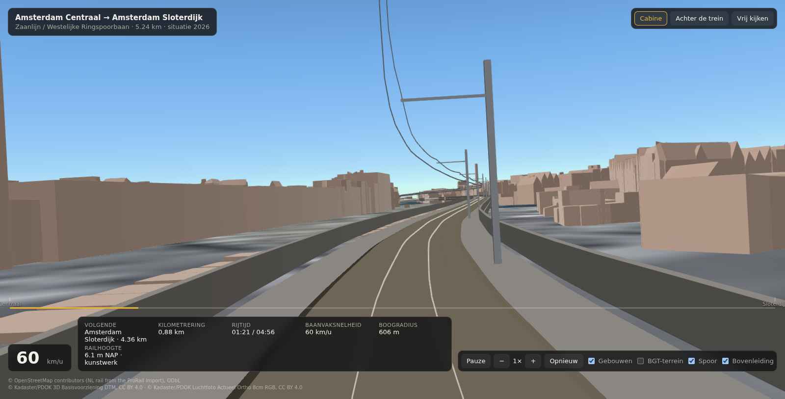
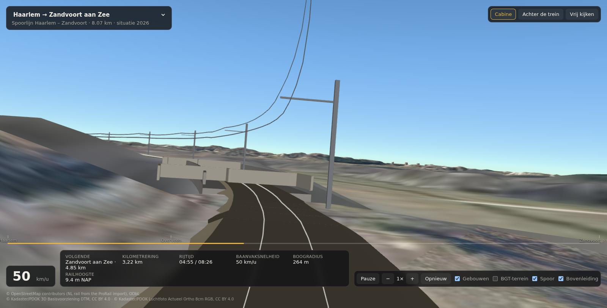

# Ride view (cab ride)

A first-person ride along a real track axis, rendered in the browser from open
Dutch geodata. It covers phases P0, P1 and most of P2 of `cabride-demo-plan.md`:
geometry, terrain, imagery, buildings, camera, a timetable-shaped speed profile,
and the near-field track furniture — ballast bed, rail heads, catenary, signals
and platforms.

Entry point: `ride.html` → `src/ride/main.js`. The map app (`index.html`) is
untouched; the two entries are separate so the Cesium bundle never loads with
the map.

## Run it

```bash
npm run build:ride -- --ride ams-centraal-sloterdijk   # writes public/ride/<id>.json
npm run dev                                            # then open /ride.html
```

Query parameters:

| Parameter | Meaning |
| --- | --- |
| `ride` | ride id, default `ams-centraal-sloterdijk` |
| `t` | start the run `t` seconds in (skips the pull out of Centraal) |
| `view` | `cab`, `chase` or `free` |

The ride picker in the top left switches between the rides in
`public/ride/index.json`, a manifest the builder keeps up to date. Switching
reloads the page: a different ride means different geometry, terrain samples and
a different speed profile.

Example: `/ride.html?ride=ams-centraal-lelylaan&t=200&view=chase`.

Keyboard: space pauses, `c` toggles cab/chase, `f` frees the camera, `+`/`-`
change the time factor.

A production build of both entries is `npm run build` (needs
`src/railData.generated.js` for the map entry). To build only the ride view:

```bash
npx vite build --config vite.ride.config.js   # -> dist-ride/
```

## Data sources

Everything streams straight from the browser. No API keys, no usage caps, and
every endpoint sends `Access-Control-Allow-Origin: *`.

| Layer | Source | Licence |
| --- | --- | --- |
| Track axis, signals, switches, stations | OpenStreetMap via Overpass (NL rail is a ProRail import) | ODbL |
| Terrain | PDOK 3D Basisvoorziening DTM, quantized mesh, zoom ≤ 15 | CC BY 4.0 |
| Ground texture | PDOK Luchtfoto Actueel Ortho 8 cm RGB (WMTS) | CC BY 4.0 |
| Buildings | PDOK 3D Basisvoorziening `gebouwen`, OGC 3D Tiles, LoD 2.2 | CC BY 4.0 |
| Ground plane (optional) | PDOK 3D Basisvoorziening `terreinen`, OGC 3D Tiles (BGT) | CC BY 4.0 |
| Height profile | AHN `dtm_05m` and `dsm_05m` via the PDOK WCS, sampled at build time | CC BY 4.0 |

## How the axis is built

`scripts/build-ride.mjs`:

1. Fetches `railway=rail` ways plus station, signal and switch nodes for the
   corridor from Overpass, and caches the response in `data/ride/`. Public
   Overpass instances answer 429/504 under load, so it rotates over mirrors;
   `--refresh` forces a new fetch.
2. Builds a **directed** edge graph. A node graph is not enough: undirected
   Dijkstra happily produces a path that runs past Sloterdijk and doubles back,
   because a node graph has no notion of a train being unable to reverse over a
   switch. Edge states plus a 60° limit on the heading change fix that.
3. Resolves the endpoints from the OSM station nodes, with an explicit track
   name — Amsterdam Centraal has fifteen platform tracks, and Sloterdijk is a
   crossing station where the Zaanlijn and the Westelijke Ringspoorbaan are on
   different levels. The destination is a *set* of candidate nodes within 60 m,
   so the search lands on the platform track it can actually reach instead of
   the one for the opposite direction.
4. Resamples to a point every 2 m, smooths (the ProRail import has
   decimetre-scale kinks that make the camera shudder), and derives chainage,
   heading, curvature, cant, line speed and bridge/tunnel flags.
5. Samples AHN for the height profile, see below.
6. Projects stations, signals and switches onto the axis and writes
   `public/ride/<id>.json`.

Checks it reports: distance against the timetable kilometrage, smallest curve
radius, and the deviation between the smoothed axis and the original OSM
polyline (p50/p95/max).

## Heights

The height profile is the part that took the most work, because every artefact
in it reads as a bug from the cab: the track visibly climbs or dips where the
real line is flat.

Six problems, six answers:

- **The DTM is ground, not track.** On a viaduct it returns the road or the
  water underneath, so the surface model has to take over there. Which one to
  believe is *not* decided by the OSM bridge tag: those tags are patchy — along
  the A10 the same viaduct is tagged in pieces — and switching source mid
  structure makes the profile jump between the deck and the ground underneath.

  Instead every sample offers up to three candidates: terrain, surface, and
  "carry on at the current gradient" for stretches where neither is usable
  (under a station roof, under a road deck). A small dynamic program picks the
  path with the least kink, measured as the second difference, which is exactly
  what a railway's vertical alignment minimises anyway. On the Lelylaan route
  340 of 880 samples end up coming from the surface model, and the wobble
  between km 5.9 and 6.2 that the tag-based version produced is gone.
- **Station roofs.** Both models are useless under the roofs of Amsterdam
  Centraal and Sloterdijk: the terrain is nodata and the surface is the roof. A
  surface sample more than 12 m above the local terrain baseline is discarded as
  a roof, and the gap is interpolated. On the Sloterdijk ride that is 54 of 525
  samples.
- **Bridge tags land one segment late.** The resampler gives a new point the
  tags of the segment it starts from, so attaching the tags of the *incoming*
  edge shifts every bridge flag by one OSM segment — up to 60 m. That drops the
  track to the water at the start of a bridge and lifts it onto the road deck
  just after passing under one. Each point now carries the tags of the segment
  that leaves it, and tagged structures are widened by 10 m either side so the
  ramp does not fall back to terrain at the abutment.
- **One offset per source, not two.** AHN samples the ballast surface: as
  terrain on open track, as surface model on a structure. Adding a railhead
  offset to only one of them puts a step in the profile exactly where a bridge
  tag starts or ends — that was the bump just outside Amsterdam Centraal, 0.4 m
  up in 100 m. Both branches now add the same 0.25 m.
- **Road viaducts are baked into the rendered terrain.** Where the railway
  passes *under* one, the terrain mesh sits several metres above the track, and
  the floor that keeps the track out of the ground would lift the train onto the
  motorway. The lift is capped at 1.5 m, and stretches where the terrain stays
  above the track are cut out of the globe with a clipping polygon, so the train
  passes underneath through a gap in the deck.
- **Vertical datum.** AHN is NAP; the terrain tiles render in their own datum,
  about 43 m higher. The viewer measures that offset itself — the median
  difference between the two models at points that are not on a structure, which
  comes out at 42.8 m for this corridor — and shifts the whole NAP profile by it.
  A floor at terrain + 0.3 m keeps the track out of the rendered ground where the
  two disagree.

  Deriving the height from the *difference* between the AHN railhead and the AHN
  ground instead looks tempting and is wrong: AHN often classifies a bridge deck
  as terrain while the rendered DTM shows the water underneath, so on a bridge
  that difference collapses to zero and the camera drops into the canal.

After the choice, a weighted local line fit over ±80 m, re-weighted twice, drops
samples that still disagree with their surroundings by more than 0.35 m. A
gradient cap at 20 ‰ remains as a backstop but no longer binds anywhere.

The result on both rides: no gradient reversal above 3 ‰ anywhere, the largest
kink over an 80 m window is 0.22 m, and the steepest gradient is 17.3 ‰ at
km 4.71. That last one is real, not an artefact — transverse AHN profiles across
the corridor there show the crown of the line's own embankment climbing at that
rate towards the high level at Sloterdijk.

The AHN WCS returns Deflate-compressed GeoTIFF with a floating point predictor
by default. `GEOTIFF:COMPRESSION=None` gives plain float32 strips instead, which
`scripts/ahn.mjs` reads in ~60 lines with no dependency. Passing
`subsettingCrs=EPSG:4326` also switches the output grid to degrees, so no RD
projection is needed either.

## Track furniture (P2)

`src/ride/trackfurniture.js` derives everything from the axis and the OSM
objects the builder projected onto it:

- **Ballast bed** as a polyline volume, extruded along a line half a metre below
  the railhead.
- **Rail heads** as two polylines at gauge distance. Not volumes: a cross
  section of a few centimetres comes out of the volume builder as a sliver that
  never resolves on screen. Pixel-width linework is the usual answer for that and
  reads correctly from the cab.
- **Catenary**: masts every 50 m with a cantilever, a contact wire that staggers
  from span to span, and a messenger wire that sags between masts. This is the
  single strongest signal that a view is a railway rather than a road.
- **Signals** on their OSM positions, thinned to main and distant signals with a
  400 m minimum spacing — OSM has one signal every 30 m along this corridor once
  both tracks and both directions are counted.
- **Platforms** at every stop, as a run of boxes rather than one long slab, with
  a canopy on two rows of columns.
- **Viaduct decks** with parapets wherever the builder reported a bridge run.
  Without them the aerial photo stays at ground level and the train appears to
  float over the water or road it crosses.
- **Noise barriers and retaining walls** from OSM, filtered to what runs within
  25 m of the axis — 6 km of wall along the Lelylaan route. They matter more than
  their size suggests: a wall passing the window is what gives the cab view its
  sense of speed.

One gotcha worth remembering: a Cesium polyline volume is drawn around the
centre of its own cross section, not around y = 0. Offsetting a profile inside
the shape therefore does nothing; the ballast came out centred on the rails and
hid them completely. Keep profiles symmetric and put the offset in the line the
volume follows.

## Rides

| Id | Route | Length | Note |
| --- | --- | --- | --- |
| `ams-centraal-sloterdijk` | Amsterdam Centraal → Sloterdijk | 5.24 km | matches the 5.3 km timetable kilometrage (km 47.2 → 52.5) |
| `haarlem-zandvoort` | Haarlem → Overveen → Zandvoort aan Zee | 8.07 km | through the Kennemerduinen: barely a building, 4.8 m NAP at Haarlem up to 12.8 m on the dune crest and back down to the coast |
| `ams-centraal-lelylaan` | Amsterdam Centraal → Lelylaan | 8.79 km | matches km 47.2 → 56.0; calls at Sloterdijk |
| `ams-centraal-schiphol` | Amsterdam Centraal → Schiphol | — | registered, not generated yet |
| `schiphol-ams-zuid` | Schiphol → Amsterdam Zuid | — | registered, not generated yet |

**There is no Amsterdam Centraal → Amsterdam Zuid ride, because there is no such
train.** The curve at Riekerpolder aansluiting joins the Zuidtak (Zuidelijke
Ringspoorbaan) to the Schiphollijn, not to the Westelijke Ringspoorbaan coming
from Lelylaan. The rail graph shows it — the Zuidtak is unreachable from
Centraal in any direction of travel — and NS confirms it: Centraal to Zuid takes
at least one change. The equivalent ride is Centraal → Schiphol followed by
Schiphol → Amsterdam Zuid.

## Known limitations

- **Sleepers are a band, not individual ties.** Modelling 9000 ties would need
  instancing or a striped material; the dark band gives the bed its two-tone
  reading at speed but does not survive close inspection.
- **Clipped underpasses leave a hole.** Cutting a road deck out of the globe
  also cuts away the aerial photo there, so a short gap in the ground is visible
  while passing under.
- **Buildings are untextured LoD 2.2 blocks.** Tinted warm grey so they do not
  read as an architect's model, but a station hall is still a solid box. The
  building tileset is clipped along an 11 m corridor so the camera is not inside
  it at Centraal and Sloterdijk.
- **Viaducts have no deck.** The track is at the right height, but the aerial
  photo stays at ground level, so on the Sloterdijk approach the camera floats
  above the photo instead of running over a structure.
- **Grazing angles blur the drape.** An 8 cm orthophoto draped on a coarse DTM
  is sharp from above and soft from 2.6 m. Expected; the fix is P2 geometry, not
  a better photo.
- **Cant sign is untested.** The roll is derived from the curvature sign and has
  not been verified against real footage; it is a few degrees either way.
- **Zuidasdok.** Amsterdam Zuid is a building site until well after 2026, so
  anything rendered there is a snapshot. The HUD says "situatie 2026" for that
  reason.

## Next

P3 cab interior, P4 sound, P5 post-processing, P6 a "Rijd dit traject" button on
the map. See `cabride-demo-plan.md`.




